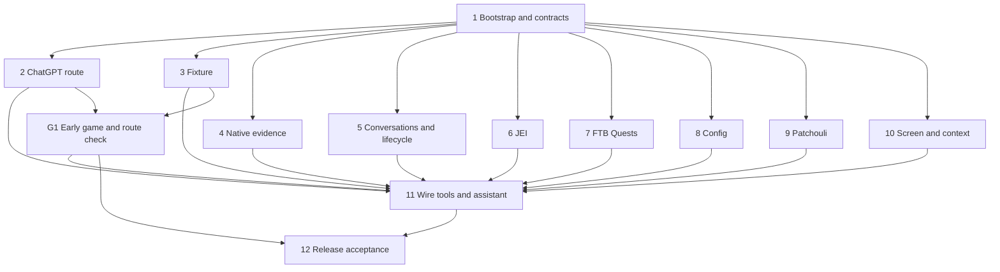

# PackSage v1 Implementation Plan

> **For agentic workers:** REQUIRED SUB-SKILL: Use `superpowers:subagent-driven-development` to implement this plan task-by-task, adapted to the parallel ownership rules below. Use `superpowers:executing-plans` for coordinator-owned work. Steps use checkboxes for tracking. Work in the existing checkout on one branch; do not create a worktree.

**Goal:** Build the agreed PackSage v1 and deliver tested Minecraft mod JARs that the player can copy into an instance and launch without running Java, Gradle or terminal commands.

**Architecture:** A client-only NeoForge mod copies game/provider observations into scoped evidence, retrieves bounded records through read-only tools, and streams grounded answers through an internal model interface. ChatGPT authentication and inference run directly inside the mod. Independent modules implement frozen internal contracts; one coordinator owns shared wiring, builds and commits.

**Tech stack:** Minecraft 1.21.1, Java 21, one pinned NeoForge 21.1.x build, the official matching MDK/Gradle wrapper, JVM tests and direct documented ChatGPT sign-in/inference. Pin compatible JEI, FTB Quests/Library/Teams and Patchouli artifacts during Task 1; do not invent version compatibility from the research examples.

**Spec:** [V1 specification](../specs/2026-10-12-v1.md). Supporting evidence: [feasibility research](../research/2026-10-12-feasibility.md), [test pack selection](../research/2026-10-12-test-pack-selection.md), [guide framework coverage](../research/2026-10-12-guide-framework-coverage.md), [glossary](../../GLOSSARY.md).

## Global constraints

- V1 is open-source, client-only, Minecraft 1.21.1/NeoForge, with reusable pack-independent collectors and PackSage-maintained adapters.
- V1 supports only Sign in with ChatGPT, directly in the mod. No helper executable, API-key fallback, custom backend UI or public adapter registration.
- All knowledge tools are read-only. Navigation opens validated views; it cannot execute commands, change inventory, complete quests or write/reload configs.
- Native loaded facts take precedence over viewer displays, installed documentation, saved files and external guidance; preserve conflicting sources and unknown state.
- JEI, FTB Quests, config inspection and Patchouli are the v1 integrations, prioritized in that order. Each is optional at runtime.
- Attach fresh focused-object data, dimension, position, biome, time/scope and a clean screenshot. Only the screenshot is removable per message. No recording.
- Save complete JSONL conversations and adjacent media under `packsage/<world-or-server>/<conversation-id>.jsonl` inside the instance game folder. Never save credentials there.
- Model history defaults to **10 completed answer turns** and **12,000 historical tokens**, both configurable in-game. Evict whole turns; keep matching tool calls/results. No automatic summaries.
- Private singleplayer opens paused by default; an in-game setting and chat button control pause/run. Multiplayer and published/LAN worlds keep running.
- One active request. Closing chat preserves it; Stop, New chat, disconnect and world change cancel it. Reject late/stale publications and navigation.
- Automatic hosted web search defaults ON; explicit search still works when automatic search is OFF. Use the normal answer flow, with no separate search-only model request.
- Query privacy instructions are best effort, not enforced hosted-query isolation. Unavailable search must be visible; external guidance cannot establish loaded pack facts.
- Preserve a future spoiler-block representation, but v1 never classifies, emits or applies spoiler blocks, including from deterministic source flags.
- Never run formatting tools. Follow the established style; inline trivial conversions and keep nontrivial functions in their smallest useful scope.
- The assistant handles toolchains, dependency resolution, builds, running all unit and other automated tests, test failures and log diagnosis. Manual JAR copying and player-run checks apply only to actual Minecraft testing. The player handles browser sign-in and Minecraft interaction, never Java/Gradle or test commands.

## Review focus

1. Late callbacks after Stop, New chat, reconnect or reload must never publish into a newer scope: Task 5 race tests and Task 11 live checks.
2. A removed recipe, failed JEI projection or empty custom slot must not become a fabricated recipe or zero-cost route: Tasks 4 and 6 normalization/traversal tests.
3. A saved setting differing from loaded state, especially on a remote server, must retain its scope and uncertainty: Task 8 tests and Task 12 remote checks.
4. A truncated JSONL write, Windows-unsafe name or oversized turn must preserve previous history and avoid orphaned tool exchanges: Task 5 recovery/budget tests.
5. An absent provider, expired credential, unsupported image or unavailable search must degrade visibly without disabling independent local evidence: Tasks 2, 6–9 and 11 failure checks.

## Branch, commits and parallel execution

Work only in `D:\Project\packsage` on **`feat/packsage-v1`**; no worktree is needed. `main` owns the empty root baseline, and the feature branch starts there. Documentation is currently untracked; writing or reorganizing this plan does not authorize committing it. Preserve unrelated work and keep ignored files out of staged changes.

Use at most **two implementation workers concurrently**, with the coordinator integrating and reviewing. Use Luna workers for bounded implementation, Luna explorers/reviewers for ordinary read-only work, and a docs researcher for version-sensitive API verification. Prefix names with model/effort, such as `luna_medium_jei`. Escalate unresolved architecture/concurrency judgment according to the repository routing rules, rather than treating mechanical compiler errors as architecture failures.

Every dispatch specifies exact write ownership, dependencies, acceptance assertions, and that other workers are present: do not revert their edits. Concurrent writers must own disjoint production, test and resource files. Shared contracts, build files, metadata, entrypoint and integration wiring have one owner: the coordinator. A worker needing a shared change sends a proposal; the coordinator changes it sequentially before dependent work resumes.

The coordinator alone runs Gradle, stages and commits. Workers can read concurrently and author their own modules/tests, but cannot mutate Git. Pause writers at compilable checkpoints for a build; never run competing Gradle processes or commit while another actor changes the index. A task may depend only on committed prerequisite contracts, never another worker's unfinished implementation. A read-only reviewer can run alongside a writer when a slot is available; avoid expensive fresh reviews for trivial edits.

**Commit protocol, at every completed task:**

1. Inspect the task's explicit changed-file list and run its focused checks. A build proves compilation; only a recorded game check proves live behavior.
2. Confirm the index is empty. If unrelated staged work exists, preserve it and resolve the conflict before staging; never reset or silently include it.
3. Stage only the exact files owned by this task, including its tests and necessary task-specific documentation. Use `git add -- <explicit paths>`; never `git add .`, `git add -A`, directory-wide staging or wildcards.
4. Apply `/commit-message` using [its SKILL.md](C:/Users/hung1/.codex/skills/commit-message/SKILL.md): verify repository, inspect only `git diff --cached`, and generate the message from that evidence. The message-generation step itself does not mutate Git. Use the exact `[Add]`, `[Chg]`, `[Fix]`, `[Rmv]` vocabulary; do not preassign messages in this plan.
5. Verify staged paths match this task and `git diff --cached --check` passes. The coordinator then commits under the user's explicit authorization. For multiline messages, write exact text to a temporary UTF-8 file and use `git commit --file <path>`.
6. Record the commit ID and automated/live validation status in the coordinator's handoff. Do not stage another task's incomplete work, generated JARs, credentials, local instances or downloaded dependencies. No pushes, merges or PRs are authorized by this plan.

Commit each independently complete task as soon as its required checks pass; parallel tasks need not commit in numeric order. A blocked task stays incomplete while independent work continues. After committing, build any player handoff JAR from the committed state and label any additional uncommitted content honestly.

## Dependency map and scheduling

Task 1 is deliberately serial: it pins dependencies and freezes the contracts needed for safe parallel work. Start Tasks **2 and 3 together** immediately afterward because account eligibility and a working test instance are the earliest blockers. As a worker becomes free, take the next ready task from **4, 5, 6, 7, 8, 9, 10**, keeping both slots occupied where possible. Task 10 can build against contract-only fakes; it does not wait for finished adapters. JEI gets the first adapter slot, followed by FTB, config and Patchouli. Schedule live G1 as soon as Tasks 2/3 are ready; pure module work can continue while awaiting the player's result. If sign-in eligibility fails, stop model-dependent integration and investigate the documented route without silently changing v1 scope.

Task 11 is the deliberate join point. Task 12 requires recorded live evidence, not just a passing build. No fabricated timing estimates or universal compatibility claims.

## Shared interfaces and file boundaries

Use package `dev.packsage` and mod ID `packsage`. All interfaces below are internal PackSage contracts, not claims about third-party API signatures. Verify each provider's pinned API before implementing its adapter. Keep small related records/enums nested in the owning contract file rather than creating a framework of tiny helper files.

| Owner/file | Contract frozen in Task 1 |
|---|---|
| `src/main/java/dev/packsage/knowledge/Evidence.java` | Immutable nested `Scope`, `Source`, `Record`, `Query`, `Result`, `NavigationTarget` and `NavigationResult`. `Record` contains its source, kind, title, bounded serialized payload and targets. `Query` contains operation, serialized arguments, limit and optional scoped cursor. `Result` contains records, coverage/outcome and optional next cursor. |
| `src/main/java/dev/packsage/knowledge/KnowledgeProvider.java` | Nested `ProviderStatus`; `String id()`, `ProviderStatus status()`, `CompletionStage<Evidence.Result> query(Evidence.Query query, Evidence.Scope scope)`, `Evidence.NavigationResult open(Evidence.NavigationTarget target, Evidence.Scope scope)`. Each provider schedules its own owning-thread reads; `open` executes on the client thread. |
| `src/main/java/dev/packsage/model/ModelBackend.java` | Nested immutable `Request`, `Event`, `Capabilities`, `AuthState`, `ToolCall`, `ToolResult`, `ResponseBlock`, `SearchMode` and `ToolDefinition`; `CompletionStage<AuthState> signIn()`, `void cancelSignIn()`, `void signOut()`, `CompletionStage<Capabilities> capabilities()`, `Exchange start(Request request, Consumer<Event> events)`. `Exchange` has `void submit(ToolResult result)` and `void cancel()`. Continuations may create new HTTP requests internally. |
| `src/main/java/dev/packsage/chat/ChatContracts.java` | Nested immutable `WorldIdentity`, `Context`, `Screenshot`, `Conversation`, `Turn`, `HistoryLimits`, `HistorySelection`, `RequestId`, `Outcome` and `View`. `View` is the screen-facing snapshot; it exposes active/sign-in/pause state, conversation, context, sources and errors without live provider objects. |
| `src/main/java/dev/packsage/chat/ChatActions.java` | Screen seam: `ChatContracts.View view()`, `void signIn()`, `void cancelSignIn()`, `void signOut()`, `void send(String question, boolean includeScreenshot, boolean explicitWebSearch)`, `void stop()`, `void newChat()`, `void setPaused(boolean paused)`, `void navigate(Evidence.NavigationTarget target)`. Closing the screen never calls `stop()`. |

Scopes separate world/session, resources/locale, player/team, provider runtime and request generations. Source identity includes provider/version, actual source handle, observed generation/time, activity/coverage and authority; preserve known winning/contributing resource provenance. Do not represent every identity as a vanilla registry ID. Records cross threads as immutable copied values, with no `Level`, mutable stacks, JEI layouts, screens or guide managers.

The payload schema retains grouped typed recipe slots and OR alternatives, quantity separately from comparison identity, consumption/reuse, outputs, remainders, catalysts, constraints and decoding status. Quest IDs are scoped 64-bit-safe strings. Config fields separate saved/loaded/server scope. Guide fields retain book/entry/page identity and opaque page status. Freeze these schema fields in Task 1; leave unverified fields explicitly unknown, not guessed.

`ModelBackend.Request` contains the selected model ID, instructions, serialized input, tool definitions, search policy, request identity and output budget. Events distinguish text deltas, client tool calls, hosted-search evidence, completion and failures. Capabilities include verified image/search support and context limits, with unknown values explicit. `HistorySelection` contains selected whole turns and their token count; `Conversation` contains its ID/world, complete saved turns and outcomes. `RequestController` owns pure request/conversation transitions; Task 11's `AssistantRuntime` implements `ChatActions` and binds those transitions to model, game and provider actions.

## Task 1: Reproducible client bootstrap and frozen contracts

**Owner:** coordinator. **Depends on:** the empty `main` baseline. **Files:** preserve the existing local `.gitignore`; create `settings.gradle`, `build.gradle`, `gradle.properties`, `gradlew`, `gradlew.bat`, `gradle/wrapper/gradle-wrapper.jar`, `gradle/wrapper/gradle-wrapper.properties`, `src/main/resources/META-INF/neoforge.mods.toml`, `src/main/resources/pack.mcmeta`, `src/main/java/dev/packsage/PackSage.java`, the five contract files above, `scripts/build.ps1`, `src/test/java/dev/packsage/knowledge/EvidenceContractTest.java`. List any additional official MDK-required files explicitly before staging. Existing documentation is outside this task's commit scope.

**Produces:** pinned development environment, compilable client-only JAR, test runner, contract-only seams for Tasks 2–10.

- [ ] Obtain the matching official MDK, verify artifact coordinates/ranges against primary sources, and record exact Minecraft/NeoForge/Java/Gradle/optional-provider versions. Resolve required FTB and content-mod dependencies. Optional APIs must not turn into mandatory production runtime dependencies or bundled third-party mods.
- [ ] Provision Java 21 for assistant builds if needed without requiring player commands or altering unrelated global settings. `scripts/build.ps1` runs the wrapper/tests/build and copies the distributable JAR plus build metadata/hash into ignored `dist/`. Ignore `.tools/`, `.gradle/`, `build/`, `dist/`, local instances, media and credentials.
- [ ] Define the shared records/interfaces and test round trips: nullable canonical recipe ID remains nullable; large quest ID remains identical text; unknown quantity remains unknown; stale scope equality fails; mutable game objects cannot enter the serialized evidence envelope. Reserve a spoiler response variant without enabling v1 production/emission.
- [ ] Implement the minimal client entrypoint and metadata without loading optional provider classes when their mods are absent. Do not add speculative registries, a public plugin API or gameplay content.
- [ ] Assistant runs `powershell -NoProfile -File scripts/build.ps1`; expected tests/build pass and one clearly named distributable JAR exists. Inspect JAR metadata/dependencies; record load testing as pending G1. Commit only the explicit Task 1 files using the commit protocol.

## Task 2: Direct ChatGPT backend and early feasibility gate

**Owner:** model worker; coordinator owns any entrypoint hook. **Depends on:** 1. **Files:** `src/main/java/dev/packsage/model/chatgpt/ChatGptBackend.java`, `ChatGptAuth.java`, `ChatGptStream.java`, `ChatGptProbeScreen.java`; `src/test/java/dev/packsage/model/chatgpt/ChatGptBackendTest.java`, `ChatGptStreamTest.java`; sanitized fixtures under `src/test/resources/chatgpt/`; coordinator-only change to `PackSage.java` for an early development probe; `docs/validation/2026-10-12-chatgpt-route.md`.

**Consumes:** `ModelBackend`. **Produces:** a direct backend and probe usable before the full assistant screen.

- [ ] Verify current registered-client OAuth/PKCE, inference permission, model catalog, refresh, supported tools/search/images and token accounting against official OpenAI sources. Obtain actual client/account eligibility; do not treat an identity token as inference permission or put secrets in the JAR. Any needed authentication/tokenizer dependency changes are coordinator-owned and explicitly added to this task's file list.
- [ ] Write request/stream tests: `stream == true`, `store == false`, history appears in `input`, and `previous_response_id` is absent. Fragment SSE across arbitrary byte boundaries, including Unicode; retain call IDs/results/citations; cancellation prevents further events. Test denied scope, expired/refresh failure, account limits and unsupported capability mappings using fixtures.
- [ ] Implement `ModelBackend` with bounded networking, protected local credential persistence outside logs/media, refresh/sign-out, sign-in cancellation, capability discovery and client-executed tool continuation. Preserve hosted-search annotations/metadata and supported image encoding. Search policy distinguishes automatic, explicit-only and an explicit per-send request. OFF must still allow natural-language explicit requests: retain supported hosted search with explicit-only instructions rather than removing the tool solely because automatic search is OFF. Verify actual OFF/explicit behavior at G1/G2; do not add a separate intent-classification or search-only model request.
- [ ] Coordinator wires a temporary development probe for sign-in, a text response, one read-only fixture tool, a synthetic image, and a hosted lookup in the same answer flow. The player uses browser/game controls only. Remove the development hook in Task 11; it is not a shipped extra workflow.
- [ ] Assistant runs focused backend tests/build and commits the implemented probe. At **G1**, record actual sign-in, streamed response, tool round trip, image and search results. Unsupported images/search require honest capability fallbacks; missing sign-in/inference eligibility blocks the release and model-dependent integration, with independent local work still possible.

## Task 3: Minimal deterministic fixture and player launch setup

**Owner:** fixture worker. **Depends on:** 1. **Files:** `fixtures/minimal/manifest.json`, `fixtures/minimal/cases.json`, explicit datapack recipe/tag files under `fixtures/minimal/datapack/`, explicit quest SNBT files under `fixtures/minimal/quests/`, explicit book resource files under `fixtures/minimal/resources/`; `scripts/prepare-fixture.ps1`, `docs/testing/2026-10-12-player-checks.md`. Enumerate authored data files before staging; downloaded JARs, saves and installed instances stay ignored.

**Produces:** a small test instance and reproducible expected evidence. Proposed fixture baseline: JEI, FTB Quests/Library/Teams, Patchouli, Nature's Aura plus resolved required dependencies; secondary check: one pinned FTB Evolution release. These are test fixtures, never branches in production logic.

- [ ] Resolve/pin one compatible artifact set and verify required providers are in its actual manifest. Prepare a separate development launcher instance through assistant-controlled setup. If the instance path or launcher cannot be discovered, ask only for the missing path/launcher choice in response text.
- [ ] Author one removed/replaced recipe and tag alternatives, a small quest chapter with dependencies/branches, and a controlled override of a real Patchouli entry. `cases.json` records exact IDs, known counts, expected visibility/status and winning resources for later comparisons.
- [ ] Prepare a small saved world with repeatable focused items/blocks and component variants, using Minecraft tooling when available or a short in-game setup checklist. Do not build a new content mod, full quest campaign or unrelated optimization stack.
- [ ] Assistant validates manifest hashes and data formats against the pinned contracts, prepares the files/dependencies and writes player-facing instructions containing only file copying, launcher selection and in-game actions. Record startup/load success at G1; make no speed claim before measurement. Commit only authored fixture/setup/checklist files.

## Task 4: Native evidence, retrieval and supported recipe planning

**Owner:** native worker. **Depends on:** 1. **Files:** `src/main/java/dev/packsage/knowledge/nativegame/NativeProvider.java`, `NativeSnapshot.java`, `src/main/java/dev/packsage/knowledge/KnowledgeIndex.java`, `RecipePlanner.java`; `src/test/java/dev/packsage/knowledge/NativeProviderTest.java`, `KnowledgeIndexTest.java`, `RecipePlannerTest.java`; explicit fixture JSON under `src/test/resources/nativegame/`.

**Consumes:** evidence/provider contracts. **Produces:** native provider; `Evidence.Result KnowledgeIndex.search(Evidence.Query query, Evidence.Scope scope)` and `Evidence.Result RecipePlanner.plan(String itemIdentity, long quantity, Evidence.Scope scope, int maxDepth)` over already copied/indexed data.

- [ ] Write tests for active-versus-shipped recipe precedence, removed recipe absence, exact ID/name/tag/component matching and unknown server data. Scope changes invalidate affected records without reparsing unrelated documentation.
- [ ] Test recipe planning with multiple AND slots and OR alternatives, output batches, catalysts, returned containers, cycles, alternative recipes and unknown quantities. Assert repeated inputs aggregate only when comparison constraints match; render-only icons never become consumed inputs. A depth/traversal bound returns a partial route rather than inventing a complete cheapest plan.
- [ ] Capture synchronized recipes, registries/tags, relevant components and effective client-visible resources on their owning thread; index copied records off-thread. Preserve winning/contributing provenance when recoverable, otherwise unknown. Support bounded pagination/exact/text lookup; no embeddings or universal cost optimizer.
- [ ] Expose requested inventory observations separately, never automatically dump the inventory. Preserve limits on unsynchronized loot, worldgen and remote state; acquisition comes only from verified loaded relations or cited documentation/display evidence.
- [ ] Assistant runs focused tests/build. Compare fixture recipe/tag overrides against actual synchronized data at G2. Commit only Task 4 files; live claims remain pending until that comparison.

## Task 5: Conversations, history budgets and request lifecycle

**Owner:** conversation worker. **Depends on:** 1. **Files:** `src/main/java/dev/packsage/chat/ConversationStore.java`, `HistorySelector.java`, `RequestController.java`; `src/test/java/dev/packsage/chat/ConversationStoreTest.java`, `HistorySelectorTest.java`, `RequestControllerTest.java`; explicit JSONL fixtures under `src/test/resources/chat/`.

**Consumes:** chat/model/evidence contracts. **Produces:** `CompletionStage<ChatContracts.Conversation> ConversationStore.openLatest(ChatContracts.WorldIdentity world)`, `CompletionStage<ChatContracts.Conversation> ConversationStore.newConversation(ChatContracts.WorldIdentity world)`, `ChatContracts.HistorySelection HistorySelector.select(List<ChatContracts.Turn> turns, ChatContracts.HistoryLimits limits, ToIntFunction<ChatContracts.Turn> tokenCounter)` and request state transitions. Store/controller constructors receive their required paths, backend, tool/context callbacks and executor; they do not reach global Minecraft state in pure tests. Define append/media operations inside `ConversationStore` and the begin/cancel/publish transitions inside `RequestController`, keeping the screen seam in `ChatActions`.

- [ ] Write persistence tests for full round-trip history/media references, latest reopening, separate New chat files, colliding readable labels and Windows-invalid/traversal names. A truncated final JSONL record preserves earlier records and reports recovery; an I/O failure is visible and never claims a save succeeded. Credentials never enter the log schema.
- [ ] Write history tests: 11 completed turns select the latest 10; historical tokens never exceed 12,000 at defaults; oversized turns are removed whole; tool calls/results stay paired; active exchange/fresh context are budgeted separately. In-game limit changes alter the request selection without truncating the saved file. Use the verified model token counter, not a claimed exact character-based estimate.
- [ ] Use controlled futures to test one-active-request rejection, close/reopen preservation, Stop/New chat/disconnect/world-change cancellation, and late-result suppression. Resource/locale/provider/team invalidations reject affected evidence; a retry uses fresh context and preserves saved outcomes.
- [ ] Implement scoped JSONL/media persistence and the controller; publish immutable `View` snapshots. Disk/network work stays off the game thread; cancellation/outcome persistence is serialized. Do not recreate the model backend or summarize old messages.
- [ ] Assistant runs focused tests/build and commits Task 5 files. Restart persistence, real close/reopen and world transitions require G2/G3 evidence.

## Task 6: JEI, the first optional adapter

**Owner:** JEI worker. **Depends on:** 1. **Files:** `src/main/java/dev/packsage/knowledge/jei/JeiProvider.java`, `PackSageJeiPlugin.java`; `src/test/java/dev/packsage/knowledge/jei/JeiProjectionTest.java`; explicit projection fixtures under `src/test/resources/jei/`.

**Consumes/produces:** `KnowledgeProvider`; scoped JEI evidence and validated recipe/category navigation.

- [ ] Verify pinned JEI APIs/runtime callbacks and category projection thread rules. Test typed/grouped slots, OR alternatives, quantities/components, catalysts, information text, known visibility, blank slots, null recipe IDs, custom ingredients and failed projections.
- [ ] Assert unknown categories preserve display roles/identity and remain partial or opaque; they cannot generate consumed-input edges. Keep canonical loaded recipe identity distinct from viewer projection, preserving conflicts instead of merging them away.
- [ ] Implement bounded on-demand query/projection and navigation with runtime-generation checks. Isolate stateful/throwing custom categories; do not scrape by rendering, interacting or invoking provider save/export methods. Re-query supported dynamic/deferred registrations where needed.
- [ ] Assistant runs focused tests/build and commits Task 6 files. At G2, compare Nature's Aura layouts/ingredients and open the selected JEI view; at G3, verify absent JEI and lost/reloaded runtime behavior.

## Task 7: FTB Quests and observed progression

**Owner:** FTB worker. **Depends on:** 1. **Files:** `src/main/java/dev/packsage/knowledge/ftb/FtbProvider.java`; `src/test/java/dev/packsage/knowledge/ftb/FtbProviderTest.java`; explicit SNBT/state fixtures under `src/test/resources/ftb/`.

**Consumes/produces:** `KnowledgeProvider`; quest/chapter/item lookup, dependency evidence, current client-accessible player/team state and validated quest navigation.

- [ ] Verify the pinned client quest-file/team synchronization and navigation APIs. Test a full-width 64-bit quest ID as text with quest-file scope, dependency thresholds/branches, visibility versus completion/reward state, and unavailable progress.
- [ ] Implement copied static quest records plus a separately invalidated player/team overlay. Use provider-evaluated/observed gates; inventory alone never proves completion. Unknown task/reward types retain their identity and partial status.
- [ ] Assistant runs focused tests/build and commits Task 7 files. At G2, change a fixture quest state through ordinary player actions and compare observed dependencies/team state; verify selected quest navigation and missing-provider behavior at G3.

## Task 8: Read-only config inspection and pinned catalog bridge

**Owner:** config worker. **Depends on:** 1. **Files:** `src/main/java/dev/packsage/knowledge/config/ConfigProvider.java`, `NeoForgeConfigCatalog.java`; `src/test/java/dev/packsage/knowledge/config/ConfigProviderTest.java`; explicit saved-config fixtures under `src/test/resources/config/`. Any required access declaration/build change belongs to the coordinator and must be separately enumerated in this task's staging list.

**Consumes/produces:** `KnowledgeProvider`; bounded config list/search/read and a narrow tested internal catalog reader.

- [ ] Prove the read-only catalog access path against the exact pinned loader; document unsupported-version fallback. Do not assume a stable global public enumeration API or generic observation through PackSage's own event bus.
- [ ] Test saved `A` versus loaded `B` without claiming gameplay effect, comments/defaults/ranges/restart metadata, synchronized server values without paths, and unknown unsynchronized remote settings. Reject paths escaping known roots, including normalized traversal and link resolution, and bound file/key reads.
- [ ] Implement handle/root-restricted list/search/read, on-demand copied snapshots and precise owner/scope/view labels. No setters, corrective saves, reloads or gameplay probes. Unsupported bridge access retains saved-file inspection with loaded state unknown.
- [ ] Assistant runs focused tests/build and commits Task 8 files. G2 checks saved-versus-loaded/restart cases; G3 separately checks synchronized versus inaccessible remote configuration. A fallback is not proof that the supported pinned bridge gate passed.

## Task 9: Loaded Patchouli content and guide navigation

**Owner:** Patchouli worker. **Depends on:** 1. **Files:** `src/main/java/dev/packsage/knowledge/patchouli/PatchouliProvider.java`; `src/test/java/dev/packsage/knowledge/patchouli/PatchouliProviderTest.java`; explicit book/page fixtures under `src/test/resources/patchouli/`.

**Consumes/produces:** `KnowledgeProvider`; supported loaded book/entry/page text, item/recipe links, known gates and scoped navigation.

- [ ] Verify the pinned loaded-book/resource/localization and navigation APIs. Test locale fallback, winning resource override, text/item/recipe pages, unknown custom pages, visibility/gates and original book/entry/page identity.
- [ ] Implement supported page decoding and bounded text lookup while retaining opaque custom content and provenance. Locale/reload invalidates affected records/targets; known source visibility controls evidence availability without generating spoilers.
- [ ] Assistant runs focused tests/build and commits Task 9 files. G2 compares the real book plus controlled override and opens the intended page; G3 verifies absent Patchouli and reload/locale behavior. Other guide frameworks and tome aggregators are outside this task.

## Task 10: Dedicated screen, settings and clean gameplay context

**Owner:** UI/context worker. **Depends on:** 1; contract fakes allow parallel implementation. **Files:** `src/main/java/dev/packsage/client/AssistantScreen.java`, `AssistantSettingsScreen.java`, `GameplayContextCapture.java`, `src/main/java/dev/packsage/chat/PackSageSettings.java`, `src/main/resources/assets/packsage/lang/en_us.json`; `src/test/java/dev/packsage/client/AssistantScreenStateTest.java`, `ContextCaptureTest.java`, `src/test/java/dev/packsage/chat/PackSageSettingsTest.java`. Entrypoint/keybind wiring stays coordinator-owned in Task 11.

**Consumes:** `ChatActions`, `View` and evidence targets. **Produces:** assistant/settings screens and `GameplayContextCapture.capture(ChatContracts.RequestId request, boolean includeScreenshot)` returning `CompletionStage<ChatContracts.Context>`.

- [ ] Test screen actions with a fake `ChatActions`: closing does not stop; Stop/New chat do; unavailable/stale navigation leaves the answer intact. Settings defaults are pause=true, automatic-search=true, history-turns=10 and historical-tokens=12,000; changed valid values persist, invalid limits cannot create unbounded requests.
- [ ] Implement chat input/history, streamed status, sign-in/cancel/sign-out, Stop/New chat, source references, validated navigation buttons and settings. Add an explicit per-send web-search action alongside natural-language requests; OFF disables automatic lookup, while both the explicit action and explicit natural-language requests remain supported. No API-key UI or v1 spoiler covering.
- [ ] Capture fresh available hovered/held/targeted identity, dimension, position, biome and time/scope; distinguish focus kinds and unavailable observations. Capture a clean game frame on the correct render path without putting the assistant UI in it or using an old screenshot as current. Respect per-message removal, release image buffers, and preserve core metadata. No rolling buffer or video.
- [ ] Implement effective pause display/button and open-paused setting using actual private-singleplayer versus remote/published state. Screenshot preparation/removal and pause controls stay usable while a response streams.
- [ ] Assistant runs focused tests/build and commits Task 10 files. G2 verifies real screenshot contents/removal, focus, screen/pause/navigation; G3 proves multiplayer/LAN running behavior.

## Task 11: Wire read-only tools, grounding and the complete assistant

**Owner:** coordinator. **Depends on:** 2–10 and successful G1 sign-in/inference/tool exchange; fixture from 3 for live checks. **Files:** modify `PackSage.java`; create `src/main/java/dev/packsage/knowledge/KnowledgeService.java`, `src/main/java/dev/packsage/chat/AssistantRuntime.java`, `src/main/java/dev/packsage/model/PackSageTools.java`, `GroundingInstructions.java`; `src/test/java/dev/packsage/chat/AssistantIntegrationTest.java`, `src/test/java/dev/packsage/model/PackSageToolsTest.java`; remove the Task 2 development probe/hook; update `docs/testing/2026-10-12-player-checks.md` and `docs/validation/2026-10-12-chatgpt-route.md` with observed evidence.

**Consumes:** all committed module contracts. **Produces:** production wiring, tool dispatch, lifecycle hooks and an installable complete v1 candidate.

- [ ] Define bounded client tool schemas: `search_pack` (text/kinds/limit/cursor), `read_evidence` (source handles), `plan_recipe` (identity/quantity/depth), `read_inventory` (selected identities), `read_progress` (selected quest handles), `list_configs`, `search_config`, `read_config` (observed handle/key or bounded section). Bind calls to the active scope; reject unknown operations/arguments and out-of-scope handles. Navigation remains a player-click action, not a model command.
- [ ] Wire optional providers behind presence/version checks, the knowledge service/index, conversation/controller, context capture, settings, model backend and keybind/screens. Register actual pinned lifecycle hooks; do not assume event names/order from older versions. Remove the development probe from production wiring.
- [ ] Ground answers in supplied source handles, installed versions and uncertainty. Preserve sources beside claims, validate local reference IDs/external URLs, and retain future spoiler representation without enabling it. Treat guide/config/web text as evidence, never permissions. Do not promise that a model prompt proves factual accuracy or query isolation.
- [ ] Test the complete mocked multi-tool turn and stream, conflicting local/web guidance, unsupported tool/provider, malformed tool arguments, no matches versus extraction failure, invalid citation, image omission, search OFF+explicit policy, search unavailable, and stream/tool errors. Live G2 tests both an ordinary local question with automatic OFF (no search) and an explicit natural-language web request with automatic OFF (search occurs). Ensure useful unaffected evidence remains accessible and failed model transport is a failed request.
- [ ] Exercise scoped cancellation with callbacks deliberately released after Stop, New chat, reload and world change. Validate tool dispatch and navigation again at use time. No game thread blocking, live-object leakage, orphaned history exchanges or hidden writes.
- [ ] Assistant runs focused integration tests plus the full tests/build, commits only Task 11 files, and delivers the G2 candidate JAR with exact path/hash/version. Record user checks and fix confirmed failures in separate scoped commits before Task 12.

## Task 12: Live acceptance, compatibility and release handoff

**Owner:** coordinator; read-only reviewer may work in parallel with evidence collection. **Depends on:** G1, 3 and 11. **Files:** `README.md`, `docs/validation/2026-10-12-v1-acceptance.md`, updates to `docs/testing/2026-10-12-player-checks.md` and pinned fixture manifest/cases when verified metadata changes. Any necessary bug-fix files receive their own explicitly scoped fix task/commit.

**Produces:** verified build and a coverage report that separates automated, observed live, partial and untested behavior.

- [ ] Complete G2/G3 below and map every specification §9 release gate to concrete evidence. Read the instance's ordinary logs/crash reports directly when its path is available; redact secrets and private details from committed notes. Never infer live success from a source read or build.
- [ ] Test each optional provider absent in an assistant-prepared variant, unsupported-access fallbacks through tests where a safe runtime combination is unavailable, reload/runtime loss, and failure isolation. Keep each variant's dependency set valid: for example, a Patchouli-absent variant also excludes content mods that require it. Prepare a client-only remote/LAN check with no PackSage server companion; if no suitable server is available, mark that release gate pending rather than claim it passed.
- [ ] Run one pinned FTB Evolution pass after the minimal fixture. Compare representative IDs, resource provenance, unknown category/task/page handling and navigation; no pack-specific hardcoding to make the pass succeed. Record actual mod/loader versions, process-to-menu/world-entry timings, heap/context and observed indexing/query responsiveness; set no universal timing/heap guarantee.
- [ ] Perform one independent final review of the committed implementation against the spec and ownership/thread/read-only contracts. Run additional tests only for new changes, failures or unresolved concerns; no formatter or repetitive blanket verification.
- [ ] Assistant builds the final JAR, inspects distributable dependencies/metadata, and records path, hash, exact supported versions, known partial coverage and install/update instructions. Commit completed acceptance/docs with `/commit-message`; rebuild the handoff from that commit. Missing required live evidence leaves release acceptance open.

## Player-only game checkpoints

The assistant supplies the built JAR, the exact destination `mods` folder, the prepared launcher instance/profile, and a short checklist for each checkpoint. The player replaces only the previous **PackSage** JAR, launches Minecraft and performs the listed game actions. The assistant prepares dependency/fixture files and diagnoses the resulting logs. Browser authorization is the only separate sign-in interaction. No Java, Gradle, server-console or terminal command is assigned to the player.

| Checkpoint | Player actions | Assistant's evidence/checks |
|---|---|---|
| **G1: early bootstrap + route** after 2/3 | Copy probe JAR, launch prepared minimal instance, open probe, complete ChatGPT browser sign-in, run its text/tool/image/search checks. | Exact loaded versions, start/world-entry success, real inference/tool/image/search results, recoverable denial/cancel states. Stop model-dependent work if eligibility is unresolved. |
| **G2: integrated minimal fixture** after 11 | Copy candidate JAR; ask the provided recipe/quest/book/config questions; click source navigation; remove one screenshot; test pause/run, close/reopen, Stop/New chat, restart and world change. | Compare against fixture's exact IDs/counts/overrides, current progression/config labels, clean fresh context, persistence and late-callback suppression. Assistant reads logs and builds fixes. |
| **G3: variants + real pack + multiplayer** during 12 | Launch prepared provider-absent variants and the pinned real-pack instance; follow a compact reload/locale and remote/LAN checklist. | Provider isolation, real-pack provenance/coverage, synchronized/unknown server state, effective multiplayer pause state, measured performance and all remaining §9 gates. |

Group checks to minimize launches; introduce an extra launch only when a failure or unresolved provider behavior needs it. A code task can be committed after automated implementation checks while its live milestone is pending, but its status must say **live validation pending**. No runtime/release gate is complete until the required player run is observed and recorded.

## Plan review and execution boundary

This plan implements the agreed v1; it does not start implementation by itself. Review it once before execution, preserving the requested single-branch, parallel-worker, per-task-commit method. During execution, continue independent ready work while awaiting live feedback, and ask in response text only for information or account/game actions that the assistant cannot perform. Do not repeatedly reapprove settled design choices.
