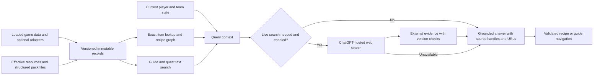

# PackSage feasibility research: a Minecraft 1.21.1 NeoForge modpack knowledge assistant

Research date: 2026-10-12

The v1 behavioral requirements are consolidated in the [v1 specification](../specs/2026-10-12-v1.md). This report retains source evidence and broader coverage opportunities; it is not the v1 implementation checklist.

## Scope and evidence rules

PackSage is intended to run in-game and answer questions about the installed modpack: recipes, item and block relationships, quests, guidebooks, AE2-style manuals, Create Ponder scenes, and nearby contextual information, with on-demand live web search when needed. This report evaluates a read-only knowledge, navigation and web-research layer. It does not propose changing recipes, completing quests, sending arbitrary commands, automating inventory actions, or bypassing server authority.

The strongest design is a hybrid: collect loaded client-visible game data and structured resources first, supplement it with optional server facts and mod-specific files, and use JEI, FTB Quests, guidebook APIs and Ponder for knowledge and navigation. A generic scan of mod JAR text is insufficient. It misses runtime overrides, conditions, generated recipes, progression state and the semantic relationship between a displayed slot and a recipe role. The agreed initial release will be client-only; server-only loot and custom state require additional support.

Evidence labels used below:

- **Confirmed** means the cited versioned documentation or source explicitly establishes the behavior.
- **Observed source** means an exact source tree, API file, release artifact, or issue from the relevant project was inspected, but behavior has not been exercised in a live Minecraft instance here.
- **Proposal** means an implementation recommendation derived from the evidence.
- **Unverified** means a claim requiring a pinned 1.21.1 JAR, a live pack, or a dedicated-server run before it can be treated as accepted behavior.

No target modpack, mod list, NeoForge JAR, JEI JAR, FTB Quests data set, or dedicated server was supplied. No code was compiled, no Minecraft instance was launched, and no live behavior or benchmark is claimed.

## Contents

1. Recommendation and feasibility
2. Version and support matrix
3. NeoForge development and runtime boundaries
4. JEI 1.21.1 API and integration audit
5. Quests and progression data
6. Guidebooks, manuals, and Ponder
7. Vanilla and broad resource surface, including source audits of JEI addons
8. Normalized records, identity, and provenance
9. Retrieval, recipe graphs, grounded answers, and live web search
10. Reload, cache, thread, and client/server scopes
11. Staged implementation and acceptance evidence
12. Risks, unresolved questions, and source index

## 1. Recommendation and feasibility

The project is feasible as a client-side NeoForge 1.21.1 mod with optional integrations, provided the first release defines “knowledge” as sourced observations rather than an omniscient semantic model. The first useful product can answer: what recipes are currently loaded, what inputs and outputs are declared, which tags and components affect matching, where a recipe or guide page came from, which quest or chapter references an item, and how to open the relevant JEI/category/manual/Ponder view. It should also state when the answer is incomplete.

The agreed design is an open-source, locally running client mod with reusable collectors and adapters across packs. A concrete pack is a verification fixture; its recipes, progression and configuration must be discovered from active data rather than hardcoded into PackSage's shared logic.

The runtime should have four local knowledge layers, with an optional live web-search path described in section 9:

1. **Loaded game data.** Read the synchronized recipe/registry/tag data available to the client. Add authoritative server-side loot and custom state through an optional companion where needed. Gameplay decisions belong to the server; the assistant does not execute them.
2. **Client display data.** Read client-visible JEI registrations, normalized ingredient forms, category roles, catalysts, and navigation APIs. This layer explains what a player can inspect through the installed recipe viewer; it must not silently replace canonical recipe identity.
3. **Pack and mod resources.** Read data-pack JSON, assets, language entries, guidebook files, quest files, and documentation resources with namespace/path provenance. These explain descriptions and intended progression but can be conditional, overridden, generated, or absent.
4. **Adapters.** Optional, isolated modules for JEI, FTB Quests, Patchouli-like books, AE2 GuideME, Create Ponder, Jade, and later EMI/REI. An absent adapter reduces coverage rather than preventing the base mod from loading. The agreed v1 integrations are maintained by PackSage; a public API for other mods to register knowledge is deferred until the knowledge model is established.

Answers should be assembled from records with confidence and source references. “This recipe uses three iron ingots” is a different claim from “JEI displays iron ingots in this category” and from “the quest recommends this recipe.” The response layer must preserve those distinctions.

## 2. Version and support matrix

| Area | Version evidence | Status and consequence |
|---|---|---|
| Minecraft | Requested 1.21.1 | Pin exactly; do not assume 1.21.x compatibility for serialized formats or APIs. |
| NeoForge | Official docs version selector covers 1.21–1.21.1; NeoForge repository labels 1.21.x active | Confirmed baseline. Pin an exact NeoForge 21.1.x build in the eventual project. |
| Java | NeoForge 1.21.1 Getting Started requires Java 21 and a 64-bit JVM | Confirmed. Build and launch environment must enforce Java 21. |
| JEI | Pinned commit `99c4ec8`, Minecraft 1.21.1 / specification 19.57.0 | Public extraction/navigation paths are source-confirmed; older 19.x artifacts may lack newer methods. |
| EMI | Official `1.21` branch documents `emi-neoforge` API; releases include `1.1.24+1.21.1` | Possible future adapter; no parity with JEI is implied. |
| REI | Official repository has a `neoforge` module and API/runtime split | Possible future adapter; exact 1.21.1 coordinates must be pinned separately. |
| FTB Quests | FTB Quests v2101.1.35 source and docs | Structured SNBT quest file and runtime/team APIs are viable; pin exact FTB Library/Teams ranges. |
| Patchouli | release-1.21.1-93 | Structured book registry/content reload; custom page renderers remain opaque. |
| Modonomicon | release/v1.21.1-1.120.4 | Structured book JSON is a candidate source; exact runtime API requires a source spike. |
| GuideME / AE2 | GuideME v21.1.17; AE2 NeoForge v19.2.18 uses GuideME 21.1.1 | AE2 packaging is source-confirmed; feature availability must follow the installed GuideME version. |
| Immersive Engineering manual | Immersive Engineering `1.21.1` source | Separate manual registry/reload model; do not treat it as Patchouli. |
| Create Ponder | Ponder `mc1.21.1` branch; Create 1.21.1 | Runtime scene registry and language metadata are available; scene compilation executes program callbacks. |
| KubeJS / LootJS / CraftTweaker | 1.21.1 branches and scripts | Scripts can mutate effective resources/recipes; static files are not sufficient truth. |
| Heracles | `1.21.1` branch with NeoForge module | Distinct quest JSON candidate; not FTB SNBT and requires schema audit. |
| Jade | `1.21-neoforge` properties specify Minecraft 1.21.1 and Jade 15.10.6 | Context/provider integration is feasible; collecting other providers' output needs a separate adapter check. |
| JER | Publisher file `6506298`: NeoForge 1.21.1, JER 1.6.0.17, labelled Alpha | Exact artifact pairing is confirmed; generic JEI intake and targeted semantic extraction are separate capabilities. |
| WTHIT / other viewer addons | First-party projects and publisher listings | Useful optional providers; each addon needs its own artifact and semantic contract check. |

NeoForge’s official 1.21.1 Getting Started page states that a Java 21 JDK and 64-bit JVM are prerequisites, describes the MDK source set, and recommends dedicated-server testing, including for client-only mods: [Getting Started](https://docs.neoforged.net/docs/1.21.1/gettingstarted/). NeoForge’s repository identifies 1.21.x as an active line: [NeoForge repository](https://github.com/neoforged/NeoForge).

JEI exact artifact/version selection should be made from the chosen pack and the version-pinned JEI source audit. Do not copy a third-party dependency catalog as a support guarantee.

## 3. NeoForge development and runtime boundaries

NeoForge distinguishes physical and logical sides. A client-only UI and JEI adapter may load only on the physical client, while recipe logic and authoritative state belong to the logical server. The client can display data received from the server or loaded from resources, but a display copy is not permission to mutate the world.

NeoForge’s versioned resource documentation groups client assets and server data separately. Mod resources become built-in resource/data packs; higher-priority packs can override many resources. Data generation produces resource files rather than an additional runtime truth source. Each custom system still owns its discovery and merge rules: FTB quest config and Patchouli book registration are not interchangeable with vanilla resource lookup. [Resources for 1.21.1](https://docs.neoforged.net/docs/1.21.1/resources/)

For 1.21.1 recipes, the versioned documentation is explicit: recipe files are under `data/<namespace>/recipe/<path>.json`; `RecipeManager` holds loaded recipes on the server; a client copy exists for display; and recipe logic should run on the server. It documents `RecipeManager#byId(ResourceLocation)`, `getAllRecipesFor(RecipeType)`, `getRecipesFor(...)`, and `Recipe#assemble(...)`: [NeoForge 1.21.1 Recipes](https://docs.neoforged.net/docs/1.21.1/resources/server/recipes/).

Recipe JSON is not the complete contract. A recipe may depend on an ingredient tag, a data component, a custom ingredient serializer, a recipe condition, a registry lookup, or code in a custom serializer. The record should therefore retain the original recipe ID and type, the decoded fields that were available, and an “opaque/custom logic” marker when matching or output cannot be reconstructed safely.

NeoForge data load conditions are versioned for 1.21.1. Most datapack JSON can include `neoforge:conditions`; failed conditions cause the file to be ignored before loading. Built-ins include `mod_loaded`, `item_exists`, and `tag_empty`: [Data Load Conditions](https://docs.neoforged.net/docs/1.21.1/resources/server/conditions/). A file scan must not report a conditionally disabled recipe as active merely because the file exists in a JAR.

### Exact 1.21.1 lifecycle hooks

| Hook | Verified purpose | PackSage implication |
|---|---|---|
| `RegisterClientReloadListenersEvent` | Fires once while constructing Minecraft; registers `PreparableReloadListener` on the client resource manager, on the mod event bus | Register the asset listener once. This event itself is not an after-reload notification. |
| `AddReloadListenerEvent` | Fires for each server resource reload on `NeoForge.EVENT_BUS`; supplies server resources, condition context and registry access | An optional server adapter can participate in resource loading. Capture effective data after the relevant application step. |
| `RecipesUpdatedEvent` | Fires on the client after server recipes have been received and synchronized; provides `getRecipeManager()` | A concrete source for rebuilding the client recipe snapshot. |
| `TagsUpdatedEvent` | Fires when tags change on client or server; exposes cause and registry access | Refresh tag-dependent identities. Respect `shouldUpdateStaticData()` for shared static state in an integrated-server connection. |

These are verified in [client reload registration](https://raw.githubusercontent.com/neoforged/NeoForge/1.21.1/src/main/java/net/neoforged/neoforge/client/event/RegisterClientReloadListenersEvent.java), [server reload listeners](https://raw.githubusercontent.com/neoforged/NeoForge/1.21.1/src/main/java/net/neoforged/neoforge/event/AddReloadListenerEvent.java), [recipe updates](https://raw.githubusercontent.com/neoforged/NeoForge/1.21.1/src/main/java/net/neoforged/neoforge/client/event/RecipesUpdatedEvent.java), and [tag updates](https://raw.githubusercontent.com/neoforged/NeoForge/1.21.1/src/main/java/net/neoforged/neoforge/event/TagsUpdatedEvent.java). Their existence does not prove ordering relative to every third-party recipe/guide adapter. Publish a snapshot only after its required sources are ready, and discard work from an obsolete session or reload generation.

An additional PackSage network protocol is needed only for facts the existing client synchronization does not supply. NeoForge’s 1.21.1 networking page documents `RegisterPayloadHandlersEvent`: [Networking](https://docs.neoforged.net/docs/1.21.1/networking/). The proposed optional server companion should expose bounded, versioned read-only records. A client-only installation must remain useful on a remote server and report unavailable server-only facts explicitly.

### Development workflow

Start from the official 1.21.1 MDK, pin ModDevGradle or NeoGradle and the Java toolchain, and use a small development instance before testing a large pack. Keep parsing, record normalization, search and graph traversal independent of Minecraft objects so fixtures can be tested without relaunching the client. The current [ModDevGradle documentation](https://docs.neoforged.net/toolchain/docs/plugins/mdg/#unit-testing-with-junit) describes JUnit support; the selected plugin/NeoForge build must be checked before copying its configuration.

The linked conversation's restart concern has a concrete JVM boundary. Java 21 class redefinition permits method-body changes but disallows structural changes such as adding fields/methods or changing inheritance, and it does not rerun class initializers. HotSwap therefore cannot be assumed to recreate registrations. [Java 21 JVMTI class redefinition](https://docs.oracle.com/en/java/javase/21/docs/specs/jvmti.html#RedefineClasses)

For PackSage, the proposed fast loop is: fixture tests for parsing/search; resource reload for reloadable text/assets; server reload for reloadable pack data; debugger HotSwap for compatible method-body changes; relaunch for registration, dependency and class-structure changes. AE2's source-mounted guide development is a useful first-party example of reducing restarts for documentation editing. Treat advanced JVM reload tools as optional experiments, not a dependency of the project.

## 4. JEI 1.21.1 API and integration audit

### Source pin, artifact and compatibility

The detailed API audit uses JEI commit `99c4ec88709feb66052f3d81f7f988a199384538` from the 1.21.1 line. At this revision the API is under `Common/src/api/java`, not the older `CommonApi/src/main/java` layout. Pin source links and compilation to the same artifact revision. [Audited JEI commit](https://github.com/mezz/JustEnoughItems/commit/99c4ec88709feb66052f3d81f7f988a199384538)

Its properties specify Java 21, Minecraft 1.21.1, development NeoForge 21.1.251, a NeoForge range beginning at 21.1.238, and specification version 19.57.0. These are properties of this revision, not the universal minimum for every JEI 19.x release. The published version also includes a build number; `19.57.0` alone is not a fully pinned dependency. [JEI properties](https://github.com/mezz/JustEnoughItems/blob/99c4ec88709feb66052f3d81f7f988a199384538/gradle.properties)

The platform API coordinate is `mezz.jei:jei-1.21.1-neoforge-api:<exact published build>`, with the common API supplied transitively. The build also names `jei-1.21.1-common-api`. Keep compile-time API dependencies separate from the JEI runtime installed in a development instance; declare integration optional and isolate direct JEI type references. [Common API artifact](https://github.com/mezz/JustEnoughItems/blob/99c4ec88709feb66052f3d81f7f988a199384538/Common/build.gradle.kts), [NeoForge API artifact](https://github.com/mezz/JustEnoughItems/blob/99c4ec88709feb66052f3d81f7f988a199384538/NeoForge/build.gradle.kts)

Several audited conveniences were added in later 19.x releases. A Minecraft-version match alone is insufficient API compatibility. Either require an appropriate JEI release or implement against an older verified subset. The source pin is a reproducible research anchor, not a claim that this artifact was installed or tested here.

### Plugin lifecycle and runtime access

An `@JeiPlugin` implementation of `IModPlugin` supplies `getPluginUid()`. `onRuntimeAvailable(IJeiRuntime)` runs after registration, while `onRuntimeUnavailable()` handles world/logout teardown. Retain the runtime only for that available lifetime. [IModPlugin](https://github.com/mezz/JustEnoughItems/blob/99c4ec88709feb66052f3d81f7f988a199384538/Common/src/api/java/mezz/jei/api/IModPlugin.java)

`IJeiRuntime` supplies `getRecipeManager()`, `getJeiHelpers()`, `getIngredientManager()` and `getRecipesGui()`. This provides public bridges for data and navigation; reflective access to JEI's internal maps is unnecessary for the basic collector. [IJeiRuntime](https://github.com/mezz/JustEnoughItems/blob/99c4ec88709feb66052f3d81f7f988a199384538/Common/src/api/java/mezz/jei/api/runtime/IJeiRuntime.java)

The plugin UID identifies PackSage's plugin. It does not automatically identify which other plugin authored each recipe; report origin as unknown unless another source establishes it. Runtime availability and a synchronized recipe update are distinct readiness signals.

### Enumerating categories and recipes

Use `IRecipeManager.createRecipeCategoryLookup().get()` to obtain a stream of `IRecipeCategory<?>`. Categories expose `getRecipeType()` and `getTitle()`. Hidden categories are excluded unless `includeHidden()` is selected. An alternative is `IJeiHelpers.getAllRecipeTypes()` plus `IRecipeManager.getRecipeCategory(type)`. [Category lookup](https://github.com/mezz/JustEnoughItems/blob/99c4ec88709feb66052f3d81f7f988a199384538/Common/src/api/java/mezz/jei/api/recipe/IRecipeCategoriesLookup.java), [JEI helpers](https://github.com/mezz/JustEnoughItems/blob/99c4ec88709feb66052f3d81f7f988a199384538/Common/src/api/java/mezz/jei/api/helpers/IJeiHelpers.java)

For each category type, `createRecipeLookup(recipeType).get()` enumerates registered recipes. `limitFocus(...)` narrows the query, and `includeHidden()` includes hidden recipes. JEI types can represent arbitrary recipe objects, not just vanilla `Recipe`/`RecipeHolder` values. [Recipe lookup](https://github.com/mezz/JustEnoughItems/blob/99c4ec88709feb66052f3d81f7f988a199384538/Common/src/api/java/mezz/jei/api/recipe/IRecipeLookup.java), [RecipeType](https://github.com/mezz/JustEnoughItems/blob/99c4ec88709feb66052f3d81f7f988a199384538/Common/src/api/java/mezz/jei/api/recipe/RecipeType.java)

`IRecipeCategory.getRegistryName(recipe)` is nullable. Its default obtains `RecipeHolder.id()` only for holder-backed recipes. A category/type UID is not an individual recipe ID. Preserve real IDs where supplied; assign clearly marked projection identities where absent and avoid claiming they are valid vanilla IDs. [IRecipeCategory](https://github.com/mezz/JustEnoughItems/blob/99c4ec88709feb66052f3d81f7f988a199384538/Common/src/api/java/mezz/jei/api/recipe/category/IRecipeCategory.java)

### Declared ingredients versus grouped display slots

There are two complementary public extraction routes:

1. `IRecipeManager.getRecipeIngredients(category, recipe)` returns `IIngredientSupplier`; `getIngredients(role)` yields typed ingredients grouped by role. This is useful for broad indexing, but does not preserve slot grouping or cycling state by itself.
2. Obtain an empty focus group through `runtime.getJeiHelpers().getFocusFactory().getEmptyFocusGroup()`, then call `createRecipeLayoutDrawable(category, recipe, focusGroup)`. The optional drawable exposes `getRecipeSlotsView()`, whose `getSlotViews()` provides the category's actual slot grouping.

The first route is established by [IRecipeManager](https://github.com/mezz/JustEnoughItems/blob/99c4ec88709feb66052f3d81f7f988a199384538/Common/src/api/java/mezz/jei/api/recipe/IRecipeManager.java) and [IIngredientSupplier](https://github.com/mezz/JustEnoughItems/blob/99c4ec88709feb66052f3d81f7f988a199384538/Common/src/api/java/mezz/jei/api/ingredients/IIngredientSupplier.java). The second uses [IRecipeLayoutDrawable](https://github.com/mezz/JustEnoughItems/blob/99c4ec88709feb66052f3d81f7f988a199384538/Common/src/api/java/mezz/jei/api/gui/IRecipeLayoutDrawable.java) and [IRecipeSlotsView](https://github.com/mezz/JustEnoughItems/blob/99c4ec88709feb66052f3d81f7f988a199384538/Common/src/api/java/mezz/jei/api/gui/ingredient/IRecipeSlotsView.java).

Each `IRecipeSlotView` exposes `getRole()`, `getAllIngredientsList()`, `getDisplayedIngredient()`, `getTagKey()` and `getSlotName()`. Candidate lists can include `null` blank rotation entries. The audited API additionally provides `getDisplayedIngredients()`; do not assume that later method exists in an older installed JEI build. Capture all alternatives separately from the currently displayed ingredient and handle empty/blank slots explicitly. [IRecipeSlotView](https://github.com/mezz/JustEnoughItems/blob/99c4ec88709feb66052f3d81f7f988a199384538/Common/src/api/java/mezz/jei/api/gui/ingredient/IRecipeSlotView.java)

`RecipeIngredientRole` distinguishes `INPUT`, `OUTPUT`, `CATALYST` and `RENDER_ONLY` for recipe lookup/display. For ordinary production recipes these commonly represent consumed inputs, produced outputs and reusable catalysts. `RENDER_ONLY` is displayed/navigable but deliberately ignored by recipe lookup. Preserve the declared role, then use the verified category contract to establish gameplay meaning. Information addons can use inputs for entity/source icons and can duplicate ingredients invisibly in both directions; roles alone do not establish consumption or production. See the category-specific audits in section 7. [RecipeIngredientRole](https://github.com/mezz/JustEnoughItems/blob/99c4ec88709feb66052f3d81f7f988a199384538/Common/src/api/java/mezz/jei/api/recipe/RecipeIngredientRole.java)

Layout construction invokes a category's recipe setup. It is not a pure serialization contract and can fail; an empty optional must become a projection error/partial result, not a recipe with zero inputs. Keep layout capture bounded and on a tested owning-thread path. Flattened role lists are sufficient for some lookups; planning requires the grouped slot representation or a stronger mod-specific recipe adapter.

### Custom ingredients and comparison identity

`ITypedIngredient` preserves ingredient type and value and offers `getItemStack()` only as an optional item-specific view. Fluids, chemicals and other custom types must remain distinct. [ITypedIngredient](https://github.com/mezz/JustEnoughItems/blob/99c4ec88709feb66052f3d81f7f988a199384538/Common/src/api/java/mezz/jei/api/ingredients/ITypedIngredient.java)

`IIngredientManager` provides registered ingredient types, ingredients by type, helpers, typed creation and normalization. PackSage should only read these APIs; runtime add/remove methods are not necessary for a knowledge collector. [IIngredientManager](https://github.com/mezz/JustEnoughItems/blob/99c4ec88709feb66052f3d81f7f988a199384538/Common/src/api/java/mezz/jei/api/runtime/IIngredientManager.java)

`IIngredientHelper` exposes display/resource identity, amount, normalization, validity and UID generation. Use `getUid(ingredient, UidContext.Recipe)` when comparing for recipe matching; `UidContext.Ingredient` has different semantics. Store the matching key separately from the original amount and variant payload. A helper UID is not automatically a vanilla registry key or a lossless persistent codec. [IIngredientHelper](https://github.com/mezz/JustEnoughItems/blob/99c4ec88709feb66052f3d81f7f988a199384538/Common/src/api/java/mezz/jei/api/ingredients/IIngredientHelper.java)

### Hidden content and catalysts

Category, recipe and catalyst lookups exclude hidden records by default. This does not fully solve visibility: slot candidate APIs explicitly ignore ingredient visibility. For a player-facing result, read `runtime.getJeiHelpers().getIngredientVisibility().isIngredientVisible(typedIngredient, UidContext.Recipe)` for candidate and catalyst visibility. Preserve filtering status separately from absence. [Ingredient visibility](https://github.com/mezz/JustEnoughItems/blob/99c4ec88709feb66052f3d81f7f988a199384538/Common/src/api/java/mezz/jei/api/runtime/IIngredientVisibility.java)

For diagnostics, a complete registered snapshot may include hidden records. Retain a known hiding reason when available; spoiler presentation is addressed separately in section 9. Tag hiding such as `c:hidden_from_recipe_viewers` is one reason for hiding; it is not the entire policy. An invalid/server-absent/mod-hidden/player-hidden ingredient can require a different decision; unavailable content must not become an active game fact. [Ingredient helper visibility rules](https://github.com/mezz/JustEnoughItems/blob/99c4ec88709feb66052f3d81f7f988a199384538/Common/src/api/java/mezz/jei/api/ingredients/IIngredientHelper.java)

`createRecipeCatalystLookup(recipeType)` provides type-level catalysts, with typed/item lookups and `includeHidden()`. These associations are separate from a recipe slot with role `CATALYST`. Preserve both so the answer can distinguish a category's crafting station from a recipe-specific non-consumed requirement. Rotating catalyst `getGroups()` was added in 19.54.0 and must be version-gated. [Catalyst lookup](https://github.com/mezz/JustEnoughItems/blob/99c4ec88709feb66052f3d81f7f988a199384538/Common/src/api/java/mezz/jei/api/recipe/IRecipeCatalystLookup.java)

### JEI information pages and navigation

JEI ingredient descriptions are an important text source. `IRecipeRegistration.addIngredientInfo(...)` produces `RecipeTypes.INFORMATION` recipes; `IJeiIngredientInfoRecipe` exposes `getIngredients()` and `getDescription()`. Enumerate these through the same recipe lookup and index them as documentation attached to ingredients, not production transformations. [Info registration](https://github.com/mezz/JustEnoughItems/blob/99c4ec88709feb66052f3d81f7f988a199384538/Common/src/api/java/mezz/jei/api/registration/IRecipeRegistration.java), [Info recipe](https://github.com/mezz/JustEnoughItems/blob/99c4ec88709feb66052f3d81f7f988a199384538/Common/src/api/java/mezz/jei/api/recipe/vanilla/IJeiIngredientInfoRecipe.java)

For navigation, `IFocusFactory.createFocus(role, typedIngredient)` or the type/value overload produces the ingredient focus. `IRecipesGui.show(...)` opens focused recipes/usages, `showTypes(...)` opens categories, and `showRecipes(category, recipes, focuses)` opens specific recipe objects. There is no need to pretend a nullable registry name is a clickable recipe ID. [IFocusFactory](https://github.com/mezz/JustEnoughItems/blob/99c4ec88709feb66052f3d81f7f988a199384538/Common/src/api/java/mezz/jei/api/recipe/IFocusFactory.java), [IRecipesGui](https://github.com/mezz/JustEnoughItems/blob/99c4ec88709feb66052f3d81f7f988a199384538/Common/src/api/java/mezz/jei/api/runtime/IRecipesGui.java)

Before dispatching navigation, recheck runtime availability, current visibility and snapshot identity on the client thread. A saved handle after logout/reload may no longer resolve. Opening a recipe view is a separate capability from recipe-transfer or inventory automation, which is outside this research scope.

### What JEI cannot generically establish

JEI covers registered viewer categories, not every behavior implemented by every installed mod. The API has no universal fields for processing duration, energy, temperature, chance, tool damage, pressure or machine gating. Categories can draw arbitrary UI and add custom extras. Generic typed slot extraction helps establish displayed ingredients; a mod-specific decoded recipe adapter or guide/runtime rule is needed for richer mechanics. Keep unknown constraints visible and report category coverage instead of claiming complete pack understanding.

## 5. Quests and progression data

### FTB Quests 2101.1

FTB Quests v2101.1.35 is a concrete 1.21.1-era source target. Its `BaseQuestFile` reads a quest folder containing `data.snbt`, `chapter_groups.snbt`, nested `chapters/*.snbt`, reward tables, and language files. The official source names the core model classes `BaseQuestFile`, `Quest`, `QuestObjectBase`, `TeamData`, and client-side `ClientQuestFile`: [BaseQuestFile](https://github.com/FTBTeam/FTB-Quests/blob/v2101.1.35/common/src/main/java/dev/ftb/mods/ftbquests/quest/BaseQuestFile.java), [Quest](https://github.com/FTBTeam/FTB-Quests/blob/v2101.1.35/common/src/main/java/dev/ftb/mods/ftbquests/quest/Quest.java), [QuestObjectBase](https://github.com/FTBTeam/FTB-Quests/blob/v2101.1.35/common/src/main/java/dev/ftb/mods/ftbquests/quest/QuestObjectBase.java), [TeamData](https://github.com/FTBTeam/FTB-Quests/blob/v2101.1.35/common/src/main/java/dev/ftb/mods/ftbquests/quest/TeamData.java), [ClientQuestFile](https://github.com/FTBTeam/FTB-Quests/blob/v2101.1.35/common/src/main/java/dev/ftb/mods/ftbquests/client/ClientQuestFile.java).

The usual pack-side root is `config/ftbquests/quests/`, containing the files above, including `lang/<locale>.snbt`. Confirm that root and the effective synchronized definitions in the selected instance. FTB documentation labels itself 1.21.1 but notes that it was initially authored against 1.21; the tagged source remains the schema authority. [FTB Quests docs](https://docs.feed-the-beast.com/mod-docs/mods/suite/Quests/)

FTB Quests 2101 uses SNBT. The current changelog describes newer migration to JSON5; do not parse the 1.21.1 line using a newer `main` schema. [Version migration notes](https://github.com/FTBTeam/FTB-Quests/blob/main/CHANGELOG.md)

Quest IDs are long values represented as hexadecimal strings. Keep them as strings in JSON/JavaScript boundaries; never round-trip them through a JavaScript floating-point number. `BaseQuestFile` maintains ID maps for quest objects, and `get(long)`/`getBase(long)` are the relevant identity lookups.

The quest dependency model is richer than a simple parent list. It includes a dependency requirement enum whose default is all completed, `min_required_dependencies`, progression mode, sequential tasks, repeats/cooldowns, optional flags, and exclusive `max_completable_dependents`. The last is an exclusive branch constraint, not an ordinary OR. Records should preserve all fields and avoid reducing them to a single boolean prerequisite.

Visibility and completion are separate facts. `Quest.isVisible(TeamData)`, `TeamData.canStartTasks(Quest, boolean)`, `isStarted`, `isCompleted`, and progress methods answer different questions. A claimed reward is player/team state and must not be mistaken for quest completion. `TeamData.get(Player)` selects server or client state; temporary client self-team data remains locked until synchronization. Query-time visibility must use the appropriate current team, not merely the presence of a quest definition.

`ClientQuestFile.getLocale()` supplies editing/client-language selection with fallback. `QuestObjectBase.getRawTitle()`/`getTitle()` and `Quest.getDescription()` resolve translated and parsed text, so preserve both language source and displayed text. `ClientQuestFile.openGui()`, `openGui(Quest, boolean)` and `openBookToQuestObject(long)` are concrete GUI entry points. They are internal/version-fragile, rather than a guaranteed stable external API. The documented `/ftbquests open_book [ID]` is a user-copiable fallback. [FTB quest commands](https://docs.feed-the-beast.com/mod-docs/mods/suite/Quests/Developer/Commands/)

Tasks include item, custom, XP, dimension, stat, kill, location, checkmark, advancement, observation, biome, structure, stage, fluid, energy, and image forms. Rewards include item, choice, random, table, loot, command, custom, XP, advancement, toast, and stage forms. Unknown custom task/reward payloads must remain opaque and must never be presented as completed or executable facts. [Task types](https://docs.feed-the-beast.com/mod-docs/mods/suite/Quests/Developer/Quests/Types/), [Reward types](https://docs.feed-the-beast.com/mod-docs/mods/suite/Quests/Developer/Quests/Rewards/)

FTB Quests uses FTB Library and FTB Teams; optional XModCompat, filters and stages affect coverage. Inspect the exact NeoForge dependency ranges from the final artifact rather than choosing companion versions independently. [FTB Library](https://github.com/FTBTeam/FTB-Library), [FTB Teams](https://github.com/FTBTeam/FTB-Teams), [FTB XMod Compat](https://github.com/FTBTeam/FTB-XMod-Compat)

Quest records should therefore include long-string ID, chapter/group, localized title/description, icon, parent/dependency structure, dependency semantics, task/reward typed unions, visibility/team/player state, completion/progress, language source, and raw SNBT provenance.

Do not equate an advancement with an FTB quest. NeoForge’s advancement format has distinct parent, criteria, recipe unlock, loot, function, and condition semantics: [Advancements](https://docs.neoforged.net/docs/1.21.1/resources/server/advancements/).

### Other progression systems

Heracles is a distinct 1.21.1 NeoForge quest candidate with JSON rather than FTB SNBT: [Heracles 1.21.1 tree](https://github.com/terrarium-earth/Heracles/tree/1.21.1). It needs a separate schema and runtime visibility audit.

KubeJS server scripts can mutate recipes and data during lifecycle/reload events, so `kubejs/data` and `kubejs/assets` are source contributors but not complete truth: [KubeJS server scripts](https://kubejs.com/wiki/folder-structure/server-scripts/), [KubeJS source](https://github.com/KubeJS-Mods/KubeJS). LootJS and CraftTweaker likewise transform loot/recipes through scripts; use their 1.21.1 branches and matching versions as explicit inputs: [LootJS 1.21.1 changelog](https://github.com/AlmostReliable/lootjs/blob/1.21.1/CHANGELOG.md), [CraftTweaker 1.21.1](https://github.com/CraftTweaker/CraftTweaker/tree/1.21.1). A static pack scan must be labelled incomplete when these scripts are present.

## 6. Guidebooks, manuals, and Ponder

Each documentation system is an independent database. PackSage should index structured metadata and provide navigation handles; it should not assume that a rendered page, custom widget, or animated scene is reducible to a recipe.

### Patchouli 1.21.1

Patchouli release `release-1.21.1-93` is a concrete NeoForge 1.21.1 target: [Patchouli release](https://github.com/VazkiiMods/Patchouli/releases/tag/release-1.21.1-93). `BookRegistry` discovers mod book definitions under `data/<modid>/patchouli_books/<book>/book.json` and derives the book ID. [BookRegistry source](https://raw.githubusercontent.com/VazkiiMods/Patchouli/release-1.21.1-93/Xplat/src/main/java/vazkii/patchouli/common/book/BookRegistry.java)

For non-external books, this release **rejects** `use_resource_pack=false`. It requires content under `assets/`, leaving `book.json` under `data/`; the migration originated in 1.20. External books use a separate path and need separate treatment. [Book constructor and reload behavior](https://raw.githubusercontent.com/VazkiiMods/Patchouli/release-1.21.1-93/Xplat/src/main/java/vazkii/patchouli/common/book/Book.java)

```text
data/<namespace>/patchouli_books/<book>/book.json
assets/<namespace>/patchouli_books/<book>/<locale>/categories/**/*.json
assets/<namespace>/patchouli_books/<book>/<locale>/entries/**/*.json
assets/<namespace>/lang/<locale>.json
```

`Book.reloadContents` rebuilds client contents. `Book.getContents()` returns the current client contents or an empty fallback when not loaded; it does not trigger a reload. `BookEntry` carries name, category, icon, secret/advancement/flag gates, pages, and `extra_recipe_mappings`; recipe mappings provide explicit item-to-entry links. Custom pages, macros and registry-backed page construction need runtime handling; unknown payloads should be retained raw. [BookEntry source](https://raw.githubusercontent.com/VazkiiMods/Patchouli/release-1.21.1-93/Xplat/src/main/java/vazkii/patchouli/client/book/BookEntry.java)

The adapter should record book ID, category, entry, page index/type, title keys, resolved locale, advancement/flag/secret gates, recipe mappings, referenced IDs, source pack winner, and reload generation. Configurations that disable advancement locks are not proof that a particular player can see a page; evaluate actual client visibility.

The versioned `PatchouliAPI.IPatchouliAPI` exposes `openBookGUI(...)` and `openBookEntry(...)` overloads. Its lifecycle warnings make loaded-book availability part of the navigation contract. Use these API calls for a validated book/entry target, rather than emulating UI clicks. [Patchouli API 1.21.1-93](https://raw.githubusercontent.com/VazkiiMods/Patchouli/release-1.21.1-93/Xplat/src/main/java/vazkii/patchouli/api/PatchouliAPI.java)

Patchouli’s public documentation is conceptual and version-aware but should not replace the pinned source audit: [Patchouli documentation](https://vazkiimods.github.io/Patchouli/). Botania and Ars Nouveau provide examples of Patchouli integrations, but their snapshots do not establish blanket stability for all custom pages: [Botania issue](https://github.com/VazkiiMods/Botania/issues/4885), [Ars Nouveau example addon](https://github.com/baileyholl/Ars-Nouveau-Example-Addon/blob/1.21.1/build.gradle).

### AE2 GuideME

GuideME v21.1.17 is a verified 1.21.1 release: [GuideME v21.1.17](https://github.com/AppliedEnergistics/GuideME/releases/tag/v21.1.17). Its 1.21.1 line previously used 2.x version numbers. The changelog attributes `GuidesCommon.openGuide(Player, guideId)` and its anchored overload to 2.1.0, full-text search/history to 2.2.0, and the Maven group move to `org.appliedenergistics` to 2.3.0. [GuideME changelog](https://guideme.appliedenergistics.org/changelog/)

The pinned `Guide` interface exposes `getId()`, `getStartPage()`, `getDefaultNamespace()`, `getContentRootFolder()` and `getExtensions()`, and extends `PageCollection`. Use the guide's declared content root rather than assuming all guides follow AE2's path. [Guide v21.1.17](https://raw.githubusercontent.com/AppliedEnergistics/GuideME/v21.1.17/src/main/java/guideme/Guide.java) Current Javadocs also describe `Guides.getAll()`/`getById(...)`; these registry methods remain API candidates until checked against the selected 1.21.1 artifact. [Current Guides Javadoc](https://guideme.appliedenergistics.org/javadoc/guideme/Guides.html)

GuideME's authoring model combines Markdown, YAML frontmatter and custom tags. The authoring documentation describes `item_ids` for item-to-page mapping, navigation metadata and tags such as `ItemLink`, `Recipe`, `RecipeFor`, `GameScene` and `ImportStructure`. Treat these current authoring examples as parser candidates, then verify the actual 1.21.1 guide fixtures. Preserve prose, frontmatter, links, anchors, custom tags and structure references; stripping tags loses recipe and multiblock meaning. [GuideME authoring](https://guideme.appliedenergistics.org/authoring/)

AE2 NeoForge v19.2.18 is an exact 1.21.1 release target. Its pinned Gradle properties set Java 21, Minecraft 1.21.1, NeoForge 21.1.169+, and GuideME 21.1.1; its build uses `implementation(org.appliedenergistics:guideme:${guideme_version})` and packages the `guidebook` source folder into `assets/ae2/ae2guide`. The development run exposes `guideme.ae2.guide.sources=guidebook`, and the guide export run uses `appeng.runGuideExportAndExit`: [AE2 19.2.18 gradle.properties](https://github.com/AppliedEnergistics/Applied-Energistics-2/blob/neoforge/v19.2.18/gradle.properties), [AE2 19.2.18 build.gradle](https://github.com/AppliedEnergistics/Applied-Energistics-2/blob/neoforge/v19.2.18/build.gradle). Current `guidebook.md` authoring notes are conceptual, not proof of 1.21.1 packaging: [current authoring notes](https://raw.githubusercontent.com/AppliedEnergistics/Applied-Energistics-2/main/guidebook.md).

### Modonomicon and Immersive Engineering

Modonomicon has a concrete 1.21.1 reference `release/v1.21.1-1.120.4`: [Modonomicon source](https://github.com/klikli-dev/modonomicon/tree/release/v1.21.1-1.120.4). A real 1.21.1 book example shows fields such as name, icon item, condition, category, lock visibility, parents, coordinates, pages, and recipe IDs: [Spectrum Modonomicon entry](https://github.com/DaFuqs/Spectrum/blob/1.21.1-neoforge/src/main/resources/data/spectrum/modonomicon/books/guidebook/entries/mod_integration/neepmeat.json). Preserve condition expressions and graph coordinates; do not claim unlock status from static JSON alone. The exact runtime API remains a targeted source spike.

Immersive Engineering has a separate manual framework. Its 1.21.1 `ManualInstance` implements a resource-manager reload listener, reads `manual/autoload.json`, merges manual entries, and supports recipe/images/item tables/entity data and custom special elements: [ManualInstance source](https://raw.githubusercontent.com/BluSunrize/ImmersiveEngineering/1.21.1/src/manual/java/blusunrize/lib/manual/ManualInstance.java). Treat custom factories and rendering payloads as opaque. Do not classify IE’s manual as Patchouli or GuideME.

### Create Ponder

Ponder is runtime-registered, code-driven documentation. The standalone Ponder 1.21.1 branch identifies Minecraft 1.21.1 and NeoForge 21.1-era builds: [Ponder 1.21.1 properties](https://raw.githubusercontent.com/Creators-of-Create/Ponder/mc1.21.1/dev/gradle.properties). `PonderIndex` exposes scene/tag/language access and plugin streaming, and reload clears/re-registers providers: [PonderIndex source](https://raw.githubusercontent.com/Creators-of-Create/Ponder/mc1.21.1/dev/common/src/main/java/net/createmod/ponder/foundation/PonderIndex.java). A collector must observe provider reload; it must not call reload merely to extract data.

`PonderSceneRegistry` exposes registered scene entries and checks whether scenes exist for an ID. Compilation loads a compressed structure template, executes the storyboard callback and constructs/mutates an in-memory scene/level. This can be expensive; the source does not establish arbitrary external side effects. [PonderSceneRegistry source](https://github.com/Creators-of-Create/Ponder/blob/mc1.21.1/dev/common/src/main/java/net/createmod/ponder/foundation/registration/PonderSceneRegistry.java) Index registry metadata first. Compile on demand for a bounded caption or navigation request, after checking thread and lifecycle requirements.

The source-backed metadata path is `PonderIndex.getSceneAccess().getRegisteredEntries()`, yielding component IDs paired with `StoryBoardEntry` objects. `compile(...)` loads `ponder/<path>.nbt` as a structure and invokes the storyboard program. Metadata extraction and compilation must therefore be separate capabilities. `SceneBuilder.title(...)`, `idle(ticks)` and overlay/world instructions describe the presentation schedule; they do not prove gameplay throughput. [SceneBuilder](https://raw.githubusercontent.com/Creators-of-Create/Ponder/mc1.21.1/dev/common/src/main/java/net/createmod/ponder/api/scene/SceneBuilder.java)

Scene records should include component association, an adapter-specific entry discriminator, schematic location, tags and navigation handle. Add scene title, caption keys and duration only when actually available from language resources or a bounded compiled scene. Multiple storyboards can share a schematic. Create's registration source supplies associations through `addStoryBoard` and `forComponents`, including addon-capable Ponder registration. [Create scene registration](https://github.com/Creators-of-Create/Create/blob/mc1.21.1/dev/src/main/java/com/simibubi/create/infrastructure/ponder/AllCreatePonderScenes.java)

`PonderUI.of(ResourceLocation)`, `of(ItemStack)` and `of(ItemStack, PonderTag)` construct the item-associated scene UI; opening the resulting screen still needs the correct client screen path. `seekToTime()` advances presentation time, not a real machine simulation. [Ponder UI source](https://github.com/Creators-of-Create/Ponder/blob/mc1.21.1/dev/common/src/main/java/net/createmod/ponder/foundation/ui/PonderUI.java) Use source-visible foundation classes only behind a version-tested compatibility adapter; a public Java method does not guarantee a stable external API.

## 7. Vanilla and broad resource surface

### Coverage inventory

“All major resources” is achievable as coverage of the major source families. It cannot mean understanding every mod's arbitrary Java callback automatically. The table below is a proposed intake checklist, not a list of already implemented adapters.

| Resource family | Useful questions | Collection strategy and boundary |
|---|---|---|
| Item/block/fluid/entity registries | What is this? Which mod/namespace owns its ID? | Loaded registries plus localized names; components and state distinguish variants. |
| Recipes and viewer registrations | How is it produced or used? | Synchronized recipes plus JEI category projection; mod-specific semantics remain typed/opaque. |
| Tags and custom ingredients | What can substitute for an input? | Loaded membership plus original predicate; displayed examples need not describe all matching stacks. |
| Data maps and effective config | What is fuel, compostable, or configured differently here? | Holder data/effective scoped values; not all server maps/configs are synchronized. |
| Advancements, quests and stages | What can I do next? What unlocks this? | Definitions plus current player/team state; each progression provider has a separate evaluator. |
| Patchouli/GuideME/Modonomicon/custom manuals | How does this feature work? | Loaded content and structured resources, with custom-page status and item links. |
| Ponder and structure previews | Where can I see a demonstration or multiblock layout? | Runtime associations plus structure/caption resources; animation is presentation evidence. |
| Loot, trades, breeding, effects and viewer addons | Where might this come from besides crafting? | Provider-specific records or server data; stochastic and contextual rules require explicit conditions. |
| Worldgen, biome modifiers, dimensions and structures | Where is a resource intended to generate? | Effective definitions where available; not an oracle for unexplored coordinates. |
| Item/entity/tooltips and looked-at data | What does this item/block currently report? | Context-sensitive client/provider output; avoid evaluating every item/block in synthetic worlds. |
| Pack scripts, generated data and overrides | Why does this pack differ from upstream? | Runtime results first, scripts and original files as provenance/explanation inputs. |
| Translations, images, models, sounds and authored books | What text or visual material explains it? | Resource-backed references and client-visible book components; assets alone rarely encode mechanics. |
| Pack-authored FAQ, changelog, README, wiki/export | What are the pack author's intended rules? | Explicitly selected, version-labelled supplemental documentation; lower authority than conflicting loaded data. |

For 1.21.1, canonical datapack paths include `data/<namespace>/recipe/`, `loot_table/`, `advancement/`, `tags/item/`, `tags/block/`, `tags/fluid/`, `dimension/`, `dimension_type/`, `structure/` and `worldgen/`. Minecraft 1.21 renamed several older plural paths to singular forms; do not silently apply a 1.20 scanner. NeoForge adds data maps, global loot modifiers and biome modifiers. [Minecraft Java 1.21 directory changes](https://www.minecraft.net/it-it/article/minecraft-java-edition-1-21), [NeoForge 1.21.1 resource inventory](https://docs.neoforged.net/docs/1.21.1/resources/)

### Components, tags and non-recipe transformations

Data components combine item defaults with a patch, including explicit removal of defaults. Persistent and network codecs are distinct; a component may be transient or may omit meaningful network data. Consequently, there is no guaranteed universal JSON export of every component. Retain the item ID, relevant component identity, quantity, export status and comparison semantics separately. [Data Components](https://docs.neoforged.net/docs/1.21.1/items/datacomponents/)

Tags should retain both symbolic identity and capture-time members. Do not multiply every tag alternative across every input slot into a Cartesian product. Also retain custom component predicates rather than interpreting a viewer's sample stack as the complete matching set. [Tags](https://docs.neoforged.net/docs/1.21.1/resources/server/tags/)

Vanilla anvil operations and brewing demonstrate that acquisition/transformation is broader than `RecipeManager`. NeoForge documents code-driven anvil modification through `AnvilUpdateEvent`, rather than ordinary recipe files. A JEI addon or a dedicated transformation adapter may describe such operations; absence from a generic recipe list does not mean they are impossible. [Other recipe mechanisms](https://docs.neoforged.net/docs/1.21.1/resources/server/recipes/#other-recipe-mechanisms)

### Data maps and effective configuration

`Holder#getData(DataMapType)` reads loaded registry-attached map values. Maps support merging, removal and replacement, and only declared synchronized maps are transmitted; a sync codec can omit fields. Built-ins include furnace fuels and compostables. A component-dependent `IItemExtension#getBurnTime` can override the fuel map, so a base fuel value is not a universal answer for every stack. [Data Maps](https://docs.neoforged.net/docs/1.21.1/resources/server/datamaps/), [Built-in Data Maps](https://docs.neoforged.net/docs/1.21.1/resources/server/datamaps/builtin/)

NeoForge distinguishes startup/client/common/server config. Server configs are synchronized and can have per-world overrides; common/client/startup values are not equivalent server truth. Some changes require a world restart. Index effective values exposed by a selected adapter and record their scope. Treat `defaultconfigs/` as starting templates and opaque third-party configuration as source text unless its effective runtime meaning is known. [Configuration](https://docs.neoforged.net/docs/1.21.1/misc/config/)

**Agreed v1 requirement.** Add read-only config inspection to the model's tools: list accessible mod configs, search their keys/comments, and read selected values or bounded file sections. This is a core capability across mods, including settings whose effects are not apparent from recipes, screens or other game observations. Restrict file access to known mod-config roots and observed config handles; the tools do not save, set, correct or reload configurations.

Keep saved file values, loaded configuration values and observed gameplay effects distinct. Return the owning mod when known, config scope, file identity or synchronized-server handle, key path, current observation, and defaults/comments/restart requirements when available. File edits can differ from loaded values, and loaded values can still require a restart before gameplay changes. A local common/client/startup file does not establish an unsynchronized multiplayer server setting; unavailable server values remain unknown.

**Observed source.** `ModConfig` exposes owner, type, filename, spec and loaded data through `getModId()`, `getType()`, `getFileName()`, `getSpec()` and `getLoadedConfig()`. File-backed configs have `getFullPath()`; synchronized server configs can be in-memory with no local path. `ModConfigSpec` exposes spec/value metadata, including restart requirements. These establish per-config read paths, not a public global catalog. [ModConfig 1.21.1](https://raw.githubusercontent.com/neoforged/FancyModLoader/1.21.1/loader/src/main/java/net/neoforged/fml/config/ModConfig.java), [ModConfigSpec 1.21.1](https://raw.githubusercontent.com/neoforged/NeoForge/1.21.1/src/main/java/net/neoforged/neoforge/common/ModConfigSpec.java).

`ConfigTracker` holds the registered-config catalog internally, without a stable public enumeration API in the inspected source. **Agreed v1 approach:** use a narrowly scoped, read-only, version-tested compatibility bridge for loaded-value discovery; on unsupported versions, retain file-based inspection with unknown loaded state. Config loading/reloading/unloading events are posted to individual mod buses, so PackSage cannot rely on its own normal subscription to observe every mod. Refresh requested config snapshots through the supported read path, and treat file changes and loaded-state changes separately. [ConfigTracker 1.21.1](https://raw.githubusercontent.com/neoforged/FancyModLoader/1.21.1/loader/src/main/java/net/neoforged/fml/config/ConfigTracker.java), [ModConfigEvent 1.21.1](https://github.com/neoforged/FancyModLoader/blob/1.21.1/loader/src/main/java/net/neoforged/fml/event/config/ModConfigEvent.java).

### Loot, worldgen and contextual rules

Loot data is server-side and can depend on tool, luck, player, biome/context and random state. Global loot modifiers apply ordered code after a table is rolled. Static weights alone cannot prove every drop probability, and calling live loot generation is not a safe or exhaustive enumeration technique. Keep possible drops, declared conditions and verified probabilities as distinct facts. [Loot Tables](https://docs.neoforged.net/docs/1.21.1/resources/server/loottables/), [Global Loot Modifiers](https://docs.neoforged.net/docs/1.21.1/resources/server/loottables/glm/)

Biome modifiers alter features/spawns in addition to base worldgen definitions. A rule for ore placement is evidence of intended generation under its conditions, not proof that a particular coordinate contains ore. Similarly, data-driven enchantment effects belong in an effect/mechanic record, not a crafting edge. [Biome Modifiers](https://docs.neoforged.net/docs/1.21.1/worldgen/biomemodifier/), [Enchantments](https://docs.neoforged.net/docs/1.21.1/resources/server/enchantments/)

### Localization, tooltips and optional providers

Translatable `Component` values contain keys and arguments resolved by the client. Preserve those alongside locale and resolved text; flattening with `getString()` loses the structured representation. Item names can collide across mods and languages, so search labels must not become identity keys. [Internationalization](https://docs.neoforged.net/docs/1.21.1/resources/client/i18n/)

Jade's `1.21-neoforge` build properties explicitly target Minecraft 1.21.1. Its documentation describes `IWailaPlugin`, `IBlockComponentProvider#appendTooltip` and server data providers. This is useful looked-at context, but registering a provider is not automatically an API for harvesting all other providers' output. Availability of current block/entity facts depends on what the server sends and what the client can observe. [Jade properties](https://raw.githubusercontent.com/Snownee/Jade/1.21-neoforge/gradle.properties), [Jade provider docs](https://jademc.readthedocs.io/en/1.x/plugins20/getting-started/)

### Using JEI addons as knowledge providers

Addons can expand PackSage's knowledge beyond crafting without independently rebuilding every information system. The proposed integration has two levels:

1. **Generic JEI intake.** Enumerate all registered categories, including those added by addons, through the public API in section 4. Capture types, grouped ingredients, information recipes and navigation targets. This should require no hard dependency on each addon, although actual category compatibility still needs testing.
2. **Targeted semantic extraction.** When an addon supplies meaningful fields outside JEI's common slot model, a version-tested adapter can decode them from its public model, structured resources or read-accessible recipe objects. Add such an adapter only when it provides facts missing from the generic record.

This is an inference from JEI's category/type model, not a claim that every addon payload is already readable. A rendered tooltip, graph or interactive calculator is not necessarily serialized in JEI's common API. Preserve a generic searchable/navigation record when deeper decoding is unsupported. Do not infer the addon author solely from a category namespace, and do not run addon registration mutators to collect information.

### JER: a high-value acquisition provider

The publisher lists `JustEnoughResources-NeoForge-1.21.1-1.6.0.17.jar`, uploaded May 7, 2025, as a Minecraft 1.21.1 NeoForge client artifact, labelled Alpha. This resolves the earlier report's uncertainty about an exact loader/game pairing. It does not establish PackSage interoperability or identify the newest compatible build. [JER 1.21.1 artifact](https://www.curseforge.com/minecraft/mc-mods/just-enough-resources-jer/files/6506298)

The corresponding source anchor is `c8341e5fa89c3fb32b2b50fd9da3164bd92c657c`. Its properties specify Minecraft 1.21.1, development NeoForge 21.1.117 with range `[21.1.0,)`, JEI 19.21.0.247 and specification 1.6.0 plus build 17. These pins differ from the newer JEI API audit in section 4; reconcile the actual selected dependencies rather than assuming a single 19.x API contract. [JER pinned properties](https://github.com/way2muchnoise/JustEnoughResources/blob/c8341e5fa89c3fb32b2b50fd9da3164bd92c657c/gradle.properties)

JER advertises dungeon/chest loot, mob drops, plant/seed drops, villager trades, enchantment information and world-generation information through JEI. These are valuable acquisition and mechanic sources, rather than ordinary crafting recipes. [JER features](https://modrinth.com/mod/just-enough-resources-jer)

The pinned `JEIConfig` plugin registers six custom types and adds their entries through normal `IRecipeRegistration.addRecipes(...)`. Its plugin UID is `jeresources:minecraft`; the category/type identities below are the useful dispatch keys. It also applies configured category hiding when the runtime becomes available, so capture/query visibility still matters. [JER JEI registration](https://github.com/way2muchnoise/JustEnoughResources/blob/c8341e5fa89c3fb32b2b50fd9da3164bd92c657c/Common/src/main/java/jeresources/jei/JEIConfig.java)

| JEI type UID | JER recipe object | Semantic family |
|---|---|---|
| `jeresources:mob` | `MobEntry` | Mob/drop information |
| `jeresources:dungeon` | `DungeonEntry` | Dungeon/chest loot |
| `jeresources:worldgen` | `WorldGenEntry` | Resource generation and mining information |
| `jeresources:plant` | `PlantEntry` | Plant/seed drops |
| `jeresources:enchantment` | `EnchantmentWrapper` | Enchantment information |
| `jeresources:villager` | `AbstractVillagerEntry` | Trade information |

Therefore the base JEI collector can discover these categories without adding JER-specific registration code. Successful discovery is not semantic decoding: the custom recipe objects and UI extras contain information beyond the common ingredient model.

The proposed semantic records are:

| Source | Useful answer | Preserve when the selected model exposes it |
|---|---|---|
| Mob drops | Which creature can drop this item? | Entity identity, drop identity/count range, represented chance, looting/context restrictions and dataset origin. |
| Dungeon/chest loot | Which loot source contains it? | Named source/table identity, item alternatives, weights/counts and declared conditions. |
| Ore distributions | Where should I mine for it? | Block/resource, dimension, distribution by Y, restrictions and whether the data is supplied or measured. |
| Villager trades | Which trade can produce it? | Profession/level where available, costs, outputs and represented trade restrictions. |
| Plant drops and enchantments | What else can produce or affect it? | The provider's typed relation and conditions, rather than inventing a crafting dependency. |

The columns describe a proposed capture contract. They do not assert that every field is available through a stable JER API. In particular, source labels, probabilities and graph values may require an addon-specific extractor rather than flattening its JEI slots.

JER's `CommonApi` is primarily a producer/registration contract. `IJERAPI` exposes mob, worldgen, plant and dungeon registry interfaces plus a level, but those registry interfaces offer registration methods rather than enumeration of existing records. Registering a JER plugin does not grant a read snapshot of already-populated data. PackSage should obtain existing entries through JEI recipe lookup, then optionally decode the version-specific JER recipe model; it should not call `register`/`registerDrops` merely to collect knowledge. [IJERAPI](https://github.com/way2muchnoise/JustEnoughResources/blob/c8341e5fa89c3fb32b2b50fd9da3164bd92c657c/CommonApi/src/main/java/jeresources/api/IJERAPI.java), [Worldgen registration interface](https://github.com/way2muchnoise/JustEnoughResources/blob/c8341e5fa89c3fb32b2b50fd9da3164bd92c657c/CommonApi/src/main/java/jeresources/api/IWorldGenRegistry.java)

A concrete loss of information occurs in `WorldGenCategory.setRecipe`: it adds ore/deepslate blocks and drops as `OUTPUT` slots, with the ore slot named `oreSlot`. The Y-distribution graph and dimension are drawn by `WorldGenWrapper`, while `WorldGenTooltip` handles mining/restriction/drop details. A slot-only collector therefore cannot recover the graph, biome restrictions, Fortune conditions or complete count ranges. [Worldgen slots](https://github.com/way2muchnoise/JustEnoughResources/blob/c8341e5fa89c3fb32b2b50fd9da3164bd92c657c/Common/src/main/java/jeresources/jei/worldgen/WorldGenCategory.java), [Worldgen graph wrapper](https://github.com/way2muchnoise/JustEnoughResources/blob/c8341e5fa89c3fb32b2b50fd9da3164bd92c657c/Common/src/main/java/jeresources/jei/worldgen/WorldGenWrapper.java), [Worldgen tooltip](https://github.com/way2muchnoise/JustEnoughResources/blob/c8341e5fa89c3fb32b2b50fd9da3164bd92c657c/Common/src/main/java/jeresources/jei/worldgen/WorldGenTooltip.java)

For example, JER's built-in copper entry carries distribution/restriction data and a Fortune-affected raw-copper drop range, whereas the common slots principally expose the ore and raw copper as outputs. The richer fields can support mining guidance only if the JER-specific reader retains them and their data origin. This is a statement about JER's model, not independent proof of the current server's copper-generation rules. [JER Minecraft compatibility data](https://github.com/way2muchnoise/JustEnoughResources/blob/c8341e5fa89c3fb32b2b50fd9da3164bd92c657c/Common/src/main/java/jeresources/compatibility/minecraft/MinecraftCompat.java)

JER should answer acquisition questions alongside recipes: crafting, loot and trading are alternative source kinds with different conditions. A viewer's spawn egg or chest icon is a UI representation; it must not become a literal consumed crafting ingredient. The normalized graph should retain an acquisition relation and a link to the original JER view.

### Ore profiling and data authority

The pinned compatibility initializer checks DIY worldgen data when configured, suppresses default worldgen initialization when that data is available, and otherwise loads built-in ore definitions. Mob/chest/plant initialization and custom JER registrations follow their own paths. Thus JER's displayed registry is assembled from several sources; it is not uniformly a live-world scan. [Compatibility initialization](https://github.com/way2muchnoise/JustEnoughResources/blob/c8341e5fa89c3fb32b2b50fd9da3164bd92c657c/Common/src/main/java/jeresources/compatibility/Compatibility.java)

Villager trade ranges are sampled in this revision: `TradeList.addITradeList` evaluates an `ItemListing` 100 times with random sources and records observed minimum/maximum stack counts. Treat the result as an addon sample summary, not an exhaustive trade formula or a particular villager's current server offers. [Trade sampling](https://github.com/way2muchnoise/JustEnoughResources/blob/c8341e5fa89c3fb32b2b50fd9da3164bd92c657c/Common/src/main/java/jeresources/collection/TradeList.java)

JER's first-party profiling documentation recommends RegionScanner for newer Minecraft versions, but explicitly limits its own `/jer_profile` instructions to 1.12 and earlier. Do not treat those commands as a 1.21.1 workflow. [JER profiling documentation](https://github.com/way2muchnoise/JustEnoughResources/wiki/Profiling)

RegionScanner describes creating JER `world-gen.json` data by scanning generated region files. Its README claims testing on 1.13–1.18, not 1.21.1, so using it for this project requires an additional format compatibility check. Its historical export cannot determine mining drops from world files and always writes its Silk Touch field as false; height encoding also has version-specific conventions. This is evidence for a sampling approach, not a verified tool recommendation for 1.21.1. [RegionScanner source and limitations](https://github.com/RundownRhino/RegionScanner)

PackSage should distinguish supplied addon data, pack-authored overrides, sampled distributions and observed server rules. A sampled curve describes the scanned population; it does not locate ore in unexplored chunks or guarantee parity with changed pack generation settings. Likewise, a represented loot chance is valid only for the provider's modeled conditions; arbitrary server events, scripts and modifiers may add behavior it does not capture.

The initial addon prototype should make JER a priority after the base JEI collector: discover its category coverage, retrieve representative acquisition views, expose semantic fields that are actually available, and retain origin/conditions for every answer. It should also report absent or incomplete categories instead of treating JER as a universal drop oracle.

Acceptance should compare all six discovered types with the installed JER UI, include a hidden category, compare an ore's slots with its separately rendered graph/restrictions, identify DIY versus built-in data, and keep sampled trade ranges labelled. Verify loot-table acquisition and reload behavior on both integrated and remote servers before asserting current-server parity. None of those live checks was performed in this research task.

### Other JEI addons: source-level data and access audit

The following audit goes beyond publisher feature lists. It identifies actual recipe objects, readable fields, registration paths and information that JEI slots lose. Every source contract belongs to its pinned revision. Matching a source version string to a published filename is useful evidence, but it is not a binary equivalence or live interoperability test. Where the published artifact is newer than the inspected source, that gap is explicit.

For all addons, the first access route remains the public JEI runtime described in section 4: discover the category, retain its actual `RecipeType`, enumerate its recipe objects, inspect grouped typed slots and keep a navigation handle. A Java method being public in addon source does not make it a promised external API. Direct casts to these implementation classes must be optional and version-gated. Unknown versions should retain generic JEI search/navigation.

#### Just Enough Professions: profession-to-workstation mappings

The inspected revision is `42529b16547287d18bbabb3381cd479d2e4e12b3`, with source version 4.0.5, Minecraft 1.21.1 and mod ID `justenoughprofessions`. The publisher lists `JustEnoughProfessions-neoforge-1.21.1-4.0.5.jar`. Its development dependencies include NeoForge 21.1.227 and JEI 19.27.0.340. [Pinned build properties](https://github.com/Mrbysco/JustEnoughProfessions/blob/42529b16547287d18bbabb3381cd479d2e4e12b3/gradle.properties), [publisher artifacts](https://www.curseforge.com/minecraft/mc-mods/just-enough-professions-jep/files/all?page=1&pageSize=20&version=1.21.1)

`NeoForgeProfessionPlugin` uses plugin UID `justenoughprofessions:jei_plugin` and type `justenoughprofessions:professions`, carrying `ProfessionWrapper`. During `registerRecipes`, it enumerates `BuiltInRegistries.VILLAGER_PROFESSION`, skips `NONE`, matches POI types against each profession's `acquirableJobSite()` predicate, converts matching blocks to item stacks and deduplicates their item identities. Emerald and villager spawn egg are category catalysts. This is a registry/predicate-derived workstation list. [Pinned NeoForge plugin](https://github.com/Mrbysco/JustEnoughProfessions/blob/42529b16547287d18bbabb3381cd479d2e4e12b3/neoforge/src/main/java/com/mrbysco/justenoughprofessions/NeoForgeProfessionPlugin.java)

The category exposes workstation stacks as an `OUTPUT` slot; the profession itself is rendered as text and a synthetic villager. PackSage can obtain the missing semantic identity from `ProfessionWrapper.getProfessionName()`, its localized name from `getDisplayName()`, and the corresponding alternatives from `getBlockStacks()`. The wrapper's `entry()` also retains the underlying `ProfessionEntry`. These are public implementation readers; no reflection or render invocation is required. Copy mutable stacks instead of retaining or editing the wrapper's list. [Category layout](https://github.com/Mrbysco/JustEnoughProfessions/blob/42529b16547287d18bbabb3381cd479d2e4e12b3/common/src/main/java/com/mrbysco/justenoughprofessions/jei/ProfessionCategory.java), [wrapper readers](https://github.com/Mrbysco/JustEnoughProfessions/blob/42529b16547287d18bbabb3381cd479d2e4e12b3/common/src/main/java/com/mrbysco/justenoughprofessions/jei/ProfessionWrapper.java)

**PackSage capture:** `profession_workstation(profession ID, workstation alternatives, displayed title, JEI handle)`. A farmer/composter mapping becomes an eligibility relation, not a recipe that produces a composter. JEP supplies no trade offers, prices, profession levels or restock state. Its cached villager is a rendering aid; it is not an observed villager in the world. JER trades and a current villager's synchronized offers remain separate sources. [Profession model](https://github.com/Mrbysco/JustEnoughProfessions/blob/42529b16547287d18bbabb3381cd479d2e4e12b3/common/src/main/java/com/mrbysco/justenoughprofessions/jei/ProfessionEntry.java), [villager render cache](https://github.com/Mrbysco/JustEnoughProfessions/blob/42529b16547287d18bbabb3381cd479d2e4e12b3/common/src/main/java/com/mrbysco/justenoughprofessions/VillagerCache.java)

#### Just Enough Breeding: six entity interaction families

Revision `a5919a22ef9befa47260aac44b6c18eef9692c67` identifies version 3.3.1, Minecraft 1.21.1, Java 21 and mod ID `justenoughbreeding`; the publisher lists `justenoughbreeding-neoforge-1.21.1-3.3.1.jar`. The NeoForge plugin UID is `justenoughbreeding:jei_plugin`. [Pinned properties](https://github.com/Christofmeg/JustEnoughBreeding/blob/a5919a22ef9befa47260aac44b6c18eef9692c67/gradle.properties), [publisher artifacts](https://www.curseforge.com/minecraft/mc-mods/justenoughbreeding/files/all?page=1&pageSize=20&version=1.21.1), [JEI plugin](https://github.com/Christofmeg/JustEnoughBreeding/blob/a5919a22ef9befa47260aac44b6c18eef9692c67/neoforge/src/main/java/com/christofmeg/justenoughbreeding/jei/JEIPlugin.java)

Its coverage extends beyond breeding. Categories use the `justenoughbreeding` namespace and paths `breeding`, `allay_duplication`, `taming`, `temper`, `transformation` and `trusting`. `JEIUtils.registerRecipes()` reads provider recipe types from the current client `RecipeManager`, filters for loaded mods, available entities and usable inputs, sorts and registers them. The shipped NeoForge resources use `data/justenoughbreeding/recipe/` with folders for those six families. Capture the loaded records after synchronization; shipped JSON is only an offline fallback. [Recipe registration and filtering](https://github.com/Christofmeg/JustEnoughBreeding/blob/a5919a22ef9befa47260aac44b6c18eef9692c67/neoforge/src/main/java/com/christofmeg/justenoughbreeding/jei/JEIUtils.java), [resource tree](https://github.com/Christofmeg/JustEnoughBreeding/tree/a5919a22ef9befa47260aac44b6c18eef9692c67/neoforge/src/main/resources/data/justenoughbreeding/recipe)

| Source model | Public record accessors useful to PackSage |
|---|---|
| `BreedingRecipe` | `entityType()`, `inputs()`, `spawnEggs()`, nullable `tamed()` and `trusting()`, `outputs()`, `extraInputs()`, `mod()`, `inputEntity()`, optional `inputEntityNbt()` |
| `TamingRecipe` | `entityType()`, `inputs()`, `spawnEggs()`, `extraInputs()`, `mod()`, `inputEntity()`, optional `inputEntityNbt()` |
| `TransformationRecipe` | `inputEntityType()`, `outputEntityType()`, input/output spawn eggs, `inputs()`, `extraInputs()`, `outputs()`, input/output entity names and optional NBT, `mod()`, nullable `tamed()` |

These names are Java record accessors, not a new PackSage API. The remaining three families can initially use their verified category identity and generic slots; their category-specific fields should be decoded only after inspecting the selected model. [Breeding model](https://github.com/Christofmeg/JustEnoughBreeding/blob/a5919a22ef9befa47260aac44b6c18eef9692c67/neoforge/src/main/java/com/christofmeg/justenoughbreeding/recipe/BreedingRecipe.java), [taming model](https://github.com/Christofmeg/JustEnoughBreeding/blob/a5919a22ef9befa47260aac44b6c18eef9692c67/neoforge/src/main/java/com/christofmeg/justenoughbreeding/recipe/TamingRecipe.java), [transformation model](https://github.com/Christofmeg/JustEnoughBreeding/blob/a5919a22ef9befa47260aac44b6c18eef9692c67/neoforge/src/main/java/com/christofmeg/justenoughbreeding/recipe/TransformationRecipe.java)

The layouts use spawn eggs as entity representations and, in several categories, duplicate them as invisible outputs for reverse lookup. Breeding adds recipe inputs and extra inputs as `INPUT` and represented outputs as `OUTPUT`; transformation also has output entity eggs. Allay duplication additionally displays the `CREEPER_DROP_MUSIC_DISCS` tag and jukebox as input slots. A jukebox, an entity and a food requirement have different gameplay roles even when JEI marks each as `INPUT`. The shown spawn eggs must never become consumed materials in a crafting plan. [Breeding layout](https://github.com/Christofmeg/JustEnoughBreeding/blob/a5919a22ef9befa47260aac44b6c18eef9692c67/neoforge/src/main/java/com/christofmeg/justenoughbreeding/jei/BreedingCategory.java), [Allay layout](https://github.com/Christofmeg/JustEnoughBreeding/blob/a5919a22ef9befa47260aac44b6c18eef9692c67/neoforge/src/main/java/com/christofmeg/justenoughbreeding/jei/AllayDuplicationCategory.java), [transformation layout](https://github.com/Christofmeg/JustEnoughBreeding/blob/a5919a22ef9befa47260aac44b6c18eef9692c67/neoforge/src/main/java/com/christofmeg/justenoughbreeding/jei/TransformationCategory.java)

**PackSage access:** obtain recipe objects through JEI or the corresponding client recipe types, decode their public record fields, preserve nullable requirements and NBT, and add explicit relations such as `breeding_food`, `taming_item` and `entity_transformation`. The models implement `Recipe<CraftingInput>`, but `matches`, `assemble` and `getResultItem` return false/empty in the inspected records. They are information records, not executable crafting recipes. No source-proven universal cooldown, offspring probability, genetic model or current animal state should be added. The inspected JEI utility performs registration-time capture; this audit did not establish continuous JEI refresh after every provider reload.

#### JEED: effect identity, descriptions and represented providers

Revision `2efbcb02a5acddc6d88f331fbecded17cc5055a8` explicitly targets Minecraft 1.21.1 and mod ID `jeed`, but its properties identify `1.21-2.3.4`. The publisher listing includes a newer `jeed-1.21-2.3.5-neoforge` artifact. The following readers describe the pinned source; validate them against a selected 2.3.5 binary before accepting that version. [Pinned properties](https://github.com/MehVahdJukaar/JustEnoughEffectDescriptions/blob/2efbcb02a5acddc6d88f331fbecded17cc5055a8/gradle.properties), [publisher versions](https://www.curseforge.com/minecraft/mc-mods/just-enough-effect-descriptions-jeed/files/all?page=1&pageSize=20&version=1.21)

The plugin UID is `jeed:jei_plugin`; type `jeed:effect_info` carries `EffectInfoRecipe`. It registers a custom `IIngredientType<MobEffectInstance>` using `MobEffectInstance.CODEC`. Effect-info layouts show that custom effect as `OUTPUT`, add an invisible duplicate `INPUT` for lookup, and show provider items as input ingredients. The formatted description is drawn outside those slots. JEED skips its JEI category/recipe registration when its EMI or REI flags select another viewer, so addon presence alone does not establish JEI coverage. [Plugin and custom ingredient registration](https://github.com/MehVahdJukaar/JustEnoughEffectDescriptions/blob/2efbcb02a5acddc6d88f331fbecded17cc5055a8/common/src/main/java/net/mehvahdjukaar/jeed/plugin/jei/JEIPlugin.java), [effect-info layout](https://github.com/MehVahdJukaar/JustEnoughEffectDescriptions/blob/2efbcb02a5acddc6d88f331fbecded17cc5055a8/common/src/main/java/net/mehvahdjukaar/jeed/plugin/jei/display/EffectInfoRecipeCategory.java)

`EffectInfoRecipe` inherits public `getEffect()` and `getDescription()` readers from `EffectInfo`; its `ingredients` and `slots` fields are protected. Read item alternatives through JEI slots rather than assuming public access to those lists. Description pages are wrapped and paginated by the client font, so retain page order when indexing existing JEI pages. For a full unwrapped description, the public static `EffectInfo.getDescription(Holder<MobEffect>)` resolves `effect.<namespace>.<path>.description`, falling back to `jeed.description.missing`. Preserve the translation key and locale and treat the missing-description text as missing coverage. [Effect-info model and pagination](https://github.com/MehVahdJukaar/JustEnoughEffectDescriptions/blob/2efbcb02a5acddc6d88f331fbecded17cc5055a8/common/src/main/java/net/mehvahdjukaar/jeed/plugin/jei/display/EffectInfoRecipe.java), [description and provider derivation](https://github.com/MehVahdJukaar/JustEnoughEffectDescriptions/blob/2efbcb02a5acddc6d88f331fbecded17cc5055a8/common/src/main/java/net/mehvahdjukaar/jeed/common/EffectInfo.java)

The source combines client recipe-manager provider recipes with scans of potion carriers, suspicious-stew flowers, food effects and beacon effects. Structured resources live under `data/jeed/recipe/`. `EffectProviderRecipe` preserves codec fields `effect`, `providers`, `effect_providers` and `fluid_providers`; `PotionProviderRecipe` uses `potions` and `providers`. For example, the absorption provider associates a totem with an effect, not a recipe that consumes a totem to craft an effect item. An optional richer reader can inspect these loaded provider recipe records, including fluid/effect relations that the item slots do not fully expose. It does not need to rerun JEED's derivation helpers just to read registered pages. [Effect-provider schema](https://github.com/MehVahdJukaar/JustEnoughEffectDescriptions/blob/2efbcb02a5acddc6d88f331fbecded17cc5055a8/common/src/main/java/net/mehvahdjukaar/jeed/recipes/EffectProviderRecipe.java), [potion-provider schema](https://github.com/MehVahdJukaar/JustEnoughEffectDescriptions/blob/2efbcb02a5acddc6d88f331fbecded17cc5055a8/common/src/main/java/net/mehvahdjukaar/jeed/recipes/PotionProviderRecipe.java)

**Identity trap:** `EffectInstanceHelper` creates effect UIDs from the effect resource key and normalizes instances to duration 600 ticks and amplifier 0. That normalization is for documentation/ingredient matching; it must not overwrite an observed player's active duration or amplifier. Keep `effect_info(effect ID, description, represented providers)` separate from `active_effect(player, duration, amplifier)`. Navigation can use the registered custom effect ingredient with an INPUT focus. `JeedAPI` offers tooltip, screen-extension and hidden-effect facilities, not a universal database export. [Ingredient identity and normalization](https://github.com/MehVahdJukaar/JustEnoughEffectDescriptions/blob/2efbcb02a5acddc6d88f331fbecded17cc5055a8/common/src/main/java/net/mehvahdjukaar/jeed/plugin/jei/ingredient/EffectInstanceHelper.java), [JEED API](https://github.com/MehVahdJukaar/JustEnoughEffectDescriptions/blob/2efbcb02a5acddc6d88f331fbecded17cc5055a8/common/src/main/java/net/mehvahdjukaar/jeed/api/JeedAPI.java)

#### AE2 JEI Integration: restored machine and mechanic categories

This is a separate compatibility mod from AE2's GuideME guide. Revision `ce16a255305e95e0ad670ca2755cdf8202d0395d` identifies Minecraft 1.21.1, addon 1.2.1, AE2 19.2.17 and JEI 19.27.0.335. Its mod ID is `ae2jeiintegration`, while its JEI plugin UID is `ae2:core`. This is a concrete example of why category/plugin namespaces cannot identify the contributing installed addon by themselves. The project restores JEI integration removed from AE2's 1.21 line. [Pinned properties](https://github.com/Tamaized/AE2-JEI-Integration/blob/ce16a255305e95e0ad670ca2755cdf8202d0395d/gradle.properties), [project README](https://github.com/Tamaized/AE2-JEI-Integration/blob/ce16a255305e95e0ad670ca2755cdf8202d0395d/README.md), [plugin registration](https://github.com/Tamaized/AE2-JEI-Integration/blob/ce16a255305e95e0ad670ca2755cdf8202d0395d/src/main/java/tamaized/ae2jeiintegration/integration/modules/jei/JEIPlugin.java)

| Category/type source | Recipe object | Additional meaning PackSage can read |
|---|---|---|
| `AERecipeTypes.TRANSFORM` via `createFromVanilla` | `RecipeHolder<TransformRecipe>` | `getIngredients()`, `getResultItem()` and `circumstance`: fluid submersion or explosion. |
| `ae2:condenser` | `CondenserOutput` | Generated matter-ball/singularity output, `requiredPower` and viable storage-component catalysts. |
| `AERecipeTypes.INSCRIBER` via `createFromVanilla` | `RecipeHolder<InscriberRecipe>` | `getTopOptional()`, `getMiddleInput()`, `getBottomOptional()`, `getResultItem()`. |
| `AERecipeTypes.CHARGER` via `createFromVanilla` | `RecipeHolder<ChargerRecipe>` | `getIngredient()`, `getResultItem()`; category text also explains power/crank constants. |
| `ae2:attunement` | `AttunementRecipe` | P2P tunnel associations generated from API predicates and tags. |
| `ae2:certus_growth` | `CertusGrowthCategory.Page` enum | Informational pages for growth, drops, decay, movement, worldgen and acceleration. |
| `AERecipeTypes.ENTROPY` via `createFromVanilla` | `RecipeHolder<EntropyRecipe>` | `getInput()`, `getOutput()`, `getDrops()`, `getMode()`; HEAT/COOL and optional block/fluid forms. |

For vanilla-derived types, read the resolved UID from the actual registered JEI type rather than duplicating AE2's registry mapping in configuration. Preserve the holder ID where available. The generated enums/pages are distinct records, even when a category supplies a projection ID. [Pinned categories](https://github.com/Tamaized/AE2-JEI-Integration/tree/ce16a255305e95e0ad670ca2755cdf8202d0395d/src/main/java/tamaized/ae2jeiintegration/integration/modules/jei/categories)

**Concrete read routes:** the transform model preserves the environmental circumstance that a flattened ingredient list misses; the condenser category filters cell components with `IStorageComponent.getBytes(stack) * CondenserBlockEntity.BYTE_MULTIPLIER >= requiredPower`; attunement entries derive from `P2PTunnelAttunementInternal.getApiTunnels()` and `getTagTunnels()`. Read registered recipe objects and their exposed model fields rather than regenerating all item predicates. Certus growth is curated category information, not a timed recipe whose duration can be inferred from item slots. [Transform category](https://github.com/Tamaized/AE2-JEI-Integration/blob/ce16a255305e95e0ad670ca2755cdf8202d0395d/src/main/java/tamaized/ae2jeiintegration/integration/modules/jei/categories/TransformCategory.java), [condenser calculation](https://github.com/Tamaized/AE2-JEI-Integration/blob/ce16a255305e95e0ad670ca2755cdf8202d0395d/src/main/java/tamaized/ae2jeiintegration/integration/modules/jei/categories/CondenserCategory.java), [attunement generation](https://github.com/Tamaized/AE2-JEI-Integration/blob/ce16a255305e95e0ad670ca2755cdf8202d0395d/src/main/java/tamaized/ae2jeiintegration/integration/modules/jei/recipes/AttunementRecipe.java)

**PackSage use:** explain inscribing, charging, transformations, condenser requirements and P2P attunement, then link the corresponding JEI view or AE2 guide. Category visibility, terminal search synchronization, ghost ingredients and recipe-transfer handlers are separate capabilities. Reading recipes does not require invoking transfer handlers or encoding patterns. Detect the optional integration mod before promising complete AE2 JEI coverage.

#### FTB JEI Extras: ExtendedAE and Genetics Resequenced visibility

Revision `903b1422fd4e003775670328095cf3bb61e9d8c4` identifies addon 21.1.7, Minecraft 1.21.1, JEI 19.21.0.247 and mod ID `ftbjeiextras`. It conditionally loads integrations for `extendedae` and `geneticsresequenced`. Its name does not imply FTB Quests graph or progress access. [Pinned properties](https://github.com/FTBTeam/FTB-JEI-Extras/blob/903b1422fd4e003775670328095cf3bb61e9d8c4/gradle.properties), [project scope](https://github.com/FTBTeam/FTB-JEI-Extras/blob/903b1422fd4e003775670328095cf3bb61e9d8c4/README.md)

ExtendedAE registers `RecipeHolder<CrystalFixerRecipe>`, `RecipeHolder<CircuitCutterRecipe>` and `RecipeHolder<CrystalAssemblerRecipe>` from the synchronized client recipe manager. The JEI types follow the provider's corresponding `TYPE` definitions; discover their resolved UID at runtime. The crystal-fixer model exposes `getInput()`, `getFuel()`, `getOutput()` and `getChance()`. The cutter uses `getInput()` and public `output`; the assembler uses `getInputs()`, `getFluid()` and public `output`. Its fluid ingredient exposes matching stacks and each stack's required amount, so item-only extraction loses a real requirement. The plugin also adds ingredient info for entro crystal/seed and ExtendedAE machine catalysts to AE2 inscriber/charger types. [ExtendedAE plugin](https://github.com/FTBTeam/FTB-JEI-Extras/blob/903b1422fd4e003775670328095cf3bb61e9d8c4/src/main/java/dev/ftb/mods/ftbjeiextras/extendedae/ExtendedAePlugin.java), [category readers](https://github.com/FTBTeam/FTB-JEI-Extras/tree/903b1422fd4e003775670328095cf3bb61e9d8c4/src/main/java/dev/ftb/mods/ftbjeiextras/extendedae)

Genetics uses types generated as `ftbjeiextras:gr_<key>`. The pinned plugin covers `blood_purifier`, `cell_analyzer`, `dna_extractor`, `dna_decryptor`, `plasmid_infuser`, `plasmid_injector`, `basic_incubator`, `cell_dupe`, `set_potion_entity`, `virus`, `black_death` and `gmo`. Their objects include `PurifySyringeRecipe`, `OrganicMatterRecipe`, `CellToHelixRecipe`, `DecryptHelixRecipe`, plasmid models, incubator models and mutation/disease models. Some come from ordinary recipes, some from `collectAllRecipes(RecipeManager, RegistryAccess)`, organic-matter entries from valid entity types, and syringe purification from two generated variants. JEI lookup therefore provides coverage that raw recipe JSON does not. [Genetics plugin and model registration](https://github.com/FTBTeam/FTB-JEI-Extras/blob/903b1422fd4e003775670328095cf3bb61e9d8c4/src/main/java/dev/ftb/mods/ftbjeiextras/geneticsresequenced/GeneticsResequencedPlugin.java)

**PackSage access:** use generic JEI recipes/catalysts/info first, then a small ExtendedAE reader for chance and fluid requirements. Treat Genetics objects as opaque beyond verified grouped slots until each genetics component/entity relation is decoded; their category names do not establish mutation probabilities or gameplay timing. Preserve the backing mod and bridge mod separately. Quest links, quest visibility and completion still come from FTB Quests; bookmarks and terminal state do not establish quest requirements.

#### Just Enough Beacons Reforged: eligibility sets and mechanic pages

Revision `3bafb678be30ef45a4791303bdcea777aad4079f` identifies version 1.3.0, mod ID `just_enough_beacons`, development Minecraft 1.21 and published game versions 1.21/1.21.1. The publisher lists `JustEnoughBeacons-NeoForge-1.21-1.3.0.jar` for 1.21.1. Keep the source's actual development version visible instead of claiming it was built against 1.21.1. [Pinned properties](https://github.com/CERBON-MODS/Just-Enough-Beacons/blob/3bafb678be30ef45a4791303bdcea777aad4079f/gradle.properties), [publisher artifact](https://www.curseforge.com/minecraft/mc-mods/just-enough-beacons-reforged)

`JEBRecipeTypes` declares `just_enough_beacons:beacon_base_block` / `BeaconBaseBlockRecipe`, `just_enough_beacons:beacon_payment` / `BeaconPaymentRecipe` and `just_enough_beacons:conduit_frame_block` / `ConduitFrameBlockRecipe`. Plugin UID is `just_enough_beacons:jei_plugin`. Registration calls each model's `refresh()` and creates page-index records with up to 28 entries per page, adding beacon/conduit catalysts. PackSage should read the registered pages and slots, not call `refresh()` to collect data. [Recipe types](https://github.com/CERBON-MODS/Just-Enough-Beacons/blob/3bafb678be30ef45a4791303bdcea777aad4079f/Common/src/main/java/com/cerbon/just_enough_beacons/util/JEBRecipeTypes.java), [registration](https://github.com/CERBON-MODS/Just-Enough-Beacons/blob/3bafb678be30ef45a4791303bdcea777aad4079f/Common/src/main/java/com/cerbon/just_enough_beacons/jei/JEBJeiPlugin.java)

Base blocks are derived from `BlockTags.BEACON_BASE_BLOCKS`; payments from `ItemTags.BEACON_PAYMENT_ITEMS`; conduit frames from the platform `isConduitFrame` predicate with a `doubleslabs` compatibility exclusion. `BeaconBaseBlockRecipe.getBeaconBaseBlocksSublist()` is one public reader; the tag membership can also be read directly without an addon dependency. These are eligibility sets, not ordinary production transformations. Range/amplifier information influenced by Better Beacons needs that optional mod's selected implementation/config; the three page-index records alone do not provide a universal numeric mechanic schema. [Base-block reader](https://github.com/CERBON-MODS/Just-Enough-Beacons/blob/3bafb678be30ef45a4791303bdcea777aad4079f/Common/src/main/java/com/cerbon/just_enough_beacons/jei/beacon_base_block/BeaconBaseBlockRecipe.java), [payment source](https://github.com/CERBON-MODS/Just-Enough-Beacons/blob/3bafb678be30ef45a4791303bdcea777aad4079f/Common/src/main/java/com/cerbon/just_enough_beacons/jei/beacon_payment/BeaconPaymentRecipe.java), [conduit predicate](https://github.com/CERBON-MODS/Just-Enough-Beacons/blob/3bafb678be30ef45a4791303bdcea777aad4079f/Common/src/main/java/com/cerbon/just_enough_beacons/jei/conduit_base_block/ConduitFrameBlockRecipe.java)

**PackSage capture:** accepted base/payment/frame identities, tag or predicate provenance, pagination and navigation. This answers which materials qualify without inventing an item output or asserting that an actual nearby beacon/conduit is active. Compare registration-time page membership with current tags after reload before assuming the addon refreshed.

#### Just Enough Advancements: searchable advancement displays

The publisher lists `JustEnoughAdvancements-21.1.1.jar` as a NeoForge 1.21.1 beta and requires server installation for its complete display set. The audited 1.21 branch is pinned to `52d44c6649b758cd3703bd0238aaa024771dbf04`; mod ID is `jea`. Its type `jea:advancement` carries `AdvancementRecipe`, and it registers a custom advancement ingredient type. This is a source-pinned display/network audit, not proof that every installed beta shares the same contract. [Publisher and server requirement](https://www.curseforge.com/minecraft/mc-mods/jea), [JEI plugin](https://github.com/ChaoticTrials/JustEnoughAdvancements/blob/52d44c6649b758cd3703bd0238aaa024771dbf04/src/main/java/de/melanx/jea/JustEnoughAdvancementsJEIPlugin.java), [category](https://github.com/ChaoticTrials/JustEnoughAdvancements/blob/52d44c6649b758cd3703bd0238aaa024771dbf04/src/main/java/de/melanx/jea/recipe/AdvancementCategory.java)

`AdvancementRecipe` lays out the advancement as a custom `OUTPUT` ingredient and its parent, when present, as `INPUT`. Decode that as a parent/display link rather than a consumed-input recipe. `AdvancementInfo` implements `IAdvancementInfo` and offers `getId()`, `getDisplay()`, `getParent()` and `getFormattedDisplayName()`. Its codec/network payload contains only ID, `DisplayInfo` and optional parent. The display holds title, description, icon and frame/presentation information, but the payload does not contain criteria, requirements or rewards. Hidden advancements are excluded unless configuration permits them; definitions without display info are also excluded by `AdvancementInfo.create`. [Recipe layout](https://github.com/ChaoticTrials/JustEnoughAdvancements/blob/52d44c6649b758cd3703bd0238aaa024771dbf04/src/main/java/de/melanx/jea/recipe/AdvancementRecipe.java), [read API and exact payload](https://github.com/ChaoticTrials/JustEnoughAdvancements/blob/52d44c6649b758cd3703bd0238aaa024771dbf04/src/main/java/de/melanx/jea/AdvancementInfo.java)

**PackSage access:** enumerate custom JEI advancement ingredients/recipes and decode the public display/parent model; await the addon's server-to-client update lifecycle. Full criteria/reward explanations require additional canonical advancement resources or server facts. Current player progress is separate from this display payload. A missing JEI entry can mean hidden, displayless, unsynchronized or absent; it does not prove that the advancement does not exist. [Synchronization handler](https://github.com/ChaoticTrials/JustEnoughAdvancements/blob/52d44c6649b758cd3703bd0238aaa024771dbf04/src/main/java/de/melanx/jea/network/AdvancementInfoUpdateHandler.java)

#### Just Enough Archaeology: brushing and sniffing acquisition views

Revision `a704aca8eb9f5b27163e0beb43fb99556bc720b5` is on a branch named `dev-1.21.0`, but its actual properties target Minecraft 1.21.1 and version `1.21.1-1.2.0`, matching the publisher's `jearchaeology-1.21.1-1.2.0.jar` line. Mod ID is `jearchaeology`; plugin UID is `jearchaeology:jearchaeology`. It registers vanilla recipe types/serializers `jearchaeology:sniff` and `jearchaeology:brush`, with JEI types derived by `createFromDeferredVanilla` and objects `RecipeHolder<SniffRecipe>` / `RecipeHolder<BrushingRecipe>`. [Pinned properties](https://github.com/JDKDigital/jearchaeology/blob/a704aca8eb9f5b27163e0beb43fb99556bc720b5/gradle.properties), [publisher versions](https://www.curseforge.com/minecraft/mc-mods/just-enough-archaeology/files/all), [JEI plugin](https://github.com/JDKDigital/jearchaeology/blob/a704aca8eb9f5b27163e0beb43fb99556bc720b5/src/main/java/cy/jdkdigital/jearchaeology/jei/JeiPlugin.java)

The public recipe fields are `item` (an `Ingredient` of represented possible results) and `chance`; brushing adds `brushableBlock`. Codec fields are `item`, `chance` and `brushableBlock`, with a default chance of 0.05 when omitted. The layouts expose result alternatives as separate `OUTPUT` slots and brushing's block as an `INPUT` named `sussy_block`; structure/source text is drawn from the recipe holder path and language keys. Read the holder ID and fields to retain acquisition source grouping. [Sniff model](https://github.com/JDKDigital/jearchaeology/blob/a704aca8eb9f5b27163e0beb43fb99556bc720b5/src/main/java/cy/jdkdigital/jearchaeology/recipe/SniffRecipe.java), [brush model](https://github.com/JDKDigital/jearchaeology/blob/a704aca8eb9f5b27163e0beb43fb99556bc720b5/src/main/java/cy/jdkdigital/jearchaeology/recipe/BrushingRecipe.java), [brush layout](https://github.com/JDKDigital/jearchaeology/blob/a704aca8eb9f5b27163e0beb43fb99556bc720b5/src/main/java/cy/jdkdigital/jearchaeology/jei/BrushRecipeCategory.java)

**Critical data-origin limit:** `Helper.getAllBrushingRecipes` samples each compatible loot table up to 600 times, stopping early after sufficient duplicate results, with a fake-player CHEST context at origin and luck 1. It deduplicates by item identity. Sniffer results are sampled 400 times using a sniffer/GIFT context. Both generated summaries set `chance` to `1f` while holding multiple possible results. That field is therefore not proof that each displayed item has a 100% drop probability. Rare or context-dependent outcomes can be missed, and representative stack counts are not an exhaustive range. PackSage should preserve the raw chance field but leave per-item probability unknown for these generated summaries. [Exact sampling and generated chance values](https://github.com/JDKDigital/jearchaeology/blob/a704aca8eb9f5b27163e0beb43fb99556bc720b5/src/main/java/cy/jdkdigital/jearchaeology/recipe/Helper.java)

On datapack sync, the addon checks whether sniff recipes exist and, if absent, adds generated brushing/sniffing holders through `RecipeManager.replaceRecipes`. Its helper lists are statically cached. Thus these registered records are addon-generated acquisition projections even though they enter the ordinary recipe manager; do not label them canonical gameplay crafting rules or assume every loot reload regenerates them. PackSage reads the final synchronized holders without calling generation helpers or replacing recipes. Exact per-output probabilities require independent contextual loot evaluation. [Sync and injection path](https://github.com/JDKDigital/jearchaeology/blob/a704aca8eb9f5b27163e0beb43fb99556bc720b5/src/main/java/cy/jdkdigital/jearchaeology/JEArchaeology.java)

#### JEI Biome: biome, spawn and ore cache records

The publisher lists JEI Biome 1.21.1 NeoForge 1.10. The inspected 1.21.1 NeoForge branch is pinned to `16a887f47d94884839688a1fd942731aabc77737`, whose properties still identify `1.5fix`; its APIs are not proven equivalent to the newer 1.10 artifact. Mod ID is `jei_biome`, plugin UID `jei_biome:plugin`, with types `jei_biome:biome_blocks` / `BiomeBlockRecipe` and `jei_biome:biome_mobs` / `BiomeMobRecipe`. [Publisher version](https://www.curseforge.com/minecraft/mc-mods/jei-biome), [pinned properties](https://github.com/hp3081925122/JEI-Biome/blob/16a887f47d94884839688a1fd942731aabc77737/gradle.properties), [plugin](https://github.com/hp3081925122/JEI-Biome/blob/16a887f47d94884839688a1fd942731aabc77737/src/main/java/com/jei_biome/jei/JeiBiomePlugin.java)

Both recipe objects expose `entry()` and `id()`. The block object also exposes `terrainStacks()`, `surfaceFeatureStacks()`, `undergroundFeatureStacks()`, `oreStacks()` and `getOreDistributionLines(ItemStack)`; the mob object has `mobEntries()` and `lookupStacks()`. Their public DTO fields provide a more useful semantic source than screen scraping:

| DTO | Fields exposed in the pinned source |
|---|---|
| `BiomeEntry` | `biomeId`, placed/configured feature IDs, terrain/surface/underground/ore block lists, ore distributions and mob spawn entries |
| `MobSpawnEntry` | `entityId`, category, weight, minimum/maximum group count, placement/heightmap type, placement availability, spawn charge/energy budget and represented drop item IDs |
| `OreDistributionLine` | `sourceId`, `sourceKind`, vein size, attempts-per-chunk/average-every-chunks text, minimum/maximum height text and height mode |

Keep textual height/attempt descriptions as text unless their selected schema is explicitly decoded. A spawn weight is a relative configured weight, not an unconditional chance to encounter the mob. [Cache schema](https://github.com/hp3081925122/JEI-Biome/blob/16a887f47d94884839688a1fd942731aabc77737/src/main/java/com/jei_biome/data/BiomeBlockIndexCache.java), [block object readers](https://github.com/hp3081925122/JEI-Biome/blob/16a887f47d94884839688a1fd942731aabc77737/src/main/java/com/jei_biome/jei/BiomeBlockRecipe.java), [mob object readers](https://github.com/hp3081925122/JEI-Biome/blob/16a887f47d94884839688a1fd942731aabc77737/src/main/java/com/jei_biome/jei/BiomeMobRecipe.java)

The registered layouts deliberately use `RENDER_ONLY` display slots and invisible duplicated `INPUT`/`OUTPUT` lookup ingredients. Advanced recipe-manager plugins match either direction by item. Consequently a flattened role supplier loses biome/group metadata and can falsely make the same block an input and output. Read the model's biome/entity/source associations; keep the generic slots only as display/lookup metadata. [Block category](https://github.com/hp3081925122/JEI-Biome/blob/16a887f47d94884839688a1fd942731aabc77737/src/main/java/com/jei_biome/jei/BiomeBlockRecipeCategory.java), [mob category](https://github.com/hp3081925122/JEI-Biome/blob/16a887f47d94884839688a1fd942731aabc77737/src/main/java/com/jei_biome/jei/BiomeMobRecipeCategory.java)

The actual source is `config/jei_biome/biome_blocks.json`, schema version 10 with `generatedAt`. Its loader validates the version and caches by modification time. `BiomeBlockIndexExporter.export(MinecraftServer)` traverses loaded biome/feature registries with bounded feature decoding and a `jei_biome:biome_block_blacklist` tag. Entity drop IDs are collected from loot-table JSON; this is not a full evaluation of contextual loot functions/modifiers. The permission-level-2 `/jei_biome export` is a pack-author operation; PackSage should read an existing export or registered model, not automatically execute it. A local cache must be fingerprinted against the connected pack/server before calling it current-server data. [Path and loader](https://github.com/hp3081925122/JEI-Biome/blob/16a887f47d94884839688a1fd942731aabc77737/src/main/java/com/jei_biome/data/BiomeBlockIndexCacheLoader.java), [export source](https://github.com/hp3081925122/JEI-Biome/blob/16a887f47d94884839688a1fd942731aabc77737/src/main/java/com/jei_biome/export/BiomeBlockIndexExporter.java), [command permissions](https://github.com/hp3081925122/JEI-Biome/blob/16a887f47d94884839688a1fd942731aabc77737/src/main/java/com/jei_biome/command/BiomeExportCommands.java)

**PackSage capture:** `biome_spawn`, `biome_feature` and `ore_generation` relations with cache timestamp/schema, source feature IDs and coverage limits. This complements JER's ore curves without merging exported generation descriptors and measured/supplied distributions into one supposedly exact statistic.

#### JEI Structures: structure-to-biome, entity and loot associations

The publisher lists `jei_structures-1.21.1-1.9.jar`. The inspected 1.21.1 NeoForge revision is `093cec800ca6be3455338389825b5db0b85e143e`, whose properties identify version 1.8. Mod ID is `jei_structures`, plugin UID `jei_structures:plugin`, and type `jei_structures:structure_index` carries `StructureRecipe`. The source/artifact version gap remains untested. [Publisher artifact](https://www.curseforge.com/minecraft/mc-mods/jei-structures), [pinned properties](https://github.com/hp3081925122/JEI-Structures/blob/093cec800ca6be3455338389825b5db0b85e143e/gradle.properties), [plugin](https://github.com/hp3081925122/JEI-Structures/blob/093cec800ca6be3455338389825b5db0b85e143e/src/main/java/org/hp/jei_structures/jei/JeiStructuresPlugin.java)

Unlike an ordinary `addRecipes` list, this plugin registers an advanced `ISimpleRecipeManagerPlugin` with `getAllRecipes()`. PackSage's generic recipe lookup must be verified with this dynamic route, not only ordinary static registrations. A version-specific fallback is the public implementation reader `JeiStructuresPlugin.getSharedRecipes()`. For each object, `getStructureId()` supplies semantic identity and `getEntry()` returns a copied structured entry. `getContentBlocks()` and `getSlotTooltips(slotName)` retain explanatory components, so OCR is unnecessary. Navigation can use generic JEI `showRecipes`, or the implementation's `openStructureRecipe(String)` when its exact contract is supported. [Recipe object readers](https://github.com/hp3081925122/JEI-Structures/blob/093cec800ca6be3455338389825b5db0b85e143e/src/main/java/org/hp/jei_structures/jei/StructureRecipe.java)

| DTO | Data PackSage can preserve |
|---|---|
| `StructureEntry` | Structure ID/type, generation step, terrain adjustment, biome selectors/resolved biomes/dimensions, template IDs, spawn overrides, template/captured entity lists, spawners, special information and container/suspicious-block/manual bindings |
| `LootBinding` | Template, block and loot-table IDs, represented items and stored stack snapshots |
| `LootItemEntry` | Item/stack payload, weight, quality, rolls/bonus-rolls/chance/count text and translated notes |
| `SpecialInfoEntry` | Target type/ID and explanation translation key |

The schema is version 14 with `generatedAt`; loot-table details can be shared by ID. Distinguish template entities, observed captures and spawn overrides. Keep weights/count/chance strings and notes as modeled text; do not treat them as universally evaluated drop probabilities. Stored container snapshots are different from possible generated loot and should retain their stack components/payload. [Exact cache schema](https://github.com/hp3081925122/JEI-Structures/blob/093cec800ca6be3455338389825b5db0b85e143e/src/main/java/org/hp/jei_structures/data/StructureIndexCache.java)

Its category uses entity eggs and special blocks as `INPUT`, loot/stored items as `OUTPUT`, custom biome ingredients as `RENDER_ONLY`, plus invisible bidirectional lookup lists. Those input roles identify sources rather than consumed materials. In fact, the recipe's lookup-output reader returns the same lookup list as its input reader. Normalize explicit `structure_contains`, `structure_generates_in` and `structure_loot_source` relations from the structured model. [Layout and custom slots](https://github.com/hp3081925122/JEI-Structures/blob/093cec800ca6be3455338389825b5db0b85e143e/src/main/java/org/hp/jei_structures/jei/StructureRecipeCategory.java)

**Loaded-data trap:** the exporter names `config/jei_structures/structure_index.json`, but this pinned client loader reads `structure_index.cache`, a GZIP Java-object cache with binary format 4, and returns an empty model if it is missing or incompatible. Having JSON on disk does not establish that JEI loaded it. Prefer registered recipe objects and `getEntry()` for the displayed snapshot; a read-only JSON parser can supply a separately labelled offline/export source. PackSage should not independently deserialize the binary cache or invoke `writeExportedCache()` for indexing. [Cache paths](https://github.com/hp3081925122/JEI-Structures/blob/093cec800ca6be3455338389825b5db0b85e143e/src/main/java/org/hp/jei_structures/data/StructureIndexPaths.java), [actual load path](https://github.com/hp3081925122/JEI-Structures/blob/093cec800ca6be3455338389825b5db0b85e143e/src/main/java/org/hp/jei_structures/data/StructureIndexCacheLoader.java)

The project's export workflow merges configuration, datapack bindings and imported capture batches. `debug_capture_quick` actually locates structures, teleports the player and loads chunks to capture code-generated entities/loot. That is outside a passive knowledge read: consume existing pack-authored exports, never run capture commands as part of normal assistant indexing. The optional current-structure network payload sends a structure ID, not the full index; it does not prove the local cache matches the remote server. [Export/capture workflow](https://github.com/hp3081925122/JEI-Structures/blob/093cec800ca6be3455338389825b5db0b85e143e/README.md), [network registration](https://github.com/hp3081925122/JEI-Structures/blob/093cec800ca6be3455338389825b5db0b85e143e/src/main/java/org/hp/jei_structures/network/JeiStructuresNetwork.java), [current-structure payload](https://github.com/hp3081925122/JEI-Structures/blob/093cec800ca6be3455338389825b5db0b85e143e/src/main/java/org/hp/jei_structures/network/CurrentStructurePayload.java)

#### Multiblock addons

**Just Enough Immersive Multiblocks (JEIM).** The release `v1.21.1-1.0.6` points to `b3bb446d362e1a8cfe374d909ac3a37a6e279ebc`, matching publisher file 7131196, `jeimultiblocks-1.21.1-1.0.6.jar`. Source properties target Minecraft 1.21.1, NeoForge 21.1.93, IE 12.0.0-182.88 and JEI 19.21.0.247. Mod ID is `jeimultiblocks`; JEI is an optional viewer dependency. [Release and pin](https://github.com/sguest/jei-multiblocks/releases/tag/v1.21.1-1.0.6), [exact publisher artifact](https://www.curseforge.com/minecraft/mc-mods/just-enough-immersive-multiblocks/files/7131196), [properties](https://github.com/sguest/jei-multiblocks/blob/b3bb446d362e1a8cfe374d909ac3a37a6e279ebc/gradle.properties)

`JeiModPlugin` uses UID `jeimultiblocks:plugin` and registers type `jeimultiblocks:multiblock`, carrying IE's `MultiblockHandler.IMultiblock`. It adds multiblock icon ingredients and an IE hammer catalyst. Recipes are added through `IRecipeManager.addRecipes` by a one-shot client-tick callback registered in `onRuntimeAvailable`. Another runtime callback may observe the category before or after its recipes are inserted; re-query after the deferred tick instead of relying on callback order. The list filters `MultiblockHandler.getMultiblocks()` to `TemplateMultiblock`, so a non-template custom implementation is outside this addon's coverage. [Plugin and deferred registration](https://github.com/sguest/jei-multiblocks/blob/b3bb446d362e1a8cfe374d909ac3a37a6e279ebc/src/main/java/sguest/jeimultiblocks/jei/JeiModPlugin.java), [tick insertion](https://github.com/sguest/jei-multiblocks/blob/b3bb446d362e1a8cfe374d909ac3a37a6e279ebc/src/main/java/sguest/jeimultiblocks/JeiMultiblocksEventHandler.java), [template-only source list](https://github.com/sguest/jei-multiblocks/blob/b3bb446d362e1a8cfe374d909ac3a37a6e279ebc/src/main/java/sguest/jeimultiblocks/MultiblockUtils.java)

The category lays out `multiblock.getBlock()` as an output icon and `ClientMultiblocks.get(multiblock).getTotalMaterials()` as input materials. Geometry is rendered through IE's manual multiblock element factory using the unique name. The meaningful stable identity is `getUniqueName()`, not an invented vanilla recipe ID. Generic JEI already supplies the displayed materials and navigation; the optional IE API reader supplies the missing structure. [JEI materials/layout](https://github.com/sguest/jei-multiblocks/blob/b3bb446d362e1a8cfe374d909ac3a37a6e279ebc/src/main/java/sguest/jeimultiblocks/jei/MultiblockRecipeCategory.java)

The 1.21.1 IE API offers `IMultiblock.getUniqueName()`, `getDisplayName()`, `getBlock()`, `getSize(Level)` and `getStructure(Level)`, plus `MultiblockHandler.getByUniqueName(...)` and `ClientMultiblocks.get(...)`. `MultiblockManualData.getTotalMaterials()` reads the display construction costs. IE's `BasicClientProperties` computes these from the client template, skips `MULTIBLOCKSLAVE` states, obtains representative pick-block stacks and aggregates equal items. Raw structure block count and construction-item count therefore need not match. Preserve both block positions/states and the displayed material tally without deriving one from a naive count of the other. [IE multiblock API](https://github.com/BluSunrize/ImmersiveEngineering/blob/1.21.1/src/api/java/blusunrize/immersiveengineering/api/multiblocks/MultiblockHandler.java), [client properties API](https://github.com/BluSunrize/ImmersiveEngineering/blob/1.21.1/src/api/java/blusunrize/immersiveengineering/api/multiblocks/ClientMultiblocks.java), [material calculation](https://github.com/BluSunrize/ImmersiveEngineering/blob/1.21.1/src/main/java/blusunrize/immersiveengineering/client/utils/BasicClientProperties.java)

**PackSage capture:** `multiblock_template(unique name, size, structure states/positions, total materials, optional formed-block icon, JEI handle)`. `IMultiblock.getBlock()` defaults to AIR; retain a meaningful formed-block icon only when that implementation supplies one. This supports construction explanations and material shopping lists, separate from IE processing recipes and manual prose. It does not report that a nearby structure is correctly formed, oriented or running. JEIM's inspected plugin has no reload listener, and the inspected IE client-properties cache has no exposed invalidation reader. The IE API links above describe the inspected 1.21.1 branch; equivalence to JEIM's exact development IE 12.0.0-182.88 binary was not established. Verify those readers and freshness against the selected IE artifact and resource reload lifecycle.

**Just Enough Mekanism Multiblocks (JEMM).** The deeper audit uses revision `8bb7280f5745d27f38aafa70981b9fd10dddac3d` and matching `JustEnoughMekanismMultiblocks-1.21.1-7.22.jar`, publisher file 8999939. This is deliberately a pinned 7.22 audit; the publisher also lists newer 7.23, whose changes were not audited here. Mod ID is `jei_mekanism_multiblocks`; source properties use NeoForge 21.1.200, Mekanism 10.7.17.83 and JEI 19.21.0.247. [Pinned artifact](https://www.curseforge.com/minecraft/mc-mods/just-enough-mekanism-multiblocks/files/8999939), [source properties](https://github.com/gisellevonbingen-Minecraft/JustEnoughMekanismMultiblocks/blob/8bb7280f5745d27f38aafa70981b9fd10dddac3d/gradle.properties), [publisher newer versions](https://www.curseforge.com/minecraft/mc-mods/just-enough-mekanism-multiblocks)

Plugin UID is `jei_mekanism_multiblocks:jei_plugin`. `MultiblockCategory.createRecipeType` constructs UIDs as `jei_mekanism_multiblocks:multiblock.<source namespace>.<path>`. Each enabled category registers one mutable widget object, loading saved calculator state and attaching a persistence handler. The plugin skips JEI recipe registration when EMI is loaded. This is a collection of interactive design calculators, not an enumeration of all valid multiblock sizes or actual world machines. [Plugin, saved state and condition](https://github.com/gisellevonbingen-Minecraft/JustEnoughMekanismMultiblocks/blob/8bb7280f5745d27f38aafa70981b9fd10dddac3d/src/main/java/giselle/jei_mekanism_multiblocks/client/jei/JEI_MekanismMultiblocks_JeiPlugin.java), [type construction and layout](https://github.com/gisellevonbingen-Minecraft/JustEnoughMekanismMultiblocks/blob/8bb7280f5745d27f38aafa70981b9fd10dddac3d/src/main/java/giselle/jei_mekanism_multiblocks/client/jei/MultiblockCategory.java)

| UID suffix after `jei_mekanism_multiblocks:multiblock.` | Widget model | Source controls and computed information |
|---|---|---|
| `mekanism.dynamic_tank` | `DynamicTankCategory.DynamicTankWidget` | Width/height/length 3–18, valves/glass; shell materials and config-dependent fluid/chemical capacities. |
| `mekanism.evaporation_plant` | `EvaporationPlantCategory.EvaporationPlantWidget` | Fixed width/length 4, height 3–18, valves/solar/heater/glass; heat-dependent speed and tank capacity. |
| `mekanism.boiler` | `BoilerCategory.BoilerWidget` | Width/length 3–18, height 4–18, steam height/elements/valves/cooling; iterative cooling and tank calculations. |
| `mekanism.sps` | `SPSCategory.SPSWidget` | Fixed 7×7×7, ports 3–126; config-derived energy, chemical and tank values. |
| `mekanism.matrix` | `MatrixCategory.MatrixWidget` | Dimensions 3–18, ports/glass; shell cost and inner volume. Cells/providers are category catalysts, not included construction-cost slots. |
| `mekanism.lasers` | `LasersCategory.LaserWidget` | Laser count and target energy; amplifier/laser materials, rate and merge time. |
| `mekanismgenerators.turbine` | `TurbineCategory.TurbineWidget` | Coupled width/length 5–17, height 5–18, rotors/vents/condensers/valves/coils; flow, production and tanks. |
| `mekanismgenerators.fission_reactor` | `FissionReactorCategory.FissionReactorCategoryWidget` | Dimensions, pillar layout, burn rate/coolant controls; layout cost and temperature/cooling simulation. |
| `mekanismgenerators.fusion_reactor` | `FusionReactorCategory.FusionReactorCategoryWidget` | Fixed 5×5×5, ports/logic/injection/water cooling; generation, laser and tank calculations. |

The table describes data in source computation/UI, not a claim that every value has a public getter. Conditional categories also cover Better Fusion Reactor (`bfr.fusion_reactor`), Mekanism Extras (`mekanism_extras.matrix`, `mekanism_extras.naquadah_reactor`) and Evolved Mekanism (`evolvedmekanism.apt`) when their integrations are enabled. [Pinned category implementations](https://github.com/gisellevonbingen-Minecraft/JustEnoughMekanismMultiblocks/tree/8bb7280f5745d27f38aafa70981b9fd10dddac3d/src/main/java/giselle/jei_mekanism_multiblocks/client/jei/category)

**What JEI exposes:** `setRecipe` initializes the widget and adds current computed costs as `INPUT`, splitting a quantity above the item's maximum stack size into several slots. It adds an empty `OUTPUT`; slots are positioned offscreen at `(9999, 9999)` because the visible UI is custom-rendered. Aggregate split material stacks only within a known calculator snapshot. Do not treat the empty output as a recipe failure or infer a machine product from it. Dimension controls, capacities, temperatures, rates and result labels are outside these slots.

**Direct read path:** `MultiblockWidget.getDimension()`, `getDimensionInner()`, `getDimensionVolume()`, width/height/length getters and `isUseGlass()` describe current selections; `getCosts()` reads the computed list. These are public implementation methods from the pinned source, not a stable external compatibility promise; version-gate the direct adapter. Copy costs together with dimensions and available category-specific controls. Result values are built by protected `collectResult(...)` into widgets, with no stable universal result DTO. Generic public readers do not establish that PackSage can export all numeric results. Preserve an opaque calculator/navigation record for results without a verified reader; a targeted formula/field adapter requires its own pinned input/config/output contract. [Widget readers and calculation lifecycle](https://github.com/gisellevonbingen-Minecraft/JustEnoughMekanismMultiblocks/blob/8bb7280f5745d27f38aafa70981b9fd10dddac3d/src/main/java/giselle/jei_mekanism_multiblocks/client/jei/MultiblockWidget.java)

**State and side-effect boundary:** layout creation calls `initialize()` and sets widget dimensions; initialization computes costs/results. Rendering calls input handling and can recompute values, notify listeners and invoke attached save handlers after state/unit changes. Never call `draw`, `render`, `updateInput`, slider setters or provider save/load functions to scrape knowledge. Prefer a snapshot after the addon's own initialized layout is available, or a specifically tested layout-only read on the client thread. An uninitialized/stale `getCosts()` result is partial, not zero construction cost. A generic collector must isolate this category's stateful projection behavior and must not trigger hidden calculator interactions. [Layout behavior](https://github.com/gisellevonbingen-Minecraft/JustEnoughMekanismMultiblocks/blob/8bb7280f5745d27f38aafa70981b9fd10dddac3d/src/main/java/giselle/jei_mekanism_multiblocks/client/jei/MultiblockCategory.java), [render/update/save paths](https://github.com/gisellevonbingen-Minecraft/JustEnoughMekanismMultiblocks/blob/8bb7280f5745d27f38aafa70981b9fd10dddac3d/src/main/java/giselle/jei_mekanism_multiblocks/client/jei/MultiblockWidget.java)

**PackSage capture:** `calculator_snapshot(category, selected dimensions/controls, material costs, config/unit context, capture generation)`. Answers must qualify the design being evaluated. A saved 3×3×3 cost must not be reused for an 18×18×18 question; client calculator output is not a measurement of a formed reactor's efficiency or safety. Cost-only support is immediately more realistic than a universal reactor simulator.

#### Tooltip providers and version exclusions

JEI Integration: Reborn has a published NeoForge 1.21.1 `jei_integration_reborn-1.0.2.jar`. Its publisher describes burn time, durability, stack size, tags, components, translation keys, enchantability and food values, all disabled by default. No source-level read API was established here. These mostly duplicate native stack/component/tag facts that PackSage should already collect; an installed tooltip provider can contribute a displayed explanation, but a missing tooltip is not an absent item property. Do not conflate Reborn with the archived SnowShock35 JEI Integration project. [Reborn publisher contract](https://www.curseforge.com/minecraft/mc-mods/jei-integration-reborn), [original project](https://github.com/SnowShock35/jei-integration)

Enchantment Descriptions is an adjacent text provider rather than a verified JEI-category source in the inspected 1.21.1 tree. Revision `e98bfb987c0be5aa5697cd522e9390892b349ea1` has no JEI plugin class in its tree despite a JEI development property. `EnchdescMod` resolves language suffixes `.desc`, `.description` and `.info`, testing an unsuffixed-level key and then a level-specific key, with a fallback to the enchantment's own translation key. `insertDescriptions(holder, level, consumer)` is a public implementation reader, while tooltip display also depends on configuration and context. Prefer direct language-resource indexing with the verified fallback order; keep description text separate from the loaded enchantment mechanic definition. Do not claim a JEI information category based solely on later-version documentation. [Pinned tree](https://github.com/Darkhax-Minecraft/Enchantment-Descriptions/tree/e98bfb987c0be5aa5697cd522e9390892b349ea1), [description resolution](https://github.com/Darkhax-Minecraft/Enchantment-Descriptions/blob/e98bfb987c0be5aa5697cd522e9390892b349ea1/common/src/main/java/net/darkhax/enchdesc/common/impl/EnchdescMod.java)

The original Just Enough Calculation publisher listing stops at 1.20.1-era artifacts; a 1.21 support issue links an unofficial fork. It is not an established 1.21.1 NeoForge provider for this report. Just Enough Piglin Bartering and Just Enough Golems likewise have no evidenced 1.21.1 NeoForge artifact in the reviewed publisher listings. Exclude them from the accepted baseline rather than porting older APIs by assumption. Piglin barter facts can still come from appropriate loot data or a verified installed provider. [Calculation files](https://www.curseforge.com/minecraft/mc-mods/just-enough-calculation/files/all), [upstream 1.21 request](https://github.com/Towdium/JustEnoughCalculation/issues/176), [Piglin Bartering project](https://www.curseforge.com/minecraft/mc-mods/just-enough-piglin-bartering), [Golems files](https://www.curseforge.com/minecraft/mc-mods/just-enough-golems/files/)

WTHIT and other probe systems remain separate contextual providers; their exact NeoForge 1.21.1 pairing and API support were not verified here. [WTHIT project](https://github.com/badasintended/wthit)

#### Access matrix and implementation priorities

| Provider | Base JEI intake gives | Additional access needed | First useful PackSage capability |
|---|---|---|---|
| JER | Acquisition ingredients/category navigation | Pinned model reader for graph/restrictions/ranges | Explain alternative acquisition methods with supplied/sample provenance. |
| JEP | Workstation alternatives and catalysts | `ProfessionWrapper` identity readers | Map professions to workstations. |
| Just Enough Breeding | Six interaction categories and ingredients | Public interaction recipe records | Explain food/taming/transformation requirements without consuming display eggs. |
| JEED | Custom effect ingredients and item-provider slots | Public effect/text readers; provider recipes for extra relations | Explain effects and represented sources. |
| AE2 JEI Integration | Machine/curated categories and catalysts | AE2 recipe/wrapper fields for circumstances and generated facts | Explain AE2 transformations, condenser and P2P mechanics. |
| FTB JEI Extras | Conditional ExtendedAE/Genetics recipes and info | ExtendedAE chance/fluid reader; bounded Genetics model readers | Recover recipe coverage missing without the bridge. |
| Beacons Reforged | Paginated eligibility ingredients | Tags/conduit predicate where deeper meaning is required | Identify valid base, payment and frame materials. |
| JEA | Advancement/parent custom ingredients | `IAdvancementInfo`; separate canonical data for criteria/rewards | Search advancement descriptions and parent links. |
| Archaeology | Brushing/sniffing possible-result views | Holder model plus sampled-versus-authored provenance | Explain represented archaeology sources with probability unknown when sampled. |
| JEI Biome | Biome-related lookup/display ingredients | Public recipe entry DTO or versioned export JSON | Explain configured biome spawn/ore associations. |
| JEI Structures | Dynamic structure lookup/navigation | Public recipe entry DTO; existing exported data | Explain structure contents, generation biomes and loot sources. |
| JEIM | Display material tally and formed-block icon | IE multiblock API geometry/template reader | Give IE construction requirements. |
| JEMM | Current calculator cost slots | Current widget inputs/config context; specific readers for numeric results | Give design-scoped Mekanism material estimates. |

The overall adapter coverage order is in section 11. Within targeted JEI addon readers, start with JER, then JEP/Just Enough Breeding/JEED for relatively direct semantic readers. Add AE2/FTB bridge interpretation when those mods are present. JEIM is a useful construction adapter; JEMM needs stronger handling of mutable calculator state. Biome/Structures are valuable when a pack ships a matching exported dataset. JEA requires its server-side display synchronization. Generic JEI intake already covers available addon displays; these readers add semantics missing from those records.

For each enabled category, the collector should retain the actual JEI type/class, provider/version contract, source record identity, generation and semantic decoding status. Category identification uses the runtime UID, not translated titles. Generic unknown-category records should retain `INPUT`/`OUTPUT` as JEI lookup/display roles without adding gameplay consumption/production edges. Only the verified category adapter can promote them to a recipe, acquisition, eligibility, parent, template or calculator relation.

Registration-time snapshots are insufficient for every addon: JEIM adds recipes on a later tick, JEI Structures uses an advanced recipe-manager plugin, several viewers select EMI/REI instead of JEI, and JEMM values change with widget state. Capture after the relevant data is ready, re-query supported dynamic categories when needed, and compare registered-model and offline-resource generations before merging them. Keep `JEI-visible`, `semantically decoded`, `opaque`, `uninitialized`, `stale export`, `hidden` and `unavailable` distinct. No provider's registration, refresh, export or gameplay-mutating methods are needed merely to acquire existing knowledge.

EMI's official 1.21 branch documents a NeoForge API artifact and 1.21.1 releases. REI has separate API/runtime and NeoForge modules. Their data models are separate from JEI; add them only when the selected pack warrants it, and deduplicate viewer projections against canonical recipes rather than counting two views as two real recipes. [EMI README](https://github.com/emilyploszaj/emi/blob/1.21/README.md), [EMI releases](https://github.com/emilyploszaj/emi/releases), [REI repository](https://github.com/shedaniel/RoughlyEnoughItems)

## 8. Normalized records, identity, and provenance

Every record should have an immutable source envelope:

```text
source_kind: runtime | datapack | resource | jei | quest_api | guide_api | ponder_api | tooltip | config | web
provider: adapter identity and version
declared_namespace: namespace of the original resource or registry ID
origin_mod_or_pack: actual contributing mod/pack when recoverable, otherwise unknown
source_location: resource path, registry key, category UID, provider-specific stable handle or source URL
capture_generation: reload/world/play-session generation
side: logical_server | logical_client | physical_client
status: active | inactive_condition | unavailable | partial | error
confidence: authoritative | displayed | documented | shipped_only | inferred
```

Core entity records should use namespaced IDs and explicit kind: `item`, `block`, `fluid`, `entity`, `recipe`, `recipe_type`, `tag`, `quest`, `book`, `book_entry`, `ponder_scene`, `advancement`, `loot_table`, `guide_page`, and `tooltip_fact`. Config observations use scoped config/key identities rather than registry IDs; distinguish their file and loaded-value views as described in section 7.

Addon-derived acquisition and mechanic records should also retain their distinct kinds: for example `loot_rule`, `trade`, `worldgen_distribution`, `profession_workstation`, `breeding_rule`, `effect_info`, `eligibility_set`, `biome_spawn`, `structure_contents`, `multiblock_template` and `calculator_snapshot`. These are proposed internal categories. An acquisition display with output slots is not automatically a consumed-input recipe; normalize according to a verified provider/category contract. Calculator records must include the selected dimensions/controls and configuration context; export records must include schema, generation time and known pack/server scope.

These are proposed record categories, not a finished public API. FTB IDs require their own quest-file scope and 64-bit-safe string representation; JEI projections may have no registry recipe ID; Ponder associations need more than a schematic ID. Do not force them all into a vanilla registry namespace convention. A provider-generated identity must be labelled as such and scoped to a snapshot if no stable source identity exists.

Recipe records should include recipe ID, serializer/type, source mod, inputs, catalysts, outputs, render-only slots, tags, component constraints, conditions, time/energy fields when decoded, and a projection status. Inputs and outputs should carry typed ingredient identity plus the original JSON or API payload when safe.

Keep quantity separate from the normalized comparison key: ingredient normalization can discard counts or other comparison-irrelevant details. Preserve alternatives per slot, blank slots, consumed/reusable status, output multiplicity/chance, container remainders and adapter-specific constraints when known. An unknown value must remain unknown; an empty list caused by a projection failure is not evidence that a recipe has no inputs.

Provenance cannot always be reconstructed from a decoded runtime object. A recipe in the `minecraft` namespace can have been replaced by a pack; a viewer category may aggregate several mods. Record a winning source and contributing sources where available, but never infer the actual authoring pack from a namespace or an arbitrary Java object's identity.

Provenance should be attached to individual claims, not only documents. A response can then say: “The loaded server recipe says X; JEI displays Y; the quest chapter recommends Z; the guide explains W.” This is more trustworthy than merging all text into one search blob.

## 9. Retrieval, recipe graphs, grounded answers, and live web search

The retrieval pipeline should first classify the query: direct ID/name lookup, recipe direction, dependency planning, quest progression, guide explanation, contextual tooltip, navigation, or external/current information. It should then retrieve structured records before free text, with live-search routing as described below.

The proposed flow is:



Exact IDs, names, translation keys, mod names and explicit item links should provide the initial search index. Semantic retrieval can later help with prose and synonyms, but it must not replace exact ingredient matching or quest evaluators. An LLM, if used, explains selected records and proposes follow-up searches; it does not author authoritative recipe IDs, quantities or unlock state.

Recipe graph edges should be directed and labelled:

- `consumes`: input ingredient;
- `requires_catalyst`: non-consumed catalyst;
- `produces`: output;
- `mentions`: documentation or quest reference;
- `contains_tag`: tag membership;
- `explains`: guide/Ponder relationship;
- `unlocks`: advancement/quest relation.

The graph must preserve alternative recipes and cycles. A tag input should expand to candidate members only when the answer asks for possible concrete items; otherwise retain the tag as the exact requirement. Component-sensitive variants must not collapse into a bare item node.

Acquisition queries should combine recipe, loot, trade and other source relations while retaining their conditions and evidence scope. For example, a JER mob-drop record and a crafting recipe are alternative ways to obtain an item, but killing a creature is not represented as consuming its spawn-egg display icon. Unknown addon categories should remain searchable/navigation-only until their relation semantics are established.

Represent each recipe as a grouped transformation: required slots are AND requirements, alternatives within a slot are OR choices. A recipe with two inputs must not become two independent ways to make its output. Plan quantities with output batch size and current inventory when known, while retaining catalysts, remainders, probabilistic outputs and cycles. Universal cheapest-route or exact-throughput claims require machine-specific costs and conditions; a generic viewer graph cannot prove them.

The response design retains a spoiler-block capability: individual portions of a response can be covered and revealed on click, like a distinct block alongside a code block. The agreed v1 does not use spoiler blocks whatsoever: it neither classifies content as spoilers nor emits or applies spoiler covers, even when source flags are available. Game visibility, completion and unlock state remain ordinary evidence fields; unknown state must still be reported as unknown. Treat guide text, scripts and external pages as source content, never as instructions to execute commands or alter game state.

| Example question | Required evidence | Appropriate boundary |
|---|---|---|
| How do I make this item in this pack? | Current recipe IDs, grouped inputs, output counts and conditions | A removed upstream recipe is not a candidate merely because a wiki describes it. |
| Why can I not start this quest? | Current team data plus dependency/exclusive-branch/cooldown rules | Explain observed gates; do not infer completion from an inventory snapshot alone. |
| How do AE2 channels work? | Installed version's guide pages and referenced scenes | Cite the installed documentation and retain any pack-specific config caveat. |
| Show me how this Create block works | Registered item-to-Ponder associations | Open the real demonstration; do not convert presentation duration into machine throughput. |
| Where does this ore or drop come from? | Worldgen/loot/provider rules for the current environment | Distinguish declared possibilities from verified probabilities or actual coordinates. |

The collector remains independent of model integration. Send selected records rather than entire pack archives or unrelated world/player data, and keep credentials outside distributable mod code. The agreed model interface and v1 authentication constraint are described below.

Grounded answer templates should include source and uncertainty:

- “Loaded recipe `mod:machine/foo` consumes …” when server data is authoritative.
- “JEI displays … in category …” when the fact comes from JEI.
- “The quest references …” when progression data supports it.
- “The installed guide has a page about …” when book/Ponder indexing found it.
- “The file exists, but active loading was not confirmed” for shipped-only resources.
- “The upstream documentation for version … says …” with a source URL and retrieval time for external evidence, stating whether it matches the installed version.

Navigation actions should be separate from factual text. A failed navigation action must not invalidate a sourced answer. Recipe viewer calls, guide-page opening, and Ponder opening should be capability-tested at runtime.

The agreed v1 UI is a dedicated Minecraft assistant screen opened by a configurable keybind, containing chat, clickable source references and validated navigation buttons. It also displays the current sign-in and request status. A setting chooses whether the screen opens with singleplayer paused or running, defaulting to paused, and a pause/resume button inside the chat lets the player change that state while it is open.

**Observed source.** NeoForge's 1.21.1 client pause predicate requires an integrated singleplayer server that is not published, together with a pausing screen/overlay. Pause transitions have client pre/post events. The UI must report the effective pause state; remote multiplayer and published/LAN worlds remain running. The exact screen implementation still requires a live check. [Minecraft client pause patch](https://raw.githubusercontent.com/neoforged/NeoForge/1.21.1/patches/net/minecraft/client/Minecraft.java.patch), [ClientPauseChangeEvent](https://raw.githubusercontent.com/neoforged/NeoForge/1.21.1/src/main/java/net/neoforged/neoforge/client/event/ClientPauseChangeEvent.java).

### Model interface and v1 ChatGPT sign-in

**Agreed requirement.** Use one internal model interface so future custom model implementations can be added. V1 supports only sign-in with ChatGPT; additional model implementations and API-key-based model setup are outside its scope. The mod handles the documented sign-in and inference flow directly, without requiring a separate helper executable. Keep model-specific authentication, request handling and tool exchange behind this interface, while collectors and game adapters retain their own contracts.

**Confirmed documentation only.** OpenAI documents a Sign in with ChatGPT token-sharing flow for eligible local/open-source applications. The flow requires registered-client OAuth, the user's granted ChatGPT-plan inference scope, protected local credentials and token refresh; an identity token alone does not authorize inference. PackSage's sign-in and inference access still require a prototype with an eligible client and account. [Registration and sign-in](https://developers.openai.com/siwc/token-sharing-open-source/sign-in), [models and inference](https://developers.openai.com/siwc/token-sharing-open-source/models-and-inference).

The preview documents function/custom tools under its supported request forms, allowing a client-executed tool to return installed-pack evidence. Hosted web search remains conditional on model and account/workspace policy. Responses `tool_search` is a distinct feature and is unsupported on this route; it must not be used as a substitute for web search. These are documented constraints, not proof that PackSage's complete tool loop has been exercised. [Preview limitations](https://developers.openai.com/siwc/token-sharing-open-source/preview-limitations).

### Gameplay context, media, and saved conversations

**Agreed v1 context.** Each submitted message captures fresh gameplay metadata and a clean game screenshot, including the available hovered/held item or targeted block, dimension, position and biome. Show the attached context in the assistant UI. The player can remove the screenshot for a message; submission must respect that removal while core gameplay metadata remains attached because it can affect answers even when the player does not realize it. Retrieve additional inventory or progression information through read-only tools when needed. Capture timestamps and world/request scope alongside the context so media and game facts are not silently treated as observations from a different moment.

**Agreed v1 persistence.** Save conversation history as JSONL under the current Minecraft instance's game folder, using a layout such as `packsage/<world-or-server>/<conversation-id>.jsonl`. Use safe, collision-resistant directory identities and retain readable world/server labels in the saved metadata. Each file represents a conversation that can continue across multiple play sessions. Returning to the same world/server automatically reopens its latest conversation; New chat starts another file. Persist messages, their context and source references; keep screenshot assets in adjacent files referenced from the log, and keep authentication credentials outside conversation records. Historical messages retain their original observation scope; new questions use fresh context and current game evidence. In the audited 1.21.1 loader, `FMLPaths.GAMEDIR.get()` provides the instance game directory. [FancyModLoader 1.21.1 paths](https://raw.githubusercontent.com/neoforged/FancyModLoader/1.21.1/loader/src/main/java/net/neoforged/fml/loading/FMLPaths.java).

**Agreed history policy.** Preserve the complete conversation locally while model requests include recent turns, fresh gameplay context and relevant retrieved evidence. V1 does not generate automatic model summaries. **Agreed defaults:** retain at most 10 completed turns, approximately 20 ordinary user/assistant messages, with a 12,000-token historical-context budget. Both limits are configurable in-game through the assistant settings. A turn groups a player question, its tool exchanges and the completed answer. Drop the oldest whole turns when either limit is reached; keep matching tool calls/results together whenever replayed. Budget current instructions, fresh context, the active tool exchange and answer capacity separately within the selected model's supported limits. Validate the starting budget during the model prototype.

**Confirmed documentation only.** The ChatGPT sign-in preview supports images when the selected model accepts them, but excludes audio/video input. It requires `store: false` and `stream: true`; direct HTTP requests supply history in `input`, with `previous_response_id` unsupported. Local persistence and model-request history are therefore separate responsibilities. [Sign-in preview input and request limitations](https://developers.openai.com/siwc/token-sharing-open-source/preview-limitations), [account models and inference](https://developers.openai.com/siwc/token-sharing-open-source/models-and-inference).

**Deferred to v2 onward.** Gameplay recording, rolling capture buffers and sampled-frame context are outside v1; its visual context uses individual screenshots. A future recording setting may provide off, 5-second, 10-second and longer bounded context, with input representation chosen against the model integration's capabilities at that time. The general Responses guide documents multiple image inputs and inline image data, but account/model and encoding support require a prototype check; the current sign-in preview does not support the Files upload API. [Images and vision](https://developers.openai.com/api/docs/guides/images-vision).

### On-demand live web search

**Agreed v1 behavior.** Use ChatGPT's hosted web search through the authenticated model implementation when the selected model and account support it. The answer planner or model may request search when local evidence is missing or incomplete, or when the question needs current information, such as release notes or a known mod issue. Honor an explicit user search request as well. A user-configurable setting should enable automatic lookup. Separately configured search providers are deferred; when search is disabled or unavailable, return the best grounded local evidence and report the limitation.

Build lookup inputs from relevant names, namespaced IDs, mod names and installed Minecraft/mod versions. V1 uses hosted search as a normal tool in the answer flow. The hosted model derives its search queries from the supplied request context; the documented API exposes no client hook to inspect/reject the exact query before execution. Instructions to omit private world, chat or player data are therefore best effort when that data is present in the same request. Loaded local facts take precedence for recipes, progression and pack-specific state. Prefer the pack's published documentation and mod authors' versioned docs, repositories and release notes; identify version mismatches and label uncertain community advice. External results supplement missing context and cannot establish the loaded pack's behavior by themselves. [Responses web-search controls](https://developers.openai.com/api/docs/guides/tools-web-search).

Represent web results separately from game records, retaining source URLs, titles/snippets and other metadata actually exposed by the hosted tool. Record when PackSage received the evidence; source retrieval time and cache/freshness status remain unknown when the provider does not expose them. Cite source URLs beside claims in answers. Read selected source pages only where the hosted tool supports it; if snippets are insufficient and fuller content is unavailable, report incomplete evidence. Treat external text as source evidence under the same rule as local guides; it does not grant tool permissions.

**Future provider evidence, outside v1.** Brave documents a standalone web-search endpoint returning URLs, titles and descriptions, with extra snippets and freshness filters. Responses are cached by default; the documented `Cache-Control: no-cache` request header asks for a best-effort uncached search. An uncached search does not guarantee newly crawled or current source pages. This is documentation evidence for a future separate provider, not a v1 integration requirement. [Brave Web Search API reference](https://api-dashboard.search.brave.com/api-reference/web/search/get), [Brave Web Search documentation](https://api-dashboard.search.brave.com/app/documentation/web-search/codes).

Use asynchronous requests with timeout and cancellation, and request limits supported by the authenticated route. Bound retained evidence and distinguish reused evidence from a new lookup; do not claim control over hosted crawling or freshness that the provider does not expose. Publish results under the request/world generation rules in section 10. On disabled search, provider failure, rate limiting or timeout, return the useful local evidence and state which live evidence was unavailable; cancel obsolete requests without publishing into a newer session.

## 10. Reload, cache, thread, and side scopes

Use generation-scoped caches. A resource/data reload, world change, server reconnect, JEI runtime-unavailable callback, or locale change invalidates the affected scope. Never hold a `Level`, `RecipeManager`, JEI runtime, screen, or guide manager indefinitely.

A proposed snapshot fingerprint combines Minecraft/NeoForge versions, exact mod versions and relevant artifact/content hashes, active pack order, adapter/schema version and locale. Keep per-world recipe state and per-player/team progress overlays separate from reusable static prose. A team progress update should not require reparsing every guide, but it must invalidate affected visibility and progression answers.

Copy live game/provider data on its owning thread. Workers may parse copied resources, build indexes, traverse immutable graphs and perform network/model work. Do not hand workers live `Level`, mutable stacks, JEI layouts or screens. Publish completed records only if their world, reload and request generations still match; cancellation and disconnect must discard obsolete answers and navigation targets. Thread requirements for each adapter still need prototype validation.

Server facts should be obtained through the server-side source or a server payload. Client-only facts, such as a JEI category or local guide rendering, should be labelled as client observations. If a multiplayer server has different datapacks or permissions, the client’s shipped files are not proof of the server’s loaded state.

For privacy and performance, keep the server query protocol narrow: request by normalized ID, text query, or bounded graph neighborhood; return records with a schema version and generation. Do not transmit arbitrary resource packs or player inventories by default.

Collect once per relevant change, not every tick or every query. Config inspection may refresh requested snapshots on demand because generic cross-mod lifecycle observation is not guaranteed. Use bounded batches, lazy scene compilation and reusable text indexes. Measure capture time, index size, retained heap, render-frame impact and query latency on a representative pack before choosing performance budgets. The agreed conversation-history limits are starting policy defaults, not measured performance guarantees.

## 11. Staged implementation and acceptance evidence

The agreed first usable release includes in-game natural-language answers and live web search when needed, starting with a narrow set of supported questions. The stages below are engineering milestones; broader adapter coverage and the optional server companion can follow the first release. None is claimed implemented or tested by this research task.

### Adapter priorities by knowledge coverage

Native game/resource collection is the foundation. Prioritize integrations by potential knowledge coverage across installed mods, with JEI first and FTB Quests second. V1 includes those adapters, config inspection and Patchouli; each optional mod integration must tolerate its provider being absent. The remaining order is a source-based breadth estimate, not measured mod counts or popularity. Actual coverage must be recorded from the chosen verification pack.

| Priority | Integration | Coverage rationale | Release scope |
|---|---|---|---|
| 1 | JEI | Registered categories, ingredients, recipes and addon displays across participating mods. | V1 |
| 2 | FTB Quests | Pack-wide progression, dependencies and item/mod references, with current team state. | V1 |
| 3 | Config inspection | Accessible settings across mods, including differences not exposed by game displays. | V1; loaded-value reach depends on the supported catalog path. |
| 4 | Patchouli | Books and item/recipe links across participating mods. | V1 |
| 5 | Modonomicon | Shared structured book framework with cross-mod content; runtime API still needs its source spike. | Coverage expansion |
| 6 | GuideME/AE2 | Structured guides across participating providers; the audited deployment centers on AE2. | Coverage expansion |
| 7 | Ponder | Demonstrations and captions across participating Create-style mods/addons. | Coverage expansion |
| 8 | Targeted JEI addon semantic readers | Add acquisition/mechanic fields beyond generic intake; follow the reader order in section 7. | Targeted coverage expansion |
| 9 | Mod-specific manuals and construction/calculator readers | Narrower mod/system coverage, such as IE manuals or specific multiblock calculators. | Targeted coverage expansion |

Jade/probe integrations may offer broad block/entity context, but their aggregate read path remains unverified; resolve that before assigning a firm coverage rank. EMI/REI are alternate viewer paths for packs using them, rather than additive low-priority copies of JEI. Reassess these cases using actual accessible records without coupling the shared implementation to the verification pack.

| Stage | Deliverable | Acceptance evidence |
|---|---|---|
| 0: reproducible environment | Java 21, official 1.21.1 MDK, pinned NeoForge and one representative pack | Build/run metadata identifies exact versions; optional dependency ranges are reconciled. |
| 1: client recipe/resource collector | Current recipe IDs, loaded tags, component-aware identities, effective text resources and source inspection UI | A removed/replaced recipe agrees with the server-synchronized client state; logout/world switch cannot show the previous world's records. |
| 2: JEI adapter | Category/recipe lookup, grouped typed slots, catalysts, info text, hidden policy and navigation; one JER acquisition prototype | Compare counts/IDs and representative layouts; retain null IDs, blank slots, custom ingredients and projection failures. Confirm addon categories appear without treating display icons as consumed inputs. Run with JEI absent and present. |
| 3: FTB Quests, config inspection and Patchouli | Quest graph and team overlay; read-only config tools; loaded book/entry pages and item mappings | Team/progression state remains correct; saved/loaded config views and restart metadata stay distinct; unsupported config access and task/page types are reported. |
| 4: shared guide coverage expansion | Modonomicon, GuideME/AE2 and Ponder in the coverage order above | Verify each book/guide root, links and locale fallback; retain opaque custom pages; enumerate Ponder metadata and compile/open one scene on demand. |
| 5: targeted coverage expansion | Selected addon semantic readers, IE custom manuals and construction/calculator readers | Follow section 7's reader order; distinguish templates, sampled acquisition records, exported datasets and mutable calculators. Each reader names its version contract and unknown payloads; disabling it does not disable the core. |
| 6: optional server companion | Authorized unsynchronized loot/effective config/custom rules | Remote client-only mode degrades explicitly; companion mode verifies server facts without game mutation and survives reload/reconnect. |
| 7: natural-language assistant | Unified internal model interface, direct v1 ChatGPT sign-in, dedicated assistant screen, gameplay context and local JSONL history | An eligible account signs in and completes an installed-data tool exchange; chat saves its messages/context locally; screenshot removal leaves core metadata attached; singleplayer pause/run controls reflect effective state; grounded answers preserve verified facts and source handles. |
| 8: on-demand live web search | ChatGPT-hosted search for the answer planner and explicit user queries, with available external provenance | Search triggers when supported and needed, cites URLs and available metadata, respects installed versions and local authority, and reports disabled/unavailable search without requiring another provider. |

Start with a small instance to isolate adapter behavior, then run the intended large pack. Use fixture tests for pure parsing/normalization/search and live client checks for provider lifecycle and navigation. A dedicated-server smoke check establishes side-safe loading/absence behavior for any server-installable companion; it does not prove that client screens work. Integrated-server, remote-server and no-companion cases require separate evidence.

A focused acceptance set should include:

- a datapack/script removing a default recipe and replacing another;
- two stacks sharing an item ID but differing in relevant components;
- a tag input, multiple required slots, a reusable catalyst and a container remainder;
- a custom viewer ingredient, hidden candidate, nullable recipe ID and failed layout projection;
- a JER drop/acquisition view and ore dataset whose provenance/conditions remain distinct from current server truth;
- addon inputs used as source icons, invisible bidirectional lookup ingredients and JEED's custom effect ingredient without false crafting edges;
- JEIM's recipes appearing after its deferred client tick, an advanced JEI Structures lookup, and an addon selecting EMI/REI instead of JEI;
- one IE template material count, a Mekanism calculator snapshot with changed dimensions, and an uninitialized/stale calculation;
- a sampled archaeology view whose raw `chance = 1` does not become a guaranteed per-item drop, and an exported structure/biome dataset with a mismatched or missing loaded cache;
- FTB quest long IDs, dependency minimums, exclusive branches, repeats and current team visibility;
- Patchouli assets-side content, an advancement lock, a recipe mapping and an unknown custom page;
- v1 responses remaining uncovered even when quest/guide flags exist, with no spoiler classification or spoiler blocks emitted;
- a GuideME page with frontmatter, item mapping, recipe tag and structure import;
- a Ponder item with multiple registered storyboards, metadata capture and one on-demand scene;
- resource/data reload, language change, reconnect and cancellation during capture/query;
- a complete local answer requiring no web request, missing evidence triggering automatic search, and an explicit live-search request;
- an upstream recipe or guide for a different version conflicting with the loaded pack, with local facts preserved and external claims cited separately;
- disabled networking, provider timeout/rate limiting, cached evidence and a cancelled web request completing after a world change;
- cancelled ChatGPT sign-in, missing inference scope, expired credentials, account limits and a complete authenticated tool-call round trip;
- JSONL history and adjacent media surviving restart, with distinct world/server identities and no authentication secrets in conversation records;
- the latest conversation reopening for its world/server, New chat preserving the previous file, and old observations not replacing current game facts;
- a long locally preserved conversation producing a bounded model request without orphaned tool calls/results, missing fresh context or automatic summarization, with both history limits adjustable in-game without truncating saved history;
- dimension/position/biome and focused-object context, a removed screenshot, an accepted image input and an image-incompatible model;
- fresh per-message context after the world changes while chat is open, and a removed screenshot staying absent on submission;
- individual screenshots in v1 without gameplay recording, rolling buffers or sampled-frame attachments;
- opening the assistant paused/running according to its setting, toggling pause/resume, and a shared/LAN world that remains running;
- a saved config edit differing from its loaded value, a restart-required setting, synchronized server config without a local file path, and an unsynchronized remote setting reported unknown;
- a question where the correct answer is partial or unknown.

Compare extracted inputs/outputs and source scope against what the pack actually presents and accepts. Record adapter counts, unsupported/error counts and representative source handles. Screenshots can prove navigation opened the intended page; they cannot alone prove a complete extraction or machine rule. Measure representative pack performance once the collector exists rather than inventing a budget now.

## 12. Risks, unresolved questions, and source index

The largest risks are version drift, custom recipe semantics, component identity, server/client divergence, conditional resources, incomplete JEI category coverage, and guide systems that render behavior through code rather than declarative data. The following questions must be answered by targeted source spikes:

1. Which exact NeoForge/JEI/guide versions are in the target pack, and do their dependency ranges permit one tested integration build?
2. Does the target pack use a server-only recipe mod or custom serializer whose client copy differs?
3. Which methods from the audited newer JEI 19.x API are absent in the oldest release PackSage intends to support?
4. What is the FTB Quests 1.21.1 runtime/data schema in the chosen pack, including team visibility and custom tasks?
5. What are the version-specific GuideME page-registry and Modonomicon runtime visibility/navigation contracts? Which custom page extensions need individual handling?
6. How should PackSage detect Ponder/guide reload completion without invoking provider reload, and what scene compilation cost is observed in the actual pack?
7. Which items require component-sensitive identity or custom JEI ingredient types?
8. Are server resources, scripts, or pack overrides changing recipes after JAR inspection?
9. What permissions should govern server-side indexing in multiplayer?
10. What is the acceptable upper bound for snapshot size and query latency on the target hardware?
11. Which request limits and source/freshness metadata does ChatGPT-hosted search expose through the selected authenticated route?
12. Can the intended local/open-source client and ChatGPT account use the documented sign-in preview, installed-data tools and selected live-search path under the current model/account policy?
13. Which narrowly scoped config-catalog bridge can be validated for the pinned loader, and what loaded/spec metadata remains unavailable on unsupported versions?

The source review establishes promising interfaces, not a complete compatibility implementation. Prioritize the narrow acceptance cases above, then write each adapter's tested version contract. In particular, code-driven pages, third-party category setup and synchronized progression updates need live proof beyond successful parsing.

The first release should report unsupported categories explicitly. A diagnostic view can show `supported`, `partial`, `opaque`, `error`, `inactive`, and `shipped-only` counts per adapter. This is especially important for custom Patchouli/GuideME pages, FTB custom tasks/rewards, Ponder callbacks, custom recipe serializers, KubeJS/CraftTweaker transformations, and LootJS modifiers. “No record” and “record exists but is unsupported” must remain different states.

Primary source index:

- [OpenAI Sign in with ChatGPT registration and sign-in](https://developers.openai.com/siwc/token-sharing-open-source/sign-in)
- [OpenAI Sign in with ChatGPT models and inference](https://developers.openai.com/siwc/token-sharing-open-source/models-and-inference)
- [OpenAI Sign in with ChatGPT preview limitations](https://developers.openai.com/siwc/token-sharing-open-source/preview-limitations)
- [OpenAI Responses images and vision](https://developers.openai.com/api/docs/guides/images-vision)
- [FancyModLoader 1.21.1 game-directory paths](https://raw.githubusercontent.com/neoforged/FancyModLoader/1.21.1/loader/src/main/java/net/neoforged/fml/loading/FMLPaths.java)
- [NeoForge 1.21.1 Minecraft pause patch](https://raw.githubusercontent.com/neoforged/NeoForge/1.21.1/patches/net/minecraft/client/Minecraft.java.patch)
- [NeoForge 1.21.1 client pause-change events](https://raw.githubusercontent.com/neoforged/NeoForge/1.21.1/src/main/java/net/neoforged/neoforge/client/event/ClientPauseChangeEvent.java)
- [FancyModLoader 1.21.1 ModConfig](https://raw.githubusercontent.com/neoforged/FancyModLoader/1.21.1/loader/src/main/java/net/neoforged/fml/config/ModConfig.java)
- [FancyModLoader 1.21.1 ConfigTracker](https://raw.githubusercontent.com/neoforged/FancyModLoader/1.21.1/loader/src/main/java/net/neoforged/fml/config/ConfigTracker.java)
- [NeoForge 1.21.1 ModConfigSpec](https://raw.githubusercontent.com/neoforged/NeoForge/1.21.1/src/main/java/net/neoforged/neoforge/common/ModConfigSpec.java)
- [FancyModLoader 1.21.1 config lifecycle events](https://github.com/neoforged/FancyModLoader/blob/1.21.1/loader/src/main/java/net/neoforged/fml/event/config/ModConfigEvent.java)
- [Brave Web Search API reference](https://api-dashboard.search.brave.com/api-reference/web/search/get)
- [Brave Web Search documentation](https://api-dashboard.search.brave.com/app/documentation/web-search/codes)
- [JER NeoForge 1.21.1 artifact](https://www.curseforge.com/minecraft/mc-mods/just-enough-resources-jer/files/6506298)
- [JER features](https://modrinth.com/mod/just-enough-resources-jer)
- [JER profiling version caveats](https://github.com/way2muchnoise/JustEnoughResources/wiki/Profiling)
- [RegionScanner source and documented compatibility](https://github.com/RundownRhino/RegionScanner)
- [Audited JEI commit](https://github.com/mezz/JustEnoughItems/commit/99c4ec88709feb66052f3d81f7f988a199384538)
- [NeoForge 1.21.1 recipe update event](https://raw.githubusercontent.com/neoforged/NeoForge/1.21.1/src/main/java/net/neoforged/neoforge/client/event/RecipesUpdatedEvent.java)
- [NeoForge 1.21.1 tag update event](https://raw.githubusercontent.com/neoforged/NeoForge/1.21.1/src/main/java/net/neoforged/neoforge/event/TagsUpdatedEvent.java)
- [NeoForge 1.21.1 client reload registration](https://raw.githubusercontent.com/neoforged/NeoForge/1.21.1/src/main/java/net/neoforged/neoforge/client/event/RegisterClientReloadListenersEvent.java)
- [NeoForge 1.21.1 server reload registration](https://raw.githubusercontent.com/neoforged/NeoForge/1.21.1/src/main/java/net/neoforged/neoforge/event/AddReloadListenerEvent.java)
- [NeoForge 1.21.1 Getting Started](https://docs.neoforged.net/docs/1.21.1/gettingstarted/)
- [NeoForge 1.21.1 Mod Files](https://docs.neoforged.net/docs/1.21.1/gettingstarted/modfiles/)
- [NeoForge 1.21.1 Resources](https://docs.neoforged.net/docs/1.21.1/resources/)
- [NeoForge 1.21.1 Recipes](https://docs.neoforged.net/docs/1.21.1/resources/server/recipes/)
- [NeoForge 1.21.1 Recipe Types](https://docs.neoforged.net/docs/1.21.1/resources/server/recipes/builtin/)
- [NeoForge 1.21.1 Data Load Conditions](https://docs.neoforged.net/docs/1.21.1/resources/server/conditions/)
- [NeoForge 1.21.1 Advancements](https://docs.neoforged.net/docs/1.21.1/resources/server/advancements/)
- [NeoForge 1.21.1 Networking](https://docs.neoforged.net/docs/1.21.1/networking/)
- [NeoForge source repository](https://github.com/neoforged/NeoForge)
- [JEI 1.21.1 API tree](https://github.com/mezz/JustEnoughItems/tree/99c4ec88709feb66052f3d81f7f988a199384538/Common/src/api/java/mezz/jei/api)
- [JEI IRecipeLookup](https://github.com/mezz/JustEnoughItems/blob/99c4ec88709feb66052f3d81f7f988a199384538/Common/src/api/java/mezz/jei/api/recipe/IRecipeLookup.java)
- [JEI RecipeType](https://github.com/mezz/JustEnoughItems/blob/99c4ec88709feb66052f3d81f7f988a199384538/Common/src/api/java/mezz/jei/api/recipe/RecipeType.java)
- [JEI RecipeIngredientRole](https://github.com/mezz/JustEnoughItems/blob/99c4ec88709feb66052f3d81f7f988a199384538/Common/src/api/java/mezz/jei/api/recipe/RecipeIngredientRole.java)
- [JEI IRecipeCategoryRegistration](https://github.com/mezz/JustEnoughItems/blob/99c4ec88709feb66052f3d81f7f988a199384538/Common/src/api/java/mezz/jei/api/registration/IRecipeCategoryRegistration.java)
- [JEI IIngredientType](https://raw.githubusercontent.com/mezz/JustEnoughItems/99c4ec88709feb66052f3d81f7f988a199384538/Common/src/api/java/mezz/jei/api/ingredients/IIngredientType.java)
- [JEI ITypedIngredient](https://raw.githubusercontent.com/mezz/JustEnoughItems/99c4ec88709feb66052f3d81f7f988a199384538/Common/src/api/java/mezz/jei/api/ingredients/ITypedIngredient.java)
- [JEI IIngredientManager](https://github.com/mezz/JustEnoughItems/blob/99c4ec88709feb66052f3d81f7f988a199384538/Common/src/api/java/mezz/jei/api/runtime/IIngredientManager.java)
- [JEI runtime API tree](https://github.com/mezz/JustEnoughItems/tree/99c4ec88709feb66052f3d81f7f988a199384538/Common/src/api/java/mezz/jei/api/runtime)
- [JEI custom recipe integration issue](https://github.com/mezz/JustEnoughItems/issues/3951)
- [JEI 1.21.1 issue/version evidence](https://github.com/mezz/JustEnoughItems/issues/4394)
- [EMI 1.21 README](https://github.com/emilyploszaj/emi/blob/1.21/README.md)
- [EMI releases](https://github.com/emilyploszaj/emi/releases)
- [REI repository](https://github.com/shedaniel/RoughlyEnoughItems)
- [FTB Quests 2101.1.35 BaseQuestFile](https://github.com/FTBTeam/FTB-Quests/blob/v2101.1.35/common/src/main/java/dev/ftb/mods/ftbquests/quest/BaseQuestFile.java)
- [FTB Quests 2101.1.35 ClientQuestFile](https://github.com/FTBTeam/FTB-Quests/blob/v2101.1.35/common/src/main/java/dev/ftb/mods/ftbquests/client/ClientQuestFile.java)
- [FTB Quests documentation](https://docs.feed-the-beast.com/mod-docs/mods/suite/Quests/)
- [Heracles 1.21.1 source](https://github.com/terrarium-earth/Heracles/tree/1.21.1)
- [KubeJS server scripts](https://kubejs.com/wiki/folder-structure/server-scripts/)
- [LootJS 1.21.1 changelog](https://github.com/AlmostReliable/lootjs/blob/1.21.1/CHANGELOG.md)
- [CraftTweaker 1.21.1 source](https://github.com/CraftTweaker/CraftTweaker/tree/1.21.1)
- [Patchouli 1.21.1-93 release](https://github.com/VazkiiMods/Patchouli/releases/tag/release-1.21.1-93)
- [GuideME 21.1.17 release](https://github.com/AppliedEnergistics/GuideME/releases/tag/v21.1.17)
- [AE2 NeoForge 19.2.18 properties](https://github.com/AppliedEnergistics/Applied-Energistics-2/blob/neoforge/v19.2.18/gradle.properties)
- [AE2 NeoForge 19.2.18 build](https://github.com/AppliedEnergistics/Applied-Energistics-2/blob/neoforge/v19.2.18/build.gradle)
- [Modonomicon 1.21.1 source](https://github.com/klikli-dev/modonomicon/tree/release/v1.21.1-1.120.4)
- [Spectrum Modonomicon 1.21.1 entry](https://github.com/DaFuqs/Spectrum/blob/1.21.1-neoforge/src/main/resources/data/spectrum/modonomicon/books/guidebook/entries/mod_integration/neepmeat.json)
- [Immersive Engineering ManualInstance](https://raw.githubusercontent.com/BluSunrize/ImmersiveEngineering/1.21.1/src/manual/java/blusunrize/lib/manual/ManualInstance.java)
- [Ponder 1.21.1 PonderIndex](https://raw.githubusercontent.com/Creators-of-Create/Ponder/mc1.21.1/dev/common/src/main/java/net/createmod/ponder/foundation/PonderIndex.java)
- [Ponder 1.21.1 scene registry](https://github.com/Creators-of-Create/Ponder/blob/mc1.21.1/dev/common/src/main/java/net/createmod/ponder/foundation/registration/PonderSceneRegistry.java)
- [Ponder 1.21.1 UI](https://github.com/Creators-of-Create/Ponder/blob/mc1.21.1/dev/common/src/main/java/net/createmod/ponder/foundation/ui/PonderUI.java)

The first build should prove a useful client-only collector and source-linked search, with JEI, FTB Quests and Patchouli as the initial high-value adapters. Add GuideME/AE2 and Ponder using their specific content and runtime models, then expand to custom manuals and optional server facts according to the chosen pack's actual coverage gaps.
