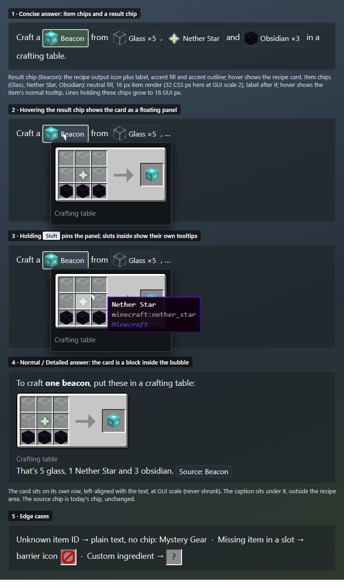

# Recipe cards in chat answers

## Why

Answers currently describe crafting layouts as text, for example a beacon grid written as three rows of item names. The rows do not line up in the chat font, and players have to rebuild the shape in their heads. Players read recipes visually in Minecraft and JEI, so answers should show the recipe the same way: real slots, real item renders and the normal item tooltips.

## Goals

- **Recipe cards.** A Normal or Detailed answer shows each recipe it explains as a card inside the answer bubble. The card shows the station layout (crafting grid, furnace, brewing stand and so on) with the real item in each slot and the normal item tooltip on hover.
- **Concise answers stay short.** A Concise answer shows item names as inline item chips, each with a small icon and the normal item tooltip on hover. It adds one result chip for the recipe output. Hovering the result chip shows the same recipe card the Normal answer would show, as a floating tooltip.
- **Shift pins the card.** While the result chip's card is showing, holding Shift keeps it open, so the mouse can move into it and hover each slot for that item's tooltip. Releasing Shift with the mouse off the chip and card closes it.
- **One look with or without JEI.** PackSage draws native cards in JEI's layout and proportions for the vanilla categories, so a card looks the same whether PackSage or JEI drew it.
- **Ready for JEI.** The card renderer sits behind a seam that a later JEI implementation can fill with JEI's own `IRecipeLayoutDrawable`. Mod recipes registered with JEI can then appear exactly as JEI draws them, and R and U over an item, plus left and right click, can open JEI's recipes and uses. Clicking an item chip or result chip opens that item's recipes in JEI (like R).

## Non-goals

- JEI integration itself. JEI was removed from this branch (commits ec8057f2 and 1e8d3f77). This work builds only the native renderer and the seam. A later change adds the JEI implementation, restores the optional dependency and wires R, U and clicks.
- Clicking an item in a card or chip. Without JEI, clicking does nothing; this work adds no click behavior.
- Drawing recipe types the native adapter cannot decode. Their citations follow the source chip rules in Design.
- Renaming the raw fallback source label (`Source: Beacon|1|3|0|minecraft:beacon`). That is a separate fix.

## Anti-goals

- A card that shows something other than the recipe the answer cites. The card must render the exact recipe the cited record carries, not a lookup by output item that might choose a different recipe.
- Inventing items. A chip or slot that names an item missing from the current registries must show a visible "missing" placeholder, not a substitute item.
- Text grids next to cards. When a card is shown, the answer must not also spell out the grid in text.
- A noticeable slowdown when opening a chat. Cards must keep the chat opening within the timings measured in the 2026-10-26 recheck (about 11–50 ms to the first frame).

## Decided by the player

- Concise answers use inline item chips. Normal and Detailed answers use inline recipe cards.
- Concise answers add a result chip whose hover shows the full card. Holding Shift pins that card so its slots can be hovered.
- Native cards copy the JEI look, so cards look the same with or without JEI.
- Hovering shows tooltips only. With JEI installed (later), R and U over an item open JEI's recipes and uses. Without JEI, clicking does nothing.

## Current state

The facts below come from the code as of `a72eb9bd`.

- **Recipe payloads.** The native adapter decodes these recipe types: shaped, shapeless, smelting, blasting, smoking, campfire, stonecutting, smithing transform, smithing trim and brewing.
  - The type definitions are in `knowledge/Evidence.java`, `RecipePayload` and its slot types. They are built in `knowledge/nativegame/NativeSnapshot.copyRecipe` and `NativeBrewingReader`.
  - Shaped recipes keep grid positions as `slot-<index>` group IDs, the `shape={width,height}` JSON and `shape=WxH` constraints. The recipe type survives only as a `recipeType=` constraint.
  - Tag ingredients stay as one `#tag` alternative with no members. Cook time, experience and fuel are not kept.
- **What reaches the client.** Recipe payloads reach the client only inside the turn's recorded tool results (`turn.replayItems()`, `serializedResult().records[]`). `ScreenText.sourceLabels` shows how to recover a record by its source handle.
- **How answers cite recipes.** The model cites a record as `[provider:handle]` or `[label](provider:handle)`, sometimes through `ref:` aliases or grouped citations. `ScreenText.inlineSpans` matches each citation to `turn.sources()` and `turn.navigationTargets()`.
  - Native recipe records use the recipe ID as their handle.
  - Recipe plans use `plan|<item>|<qty>|<depth>|<route>|<recipeHandle>` handles.
- **How messages are laid out.** Message layout (`AssistantScreen.messageLayout` and `drawInlineLines`) is line-based with a fixed line height, and every element is inline. There are no block elements, no item rendering and no vanilla item tooltips in the chat yet.
- **Verbosity.** It is applied only to the request instructions (`AssistantRuntime`, around line 1850). It is not stored on the turn, and the renderer never reads it.

## Design

### Source chips by verbosity

Detailed answers show source chips and their hover details as before. Normal and Concise answers hide source chips: labelled citations become plain label text, while bare citations and source-only citation groups disappear without leaving extra spaces. Copying uses the same labels or omissions. Navigation links, web links, item chips, result chips and recipe cards remain available. A Normal card that is too wide for its bubble falls back to a result chip with a floating card preview; Detailed keeps the source chip fallback. Legacy turns without a stored verbosity remain unchanged.

### Reference mockup

The mockup below is the reference for the overall chip and card appearance; chip dimensions and fills follow the updated rules below. It is drawn at GUI scale 2, so 1 GUI pixel equals 2 image pixels. The slot, output slot, arrow and panel art are JEI 19's own sprites; the chat colors are the `ModernUi` constants.

- **Fixed by the mockup:** the shape of each element and what tells them apart.
  - **Item chip:** rounded, with a lighter neutral fill, a 10 px item render on the left, then the label.
  - **Result chip:** rounded, with the output item's 10 px icon and label, the accent fill and the same standard border as the other chat chips (no light outline).
  - **Card:** JEI's light gray panel, JEI's slots, arrow and output slot, and a muted caption below the panel.
  - **Floating panel:** a dark `ModernUi` surface around the card and caption.
- **Not fixed by the mockup:**
  - **Exact pixel coordinates.** These come from JEI 19's category layouts, as the acceptance section requires.
  - **The icons themselves.** In the game, every slot and chip icon is the standard item render, `GuiGraphics.renderItem` plus `renderItemDecorations` for counts. That is the same render the inventory, the creative menu and JEI use, so blocks appear as their 3D item models, and mod items use their own models. The mockup only approximates those renders. Never draw a raw block or item texture in its place.

1. **Concise answer.** One result chip, Beacon, plus item chips for the ingredients, inline in the sentence.
2. **Hovering the result chip.** The card appears as a floating panel next to the chip.
3. **Shift pinned.** With Shift held, the panel stays in place. The mouse is over the Nether Star slot, which gets the vanilla slot highlight and the normal item tooltip.
4. **Normal or Detailed answer.** The card is a block row inside the bubble, left-aligned with the text, with its caption underneath. Source chips appear only in Detailed answers.
5. **Edge cases.**
   - An unresolved item ID renders as plain text, with no chip.
   - A slot whose item is missing from the registries shows a barrier icon.
   - A custom ingredient shows a "?" slot.

### What the model writes

- **Recipe cards.** The model cites the recipe record where the card should appear, on a line of its own: `[native:<handle>]` or its alias. In a Normal or Detailed answer, a citation that stands alone on a line and resolves to a recipe record with a recognized layout (see below) becomes a card. A recipe citation inside a sentence follows the source chip rules in Design. Plan citations resolve to the plan's step recipe through the `plan|…|<recipeHandle>` suffix.
- **Item chips.** The model writes `[Label](item:<registry id>)`, using item IDs it saw in tool results. The client resolves the ID against the current item registry and shows it as an item chip.
  - **Unknown IDs:** an ID that does not resolve renders as the plain label, with no icon.
  - **Components:** item chips carry no component data. When an item's components matter, for example a potion, the model cites the record instead.
- **Result chip.** In a Concise answer, an inline citation of a decodable recipe record renders as a result chip instead of a source chip. The chip shows the output item icon and label, and its hover shows the card.
- **Prompt changes.**
  - **Normal and Detailed:** show recipes by citing them on their own line; never write a grid in text.
  - **Concise:** mark item names as item chips and cite the result recipe inline.
  - Follow the assistant prompt rules in `AGENTS.md`: iterate live in the in-game editor and promote the tested whole prompt.

### Which citations become cards and chips

These rules were the designer's call:

- **Recognized layouts.** A record gets a card or a result chip when its `recipeType=` constraint names a category from the layout table and its `decodingStatus` is not `UNKNOWN`. That includes `OPAQUE` records with custom ingredients, which show "?" slots, and `PARTIAL` smithing records. A smithing trim output that is unknown shows a "?" output slot.
  - **Subclassed recipes.** Mod recipes that subclass vanilla classes are decoded as `UNKNOWN`. Their citations follow the source chip rules in Design, so the card never misrepresents a mod recipe; the later JEI implementation covers them.
- **Concise answers.** These never show block cards. Every recipe citation becomes a result chip, whether it stands on its own line or sits inside a sentence.
- **Plan citations.** A plan citation draws the plan record's own `recipePayload`, which is the route's top-level recipe. Tag slots in plan payloads are already expanded, up to 16 members, and cycle through that list. Deeper steps get cards only when the model cites their recipe records directly.

### Stored verbosity

Each assistant turn records the verbosity it was generated with, as a new `Turn` field. Old turns without it render the way they do today: no cards, no item chips and no result chips. Old answers often also spell out a text grid, so a card added next to it would break the anti-goal. Rendering follows the stored value, so changing the setting later does not reshape old answers.

### Cooking data

The native snapshot also records cooking time and experience for smelting, blasting, smoking and campfire recipes, as additive `cookingTime` and `experience` fields in the payload. The card can then show the same text JEI shows. The fields are additive, so existing evidence contracts stay valid; evidence tests are updated to match.

### The card renderer seam

- **The interface.** `RecipeCardSource` resolves a cited record into an optional `RecipeCard`. A `RecipeCard` reports its size, draws itself at a position, and returns the slot under the mouse, given as an item stack or a placeholder.
- **Sources.** The native implementation builds cards from the record's `RecipePayload`. A later JEI implementation wraps `IRecipeLayoutDrawable` (`setPosition`, `drawRecipe`, `drawOverlays`, `getItemStackUnderMouse`). PackSage tries JEI first when it is present and falls back to native.
- **Linking.** No core class links against JEI. The old optional-mod pattern (a `ModList` check plus `Class.forName`, from before commit 1e8d3f77) is the model for the JEI implementation.

### Native card layouts

Each vanilla category copies JEI 19's layout, using JEI's slots, output slots, arrows, flame, shapeless marker and brewing stand background. Positions and sprites come from `docs/research/2026-10-27-jei-recipe-layouts.md`.

| Category | Layout |
|---|---|
| Crafting (shaped) | A 3×3 grid placed by `slot-<index>` and `shape=WxH`, then an arrow and the output slot. |
| Crafting (shapeless) | Inputs fill the 3×3 grid in order, plus JEI's shapeless marker. |
| Smelting, blasting, smoking | The input slot, a flame, an arrow, the output slot, and JEI's cook time and experience text. |
| Campfire | The same as smelting, with JEI's campfire layout. |
| Stonecutting | The input slot, an arrow and the output slot. |
| Smithing transform and trim | Template, base and addition slots, then an arrow and the output slot. |
| Brewing | JEI's brewing stand layout: the reagent, three potion bottle slots, the output, JEI's full blaze-heat bar (there is no fuel slot), and the bubbles. JEI's "Steps" text is left out because the step count isn't recorded. |

JEI shows the station in its category header, not in the recipe layout. Every card, native or from JEI, gets the same one-line caption under it, outside the drawn recipe: the station name, for example "Furnace", "Blast furnace" or "Crafting table · shapeless". That keeps smelting, blasting and smoking distinguishable. Brewing fuel is not recorded per recipe; JEI also shows only a full blaze-heat bar, not a fuel slot, so the card does the same.

### Slot contents

- **Resolving items.** Each slot resolves its alternatives against the current registries: the item ID plus the recorded component data.
- **Tags.** Tag alternatives expand from the client's synced tags, and the slot cycles through the members every 20 client ticks, as JEI does. All slots in a card step together, and cycling pauses while Shift is held, as in JEI.
- **Counts.** Output counts above 1 show as the stack count.
- **Missing items.** A missing or unresolvable item shows a barrier icon in the slot, and its tooltip gives the recorded identity.
- **Custom ingredients.** These show a "?" slot whose tooltip lists the payload's description.
- **Hover.** Hovering a slot draws the standard item tooltip (`GuiGraphics.renderTooltip` with the stack's tooltip lines), including advanced tooltip lines when they are enabled.

### Chat layout

- **Block elements.** Message layout gains block elements. A card occupies its own row, with height equal to the card's height plus padding, and is aligned to the bubble's text left edge.
- **Culling and caching.** Cards follow the same culling and scroll clipping as text, and they are cached with the prepared turn.
- **Width.** Cards are drawn at GUI scale and never scaled down. A card wider than the bubble falls back to a result chip in Normal answers and a source chip in Detailed answers.
- **Item chips and result chips.** These are rounded and 12 GUI px tall, with a standard item render scaled to 10 px and inset 1 px inside the chip (so it never touches the rounded edge), followed by the label. Item chips have a lighter neutral fill than the message background; result chips have the accent fill. Both use the standard chip border, like the "Open …" chips. Lines containing chips use the usual 12 GUI px height. Card slots keep full-size 16 px item renders.
- **Result chip hover.** The card draws as a floating panel near the mouse.
  - Holding Shift freezes it in place, and hovering its slots shows their item tooltips above the panel.
  - The panel closes when Shift is released and the mouse is outside both the chip and the panel.
  - Without Shift, it follows normal tooltip behavior.
- **Copying.** The Copy button copies text. A card copies as its citation label, and an item chip copies as its label.

## Left to the builder

- **JEI art.** Whether to bundle copies of JEI's MIT-licensed GUI sprites, with the license notice, or redraw matching sprites from vanilla parts. Either way, slot coordinates, card sizes and sprites must match JEI 19 for the same category. The live comparison passes when only these differences remain: the caption, which sits outside the recipe area, and the absence of JEI's own buttons (transfer and bookmark).
- **Code structure.** Class names and file layout, and how the layout engine represents block rows.
- **Panel placement.** Exact tooltip panel positions near screen edges.
- **Test split.** The split between unit tests (citation resolution, layout sizing, slot placement, tag cycling, verbosity storage) and live checks.

## Acceptance

- **Unit tests** cover:
  - turning a citation into a card or a chip, for each verbosity;
  - each category's slot placement against JEI's coordinates;
  - missing-item placeholders;
  - old turns rendering without cards or chips.
- **Live checks** use computer use against the running game:
  - for each category, a native card next to JEI's own screen for the same recipe, with JEI temporarily installed for the comparison only;
  - slot tooltips;
  - the Concise result chip, with and without Shift;
  - chat opening timings that still meet the 2026-10-26 recheck;
  - prompt compliance, meaning no text grids next to cards, recorded in `docs/validation/`.
